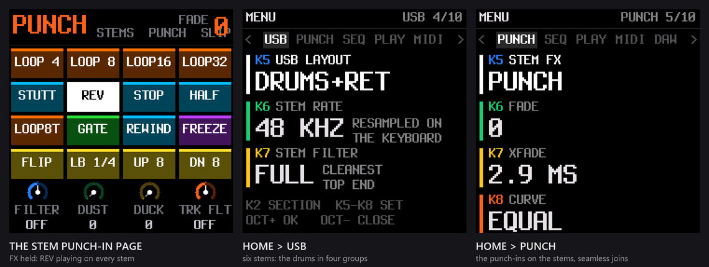
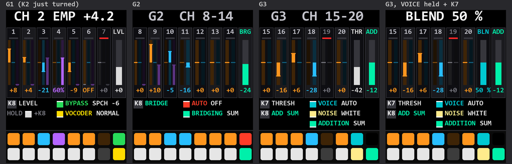

# Enhanced SLOOP for the M-Vave SMK-37

Enhanced versions of the SLOOP groovebox firmware on the M-Vave SMK-37 keyboard, in two distinct flavours. Install and edit from the browser:
**[milomeowzers.github.io/sloop-smk37](https://milomeowzers.github.io/sloop-smk37/)**

> Unofficial firmware, not affiliated with M-Vave. No warranty. **Back up the keyboard first** ([how](/SMK37.md#install)).

## Multichannel USB audio

SLOOP 2.8.4 as a **6-channel USB audio interface**: your DAW records each track and drum group on a channel of its
own, with **punch-in effects on every channel**, the punch-in page on the pads, sequencer effects (FLIP, LOOP BACK,
RAMP) and DAW mode. Every engine and the built-in samples. For the SMK-37 Pro, Elite, MKE-P37 and Starrykey 37 Play.

| HOME > USB > USB LAYOUT | The channels | Rate |
|---|---|---|
| **STEREO** (default) | the stereo mix, as on the FM-1 | 44.1 or 48 kHz (HOME > AUDIO > USB RATE) |
| **SYNTHS+RET** | T1, T2, T3, the drums, the effects return L and R | 24 bit, 48 kHz (default, resampled on the keyboard) or 44.1 kHz (the lightest): HOME > USB > STEM RATE |
| **DRUMS+RET** | kick, snare, hats, percussion, the effects return L and R | as SYNTHS+RET |
| **ALL DRY** | T1, T2, T3, kick, snare, hats and percussion | as SYNTHS+RET |

**[Install](https://milomeowzers.github.io/sloop-smk37/)** ·
**[Editor](https://milomeowzers.github.io/sloop-smk37/elite/webapp/editor/)** ·
[Manual](/SMK37.md) ·
[Release](https://github.com/MiloMeowzers/sloop-smk37/releases/tag/v2.8.4-smk37.1)

## Mewcoder (vocoder)

SLOOP 2.8.4 with a **20-channel vocoder** modelled on the Sennheiser VSM201, played from the keys and the sequencer,
and **two USB audio inputs**, each routed on the keyboard (HOME > SETUP > IN L, IN R):

| Each input | |
|---|---|
| **TRACK 3** | your voice into the vocoder, dry or vocoded |
| **CARRIER** | your own synth as the vocoder's carrier, gated by track 3's notes |
| **T1**, **T2** | an instrument through that track's effects and slicer, on a channel of its own |
| **OFF** | a mono mic on the other side, at full level |

**SETUP** picks which of SLOOP's tracks play beside the vocoder (FULL, VOC + DRUMS, VOC + SYNTH, VOC ALONE); with any
turned off, the vocoder runs at 44.1 kHz. A lean build: some engines and the built-in samples make room for it. For the SMK-37 Elite. **In
development:** a harmoniser modelled on the Eventide H949: your voice, another external sound, the drums or a synth
engine pitch-shifted into up to three harmony voices.

**[Install](https://milomeowzers.github.io/sloop-smk37/mewcoder/webapp/installer/)** ·
**[Editor](https://milomeowzers.github.io/sloop-smk37/mewcoder/webapp/editor/)** ·
[Manual](https://github.com/MiloMeowzers/sloop-smk37/blob/mewcoder/VOCODER.md) ·
[More](https://github.com/MiloMeowzers/sloop-smk37/tree/mewcoder) ·
[Release](https://github.com/MiloMeowzers/sloop-smk37/releases/tag/mewcoder-v0.1)

## Install

1. Back up the keyboard's flash ([how](/SMK37.md#install)) and your projects (the editor's Backup).
2. Open the build's installer in Chrome or Edge, connect the keyboard by USB, press Install.
3. Use the editor of the build you installed. To go back: M-Vave's own updater (M-UPGRADE).

## Branches and tags

| | Multichannel USB audio | Mewcoder |
|---|---|---|
| Branch | `ci` (built on `smk37`, `editor-slot-readback`, `stems`) | `mewcoder` |
| Release tag | `v2.8.4-smk37.1` | `mewcoder-v0.1` |
| Current build | `stems-baseline` | `mewcoder-baseline` |

Every build is checked before it is published: the FM-1 build byte-identical to SLOOP's, the host and web tests clean.
How it is built: [BUILDING.md](/BUILDING.md); the port's decisions: [smk37-port.yaml](/smk37-port.yaml).

## Credits

[SLOOP](https://github.com/isod89/sloop-fm1) by isod89, on [Felucca](https://github.com/hugelton/Felucca) by Leo
Kuroshita / Hügelton Instruments; the SMK-37 board layer and the porting method by M. Geisler
([genkigenki/sloop-fm1](https://github.com/genkigenki/sloop-fm1),
[fm1-to-smk37](https://github.com/genkigenki/fm1-to-smk37)). GPL-3.0-only ([LICENSE](/LICENSE),
[LICENSING.md](/LICENSING.md)). No vendor material is in this repository.
