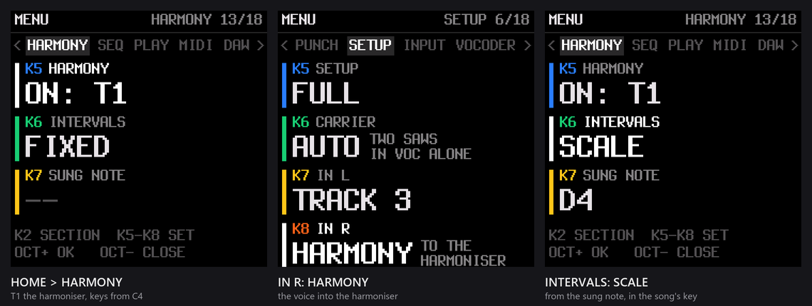
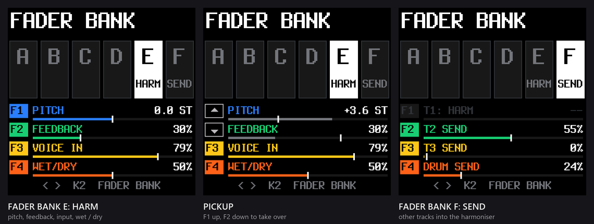
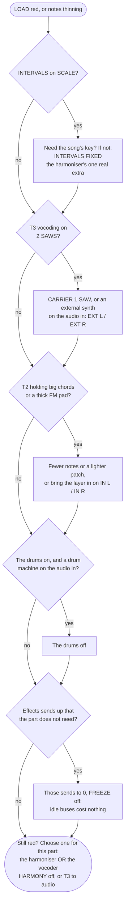
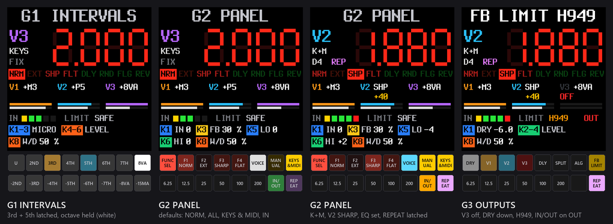
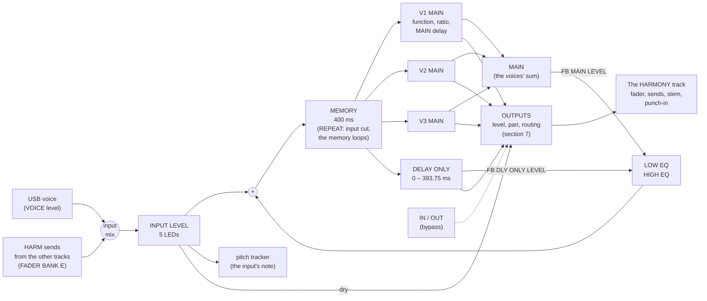
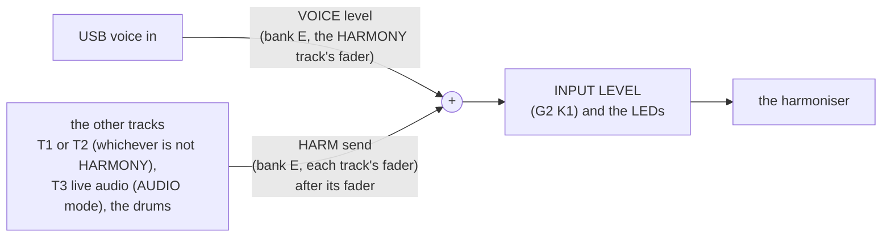

# The harmoniser: user manual (SMK-37 Elite, Mewcoder build)

> **This manual has two parts.** [Part A](#part-a-the-harmoniser-today) is what the current test build does (Stage 1a:
> the sound, played from the keys and the faders, checked on the unit; Stage 1b: the HARMONY page, A11, to test). [Part B](#part-b-coming-next-the-h949-page)
> is the design for what comes next: the harmoniser's own page with the H949's big PITCH RATIO readout (Stage 1b), then
> its effects (Stage 2). Part B is written ahead of the firmware and is corrected as each stage is built and tested.

The harmoniser turns your live voice (the same USB audio in as the [vocoder](VOCODER.md)) into up to **three harmony
voices that keep your voice's own sound**. The vocoder swaps your voice's timbre for the carrier's; the harmoniser
pitch-shifts your voice itself. Both can run at once, on different sounds: your voice harmonised on track 1 while the
vocoder, on track 3, takes a synth, the other input channel or the drums.

It is modelled on the **Eventide H949 Harmonizer** and its keyboard, the HK940: a 400 ms digital memory read by heads
moving at the pitch ratio, spliced every segment, with feedback and REPEAT. Its sound comes from that method:
- **The formants move with the pitch.** A fifth up sounds a little smaller and brighter, an octave down larger and
  darker. That is the H949's character, not a fault.
- **The splice colours it slightly**, most on low notes and big intervals down: a faint flutter at the splice rate.
  This build uses the H949's ALGORITHM 1 (a crossfaded splice: no glitches). The H910's hard splice comes in Stage 2.
- **Harmonies stay in tune**, because each voice multiplies every frequency by its ratio. It is not a frequency
  shifter.
- **The memory is stored at 22.05 kHz**, so the harmony's top end stops near 10 kHz, as the H949's did near 12-15. The
  owner's call: "we are modelling a device that had to use very limited resources and those compromises give it
  character".

## Part A: the harmoniser today

### A1. Getting started



1. **The audio in:** set up the USB audio in as for the vocoder ([VOCODER.md, Getting sound in](VOCODER.md#1-getting-sound-in),
   steps 1-3: **HOME > USB > AUDIO IN: ON**).
2. **HOME menu** (PATCH held) **> HARMONY > HARMONY: ON: T1** (K5). Track 1 is now the harmoniser: its name reads
   **HARMONY** on HOME and the tracks screen, and its synth sound is set aside (OFF gives it back, as it was). The
   FADER BANK screen opens on bank **E, HARM** when you close the menu.
3. **HOME > SETUP > IN R: HARMONY** (or IN L, the side your voice is on). The help beside it reads **TO THE
   HARMONISER**. One channel goes to one place: your voice goes to the harmoniser **or** to TRACK 3 (the vocoder).
4. Sing, and hold a key on T1 (select T1 first). **C4** plays your voice at its own pitch, **G4** a fifth above it,
   **C3** an octave below. Hold up to three keys for three harmony voices. With no key held, you hear your voice dry
   and no harmony.
5. Move the faders on bank E: **PITCH**, **FEEDBACK**, **VOICE IN** (the input's level), **WET / DRY** ([A4](#a4-the-faders-banks-e-and-f-and-pickup)).
6. For the H949's panel, open the **HARMONY page**: tap **HOME** on the tracks screen (the vocoder page), then **PATCH**.
   Its interval pads, MICRO and LEVEL per voice, the control methods (MANUAL: a voice from the PITCH fader with no key
   held), SHARP / FLAT, the feedback EQ and FB LIMIT are all there ([A11](#a11-the-harmony-page-the-h949s-panel)).

### A2. Playing the harmony: the keys

The harmony voices are played like any track's notes: **T1's keys, T1's sequencer pattern and MIDI in on T1's
channel**. Each held note is one voice, and its **distance from C4** is the voice's interval. While HARMONY is on, T1's
keys are plain chromatic: every key its own semitone, the octave buttons moving them. T1's own SCALE, ROOT, transpose,
quantise and CHORD settings do not apply (they are kept, and work again when HARMONY is off).

| Key | Interval | Ratio |
|---|---|---|
| C2 | two octaves down | 0.250 |
| C3 | an octave down | 0.500 |
| G3 | a fourth down | 0.749 |
| A3 | a minor third down | 0.841 |
| **C4** | **unison** (your own pitch) | **1.000** |
| E♭4 | a minor third up | 1.189 |
| E4 | a major third up | 1.260 |
| F4 | a fourth up | 1.335 |
| G4 | a fifth up | 1.498 |
| A4 | a major sixth up | 1.682 |
| C5 | an octave up | 2.000 |

- The range is the H949's: **two octaves down to one up**. Keys below C2 play C2's interval, keys above C5 play C5's.
  Use OCT- / OCT+ to reach the low keys.
- **Up to three voices.** A fourth key takes the place of the oldest one held. Each voice fades in and out in about
  1.5 ms, so changing chords does not click.
- **The sequencer** records and plays them as T1's notes: a pattern of chords on T1 is a harmony line that follows
  your voice. Your voice itself is never recorded, only the intervals.
- **C4 with a fifth and an octave** (C4, G4, C5) is the classic thick "power" stack. **E4 + G4** is a major triad over
  your voice, **E♭4 + G4** a minor one.

### A3. INTERVALS: FIXED or SCALE

**HOME > HARMONY > INTERVALS** (K6) sets how a key becomes an interval:
- **FIXED** (the default): as in the table above, a fixed interval from C4, whatever you sing. The H949 with its
  HK940 keyboard worked this way. A held E4 is always a major third above your voice, so on some sung notes it is
  outside the song's key. That is the expected, predictable behaviour.
- **SCALE**: the key counts from **the note you are singing**, and the result is kept in the song's key (its ROOT
  and SCALE, as set on T1: SEL held). The pitch tracker listens to the input and works out the sung note; **SUNG
  NOTE** (K7) shows what it hears (`--` until it has heard one). The note the key would give is rounded down into the
  scale: in C major, E4 (a third) over a sung **D** gives **F** (the minor third the scale has), over a sung C gives E.
  So the harmony stays diatonic as your melody moves. Neighbouring keys can land a whole tone apart: that is the scale,
  not a fault.
  - The tracker holds the last note through consonants and pauses, and takes a new one only once two of its last
    three readings agree (it reads every ~20 ms). It hears sung notes from about 80 to 690 Hz.
  - With a chromatic song key (SCALE: CHR) SCALE mode keeps the keys' distances, counted from the sung note.



### A4. The faders: banks E and F, and PICKUP

While HARMONY is on, **FADER BANK** steps through six banks, A to F. The harmoniser's live controls are all on **E**:

| Bank E, HARM | Sets |
|---|---|
| F1 **PITCH** | every voice moved together: the middle 1:1 (a small dead zone holds it there), down to two octaves under, up to one over, shown in semitones. It works in FIXED and SCALE, on top of the keys: G4 held with PITCH at +2.0 plays a sixth. |
| F2 **FEEDBACK** | the harmony fed back into the memory: each pass is shifted again, so a fifth up climbs in fifths, an octave down falls in octaves, a cascade that dies away. It always dies away: the loop's gain stays under 1, however high it is set (the H949's FB LIMIT, SAFE). |
| F3 **VOICE IN** | the audio in's level into the harmoniser (79 % = 0 dB). |
| F4 **WET / DRY** | your voice against the harmony: 50 % half each, 0 % your voice alone, 100 % the harmony alone. |

**Bank F, SEND**: T2, T3 and the drums each **into** the harmoniser (0 % at first), taken after each track's fader and
mute. Harmonise a synth line, a drum loop, or T3's audio (T3 only while it plays the dry audio in; not while it is
vocoding: [A6](#a6-the-input-and-the-sends)). F1 shows `T1: HARM` (nothing to set). On banks B and D, T1's column also
shows `T1: HARM`: the harmoniser has no filter and no delay send of its own.

**PICKUP (every bank, not only the harmoniser's).** After a bank change the faders are almost never where the new
bank's values are, so a fader does nothing until it reaches its value: it picks up when it comes within 3 steps of
it, or moves through it, from above or below. Then it takes over smoothly, without a jump. The screen shows each
fader's state in the box at its left:
- **filled**, in the track's colour: live, the fader sets the value;
- **an outlined box with an arrow**: waiting; the arrow points the way to move the fader, up or down;
- **dim**: nothing to set.

The bar is the value the bank holds; the **white tick** is where the fader physically is. Move the tick onto the end of
the bar and it is live.

**Seeing the faders:** moving any fader brings the FADER BANK screen up (for 4 seconds after the last move), so you
always see what it set. **Hold FADER BANK** (about 0.6 s) to pin the screen up for good; hold it again to let it time
out again. Its LED is steady while pinned and blinks while the screen is up on its time-out. A tap on FADER BANK while
the screen is up steps to the next bank; PATCH or KNOB BANK close it.

### A5. FEEDBACK and REPEAT

- **FEEDBACK** (bank E, F2): see [A4](#a4-the-faders-banks-e-and-f-and-pickup). At low settings it thickens the
  harmony with a short shimmer; high up it turns a held chord into rising (or falling) arpeggios of itself. The EQ in
  the loop is flat in this build (the H949's LOW / HIGH EQ is Stage 2).
- **REPEAT**: select T1 and press **NOTE REPEAT**. The memory (about 0.4 s of what the harmoniser heard) is caught and
  plays round and round, the input cut off, as the H949's REPEAT button did. The voices still play it at their
  intervals, so keys and PITCH reharmonise the loop.
  - **A tap latches it**: the NOTE REPEAT LED and **REP** in the header **flash**; tap again to let it go.
  - **Held longer** (over 0.4 s) it is momentary: steady while held, gone when you let go.
  - The loop is the whole memory (about 418 ms). Shorter loops synced to the tempo (REPEAT LENGTH) come in Stage 2.

### A6. The input and the sends

- **IN L / IN R: HARMONY** (HOME > SETUP): that channel of the USB audio in goes to the harmoniser. A channel goes to
  one place, so your voice goes to the harmoniser **or** the vocoder, never both: two heavy processes on one voice
  overload and tear, and it is the weaker sound. With both running, the pairing in mind is your voice harmonised while
  the vocoder takes another sound (the other channel, an external synth as CARRIER, T2, the drums).
- **The sends** (bank F) add the other tracks to the harmoniser's input, mixed with VOICE IN. T3 sends only while it is
  not vocoding. A send from T3 or the drums reaches the harmoniser one block (about 0.7 ms) late: inaudible.
- **AUDIO IN off**: the harmoniser hears the sends only (a synth, the drums harmonised).
- **What it tracks** (INTERVALS SCALE): the harmoniser's whole input, so sends confuse it; one clear voice or
  instrument tracks best.

**IN L / IN R with HARMONY on: what each choice does.** Each channel has one destination; the two are set
independently (setting one never changes the other).

| IN L or IN R | FULL (T2 a synth, the drums on) | VOC + SYNTH (no drums) | VOC + DRUMS, VOC ALONE (T2 off as a synth) |
|---|---|---|---|
| **TRACK 3** | T3 plays it: dry in **AUDIO** (its effects, SLICER, stem, punch-ins; its bank F send can feed the harmoniser), or as the vocoder's voice in **VOCODER** (no send then) | same | same |
| **CARRIER** | the vocoder's carrier, in place of the saws. Useful only with a voice on the **other** channel at TRACK 3 and T3 in VOCODER | same | same |
| **HARMONY** | into the harmoniser. Both channels on HARMONY: mixed together (each at half) | same | same |
| **T1** | not used (amber): T1 is the harmoniser | not used | not used |
| **T2** | not used (amber, NEEDS A SETUP): T2 is playing its synth | not used | T2 plays it dry through its own effects and stem; **its bank F send** feeds the harmoniser |
| **OFF** | nothing | nothing | nothing |

Ways to use the second channel while your voice is on HARMONY:
- **A second source to harmonise with the voice:** both on HARMONY (one shared input, each at half).
- **A second source harmonised by amount:** TRACK 3, T3 in AUDIO, T3's send (bank F, F3) sets how much reaches the
  harmoniser while T3's LEVEL sets how loud the original is. The punch-ins on T3's stem act before the send.
- **A second source vocoded:** TRACK 3, T3 in VOCODER, played from the keys (the internal saws). The harmoniser and
  the vocoder then each have their own source.
- **In VOC + DRUMS or VOC ALONE:** T2 as an audio track (its own effects and stem) with its own send, so T3 stays free
  for the vocoder or a synth.

### A7. What T1 keeps, and what HARMONY changes elsewhere

- **T1 keeps** its LEVEL, PAN, reverb and chorus sends, DIST, SLICER, STEM FX, its stem on USB and its mute / solo.
  It has **no FILTER and no DELAY SEND** (the H949 is the delay; its fader positions are the harmoniser's PITCH and
  FEEDBACK on bank E instead).
- **T1's synth** is set aside, not lost: patterns, sound and settings come back with HARMONY OFF.
- **The vocoder** stays at 22.05 kHz while HARMONY is on, whatever the SETUP (HQ beside the harmoniser is still to be
  measured). HARMONY takes T1 whatever the SETUP says about T1; T2 and the drums follow the SETUP as usual.
- **SLICER STUT records nothing** while HARMONY is on: its memory is the harmoniser's. **STEM FX** loops are about a fifth
  shorter (the harmoniser's memory comes off the shared pool first).

### A8. LOAD: managing the load

The SMK-37 makes its sound in **halves of 5.8 ms**, each eight blocks of about 0.7 ms, on **two cores**. When a half
comes close to running out of time (two halves in a row over 85 % of it), SLOOP **sheds a voice**: it fades one out
over a few blocks (no click), first a note already in its release tail, then the oldest held note, never a chord's
bass or a mono lead. Dense chords thin out from the top; the audio itself does not break up. **LOAD** in the header
(where USB shows) reports it: **orange** after a shed, **red** while it keeps happening (two or more a second), gone
about 2 s after the last one.

An orange flash in a busy fill is harmless: most sheds are release tails ending early, and you will rarely hear them.
Red, or held notes audibly thinning, means it is time to lighten the patch: work down the chart in A8.4.

#### A8.1 Where the time goes

Every figure below was measured on the unit with the console's per-section `timing`, playing the same song (the
owner's sequence, ~160 BPM, with the voice in), in 30 s windows and, for the baselines, runs of up to two hours. The
figures are the mean time per 5.8 ms half (5800 µs); a busy half can run 20-50 % above its mean.

| Core 0 | µs a half | Core 1 | µs a half |
|---|---|---|---|
| The sequencer, the keys, MIDI (always) | 580-770 | T3 vocoding, internal saw (its synthesis ~1000 of it) | 1760-2010 |
| The vocoder's analysis (while T3 vocodes) | 1150-1260 | The drums | 520-590 (780-1000 in a busy half) |
| T1, a synth | 260-580 | The tail: the effects buses, the master, the limiter, the stems | 410-950 |
| T2, a synth: a light patch / an FM6 pad | 640 / 1830-2130 | | |
| **T1 as the harmoniser**: its three voices / the tracker (SCALE) | **~460 / ~160** | | |

What these figures show:
- **The engine and the notes decide a synth's cost**, not the track. The same T2 cost 640 µs with a light patch and
  over 1800 µs with a six-operator FM pad, and every held note is another voice. Big pads are the most expensive
  thing in a song.
- **The harmoniser's voices cost about what T1's synth gives back.** HARMONY frees T1's engine, its FILTER and its
  delay send (~435-700 µs); the three voices take ~460. On their own they leave the load where it was: 0.24 sheds a
  second against 0.27 with HARMONY off, the same song in the same run.
- **The tracker is the harmoniser's only real extra** (~160 µs, and it runs only with INTERVALS SCALE). It was cut
  from 574 µs in the first probe by listening at 5.5 kHz and testing five lags a block, with no loss of accuracy on a
  sung melody (no octave errors).
- **The effects buses cost nothing while idle.** Each bus (chorus, delay, reverb) stops for any block whose sends are
  at 0 and whose tail has died away (below -78 dB); a send above 0 restarts it at once. So the global effects cost in
  proportion to how many are in use, and a reverb on FREEZE runs all the time. The same song with the global effects
  turned higher shed noticeably more.
- **The two cores share one cache.** Code running on one core evicts the other's: the larger code ran 12-29 % faster
  with one core alone. So switching a track off frees **more** than its own time (its code leaves the cache too):
  with T1 and T2 skipped, core 0's other sections got faster as well.
- **Moving work between the cores does not help.** Tried and measured: the drums on core 0 took 3.37 ms of core 0
  against 2.10 before; T3 on core 0 went from 0 to 4.2 sheds a second. The split the firmware uses is the measured
  best.

#### A8.2 What we tested, and what it showed

**The firmware is lean already.** The same song shed **6.5 times a second** on the vocoder's first build
(2026-11-01) and sheds **0.25-0.50** now, with nothing taken out of the sound. Each step was measured on the unit and
checked bit for bit against the build before it:

| Step (vocoder build) | Sheds a second |
|---|---|
| The first vocoder build (9ffbb1c) | 6.5 |
| The effects buses skipped while idle | 4.8 |
| The block's tail (effects, master) moved to core 1, alongside core 0's start of the next block | 4.7 |
| The tail's code in RAM; the code that runs every block placed together in the flash | 1.16 (over 116 minutes) |
| The sine table in RAM; FM6's feedback operator unrolled | ~1.0 |
| Today's FULL (one saw) | 0.25-0.50 |

Ideas that were measured and **rejected** because they changed the sound or made things worse:
- a multirate filter bank: 16 % faster, but up to +19 dB in the 1.5-2.3 kHz presence band;
- moving whole tracks between the cores (above);
- unrolling more of FM6's loops: slower (out of registers).

**The configurations, measured** (the same song, sheds a second; 0 means none in the window):

| What runs | One saw | Two saws |
|---|---|---|
| **FULL**: T1, T2, T3 vocoding, the drums | 0.25-0.50 | 1.95 (so FULL plays one) |
| **VOC + SYNTH**: T1, T2, T3 vocoding, no drums | 0-0.28 | 0.53 (CPU TIGHT) |
| **VOC + DRUMS**: T3 vocoding at 44.1 kHz (HQ), the drums | 0 | 0.03 |
| **VOC ALONE**: T3 vocoding at HQ | 0 (about 2 ms of a half spare) | 0 |

**The harmoniser, measured** (probe 3, 2026-11-12). The main case: T1 the harmoniser, T2 a synth, T3 vocoding with
two saws, the drums, STEM FX SLICER, the global effects higher than in the runs above. All in the same run:

| Setting | Sheds a second |
|---|---|
| HARMONY off | 0.27 |
| HARMONY on, FIXED (the tracker off) | 0.24 |
| HARMONY on, SCALE (the tracker on, at today's settings) | 1.55 |

That probe ran the harmoniser **in series** on core 0, before core 1 got its work: the worst place for it. The 1a
build (931b88b) runs it inside T1's own unit, alongside core 1's work. Played on the unit: "much improved, far more
playable". Its own timing is the next measurement.

**What we conclude:**
- **The default patch fits.** With FIXED intervals, one saw and a sensible T2, the harmoniser adds about nothing to
  the vocoder build's load.
- **The heavy items are few, and known:** the tracker (SCALE), the second saw, a dense FM pad on T2, the drums
  (~0.55 ms), and the global effects in use.
- **Each has a lighter route** that keeps the sound, or moves it outside the box. That is the order of the chart in
  A8.4.
- **The figures vary with the song.** Shed counts move by about ±0.2 a second between windows of the same song, and a
  song with longer chords or more effects sits higher. Read the tables as a ranking, not a promise.

#### A8.3 What costs what, in short

| Part | Cost | Lighter route |
|---|---|---|
| The harmoniser's three voices | about T1's synth | none needed |
| The tracker (INTERVALS **SCALE**) | ~160 µs: the harmoniser's one real extra | **FIXED** when the song's key is not needed |
| CARRIER **2 SAWS** | up to ~1.95 sheds a second in a full song, from 0.25-0.50 | **1 SAW**, or **EXT L / EXT R** (no saw at all) |
| The vocoder (T3 VOCODER) | ~3 ms over both cores | the harmoniser on the voice; T3 as audio or a synth |
| T2's synth | 640 µs to over 2 ms: the engine and the held notes | a lighter patch, fewer notes, or the layer on IN L / IN R |
| The drums | ~550 µs (up to 1 ms in a busy half) | off, when the audio in carries a drum machine |
| The global effects | only those in use (idle buses are skipped) | sends at 0 where not needed; FREEZE off |
| Anything on the audio in | almost nothing | the cheapest layer there is |

#### A8.4 Step by step

Work down the chart and stop as soon as LOAD stays quiet. The early steps cost the least sound.



**Plan for it before the gig:**
- **Build the heaviest section first** and play it for a minute with an eye on the header: if it stays quiet, the rest
  of the song will too.
- **Split the work between the box and the outside world.** Whatever already comes in on the audio in (a synth as the
  CARRIER, a drum machine, a pad on IN L / IN R) costs the SMK-37 almost nothing. Keep the box's time for what only
  the box can do: the harmoniser, the vocoder, the sequencer.
- **Harmoniser or vocoder on the voice, not both** (A6): the voice through the harmoniser and the vocoder on another
  source is lighter, and usually the better sound.
- **Spend the expensive choices where they count**: SCALE for the song that needs the key, two saws for the vocoder's
  solo, the FM pad for the breakdown.

#### A8.5 Routing: lighter, and a lot to explore

The routing was left open on purpose. Nothing is locked to one use: each USB input channel goes where you send it,
every track can feed the harmoniser, and T3 can be a vocoder, an audio track or a synth. The routing itself costs
nothing; only the engines at the ends do. So the cheapest patch is often also the most interesting one: let the
outside world bring the sounds, and spend the box's time on transforming them.

Some starting points, all in today's build:

| IN L | IN R | Inside | What you get |
|---|---|---|---|
| a synth: **CARRIER** | your voice: **TRACK 3** | T3 VOCODER; T2's send (bank F) | the classic vocoder with no saw to run, and T2's line harmonised beside it |
| a drum machine: **TRACK 3** | your voice: **HARMONY** | T3 VOCODER, its saws played from the keys | vocoded drums under a harmonised voice |
| a guitar: **HARMONY** | your voice: **TRACK 3** | T3 VOCODER | the voice vocoded; the guitar in parallel intervals |
| **OFF** | **OFF** | AUDIO IN off; T2's send (bank F) | a synth line harmonised: chords from a single voice |
| your voice: **HARMONY** | **OFF** | the drums' send up, FEEDBACK and REPEAT | the voice and the kit through the same intervals: pitched, looping percussion |
| your voice: **HARMONY** | **OFF** | STEM FX on the stems that feed the sends | a looped, reversed or stuttered stem is what the harmoniser hears: it reharmonises the punch-in |

- **The sends mix.** VOICE IN and the T2, T3 and drum sends add together into one harmoniser, so a voice and a synth
  can share the same intervals, or the drums can join for one bar.
- **The sends are after the faders**: a send is taken after the track's LEVEL, its mute and its stem punch-in (before
  its pan), so muting a track or pulling its LEVEL down also stops its send. To hear more harmony than source, keep
  the source's LEVEL low and its send high, or raise WET / DRY (bank E) so the harmoniser's own output is mostly the
  voices.
- **With SCALE**, the tracker hears the whole input: for the sung note to steer the key, keep one clear voice on the
  input and add the other sends with INTERVALS on FIXED (A3).
- **T3 sends only while it is not vocoding**: as an audio track or a synth it can feed the harmoniser too.
- **With the SETUP** (HOME > SETUP: VOC + DRUMS or VOC ALONE), T2 stops being a synth and can play IN L or IN R as an
  audio track through its own effects: an outside instrument on its own stem, beside the harmoniser, for less than
  T2's synth would cost.

Each of these costs less than an internal synth playing the same part. Try them before the chart's last step.

### A9. Saving, the editor and the console

- **Kept over a power-off:** HARMONY on / off, INTERVALS, and IN L / IN R (with the vocoder's settings). The editor's
  vocoder settings show HARMONY and INTERVALS. **Also kept** (from Stage 1b): bank E and F's values and the HARMONY
  page's settings (A11). A save from an earlier build loads them at their defaults (PITCH 0, FEEDBACK 0, VOICE IN
  0 dB, WET / DRY 50 %, the sends 0, the page as 1a).
- **T1's pattern** (the intervals) is saved with the project as any track's notes.
- **The console** (USB serial): `harm` (or `hprobe`) prints the harmoniser's state: the notes held, each voice's
  ratio, the sung note, PITCH, FEEDBACK, WET / DRY and the peaks; `harm on` / `harm off` switch it.

### A10. Playing it live: dub with the harmoniser

Found by playing it on the unit (2026-11-12): with STEM FX on PUNCH, keys on T1 and the drums and T2 sent into the
harmoniser (bank F), the SMK-37 becomes a dub instrument. Three things make it work together:

- **The punch-ins act before the sends.** Each stem's punch-in plays on the track's own signal, before its pan and
  sends, so whatever you do to a stem (loop it, reverse it, stutter it, freeze it) is what the harmoniser hears. The
  harmoniser then repitches the result by the keys and the PITCH fader: one gesture on the pads, a second on the keys.
- **The keys and PITCH shape the timbre, not only the harmony.** On short, percussive material the intervals read as
  colour more than as chords: an octave down darkens a hit, a fifth or a ninth turns it into a tuned tone, and PITCH
  sweeps all three voices at once. The H949's formant shift (the introduction) is part of the sound here.
- **The faders keep both hands free.** Bank E (PITCH, FEEDBACK, VOICE IN, WET / DRY) and bank F (the sends) are one
  move each. Pin the bank (FADER BANK held) and pickup keeps the jumps out (A4).

**The stem punch-ins, as heard through the harmoniser:**

| Pads | Through the harmoniser | Use |
|---|---|---|
| LOOP 4 / 8 / 16 / 32, LOOP 8T (rows 1, 3) | short, repeating fragments: percussive, pitched layers more than loops | a tuned rhythm from the drums' send; 8T for triplet cross-rhythm |
| REVERSE (row 2) | a rising swell into the beat, pitched by the keys | into a downbeat; with FEEDBACK for a reversed tail |
| STUTTER (row 2) | a repeated grain: with a held interval, a tuned roll | fills, builds |
| STOP, HALF (row 2) | the tape-stop and half-speed drop, repitched again by the harmoniser | the drop before a section; PITCH down with it to go further |
| REWIND (row 3) | the classic dub rewind, harmonised | the turnaround |
| FREEZE (row 3) | the reverb holds and the dry stems fade under it | a held wash under the harmonised voice |
| FLIP, LOOP BACK, RAMP UP / DOWN (row 4) | the sequencer itself moves: the parts jump, loop back or ramp | syncopation: the sequence and the harmoniser's input shift against each other |

**Dub moves to start from:**
- **Throw a stem into the harmoniser.** Bank F: raise the drums' or T2's send for a bar and drop it again, the way a
  dub engineer throws a channel into the delay. With FEEDBACK up, the throw keeps ringing in the chosen intervals
  after the send closes.
- **More shadow than source.** A track's LEVEL low and its send up, WET / DRY high: its harmonies over a quiet
  original. (The send follows the LEVEL, so all the way down silences both.)
- **REPEAT as the dub loop.** NOTE REPEAT (on T1) freezes what is in the harmoniser's memory (~418 ms); the keys and
  PITCH then play that fragment. Latch it, play the keys, let it go.
- **Pads against the sequence.** The punch-ins and row 4's FLIP / LOOP BACK / RAMP on the pads, the keys on T1, the
  sends on the faders: three layers of syncopation from one keyboard.
- **WET / DRY as the mute.** WET / DRY down to the voice alone, then up for the chorus or the drop.

**Good to know:**
- **The stems' past is shorter with HARMONY on** (about a fifth: the harmoniser's memory comes out of the same pool,
  A7). The longest loops and the slowest STOP / HALF / REVERSE play what there is: shorter, or fading where the past
  ends.
- **PUNCH HQ** keeps the stems' full band and half the time; **PUNCH** keeps the time. Through the harmoniser, whose
  own memory stops near 10 kHz, PUNCH is usually the better trade.
- **The load:** the punch-ins and the sends cost little; the heavy items are in A8. INTERVALS FIXED keeps the tracker
  out of the way, and with percussive input it is also the steadier choice: the tracker wants one clear voice.

### A11. The HARMONY page: the H949's panel



*Drawn by the page's own firmware code (ui_hpage.c, compiled on a computer), with the 16 pads lit as the page lights
them; each pad labelled with its job.*

**Opening it:** tap **HOME** on the TRACKS screen for the vocoder page, then **PATCH**: with HARMONY on, the HARMONY
page comes next (TRACKS → VOCODER → HARMONY → PUNCH IN → TRACKS). **<** and **>** (or SELECT) step its three groups.
The keys, PLAY, REC and OCT work as always; **NOTE REPEAT** is REPEAT here whatever track is selected.

**It stays up** (latched, no time-out) until you tap **PATCH** (on to PUNCH IN) or open something else: a layer, the
menu, another page.
- **The faders keep the page on screen.** Move one and the header says what it did, as the FADER BANK screen would:
  `PITCH +3.5 ST`, `FEEDBACK 38 %`, `T2 SEND 50 %`. The readout follows PITCH as you move it. A fader still waiting
  to pick up says which way to go: `PITCH MOVE UP` / `MOVE DOWN`.
- **The FADER BANK button** still shows the bank screen (all four faders, the pickup arrows; tap for the next bank,
  hold to pin it). When it closes, **the page comes back**; so it does after the pad picker.
- On the vocoder page a fader shows the FADER BANK screen for a moment, and the page comes back after it.

**The pads' lights** (each group's in the sheet above, as the page lights them):
- **G1:** a pad in use lit in its voice's colour (V1 orange, V2 cyan, V3 violet), brighter with its level; **white**
  while held; the others dim.
- **G2:** FUNCTION SELECT red (IN) or green (OUT); the chosen function bright red, the others dim (EXTEND and the OUT
  functions nearly dark: Stage 2); VOICE white (ALL) or the voice's colour; MANUAL and KEYS & MIDI amber when on; IN /
  OUT green by the input's level, dark red on OUT; REPEAT violet, flashing while latched.
- **G3:** DRY white and V1-V3 in their colours by level, **dark red when off**; FB LIMIT green (SAFE) or amber (H949)
  by the loop's level; REPEAT as on G2.
- **Any metering pad** turns **orange** from -6 dBFS and **red** from -1 dBFS (held about a second). A pad that is on
  always shows its colour, even in silence. The MAIN and DELAY ONLY switches (Stage 2) stay nearly dark.

**The screen:**
- **The PITCH RATIO readout**, the H949's four red digits: the ratio of the **readout voice**: the voice whose knob you
  just turned, else the MANUAL voice, else the newest note. Its tag (**V1** orange, **V2** cyan, **V3** violet) is at
  the left, with the control method (**KEYS**, **MAN**, **K+M**), the sung note (with INTERVALS SCALE; **FIX** with
  FIXED) and **REP** while REPEAT holds. A silent voice's digits are dim.
- **The function lights:** NRM EXT SHP FLT (red, pitch) | DLY RND FLG REV (green, delay: Stage 2): the readout voice's
  function lit.
- **The voices:** each one's interval (`+M3`, `-P5`, `U`; **SHP** / **FLT**; **MAN**), its MICRO in amber when not 0,
  its LEVEL bar and its meter; **OFF** in red when muted.
- **The status line:** the input lights (five, as the H949's: -40, -18, -12, -6, -1 dBFS), FB LIMIT (SAFE / H949),
  and **OUT** in red while IN / OUT bypasses.
- **The knobs:** the group's knobs, each as a coloured tag (K1 / K5 blue, K2 / K6 green, K3 / K7 yellow, K4 / K8
  orange, as the menu's) with its name and value beside it: G1 `K1-3 MICRO`, `K4-6 LEVEL`, `K8 W/D 50 %`; G2 `K1 IN 0`,
  `K3 FB 30 %`, `K5 LO 0`, `K6 HI 0`, `K8 W/D`; G3 `K1 DRY`, `K2-4 LEVEL`, `K8 W/D`. MICRO and LEVEL's values are in
  the voices' strips above. A knob turned shows its full value in the header.

**G1 INTERVALS**
- **Pads:** the HK940's intervals. Top row up: unison, 2nd, 3rd (major), 4th, 5th, 6th (major), 7th (minor), octave.
  Bottom row down: 2nd, 3rd, 4th, 5th, 6th, 7th, octave, two octaves. **Tap** latches (tap again to let go), **hold**
  (over 0.6 s) is momentary. A latched pad whose voice a key or the sequence took over shows dim: tap it to bring it
  back (it stays latched). A second hit within 0.15 s of the first is the same strike (the drum pads can register a
  firm hit twice) and is ignored. A pad plays as a T1 key (60 plus its interval), sharing the three voices with the keys. Lit in its
  voice's colour by level, white while held.
- **K1-K3 MICRO** V1-V3: ±100 cents, a stop at 0. **K4-K6 LEVEL** V1-V3 (0 dB by default). **K8 WET / DRY**.

**G2 PANEL** (the H949's switch row)
- **Top:** FUNCTION SELECT (IN red / OUT green), F1-F4 (IN: **NORM**, EXTEND (Stage 2), **SHARP**, **FLAT**; OUT:
  Stage 2), **VOICE** (ALL / V1 / V2 / V3: which voices the functions and MANUAL act on), **MANUAL**, **KEYS & MIDI**
  (hold one and press the other: both, **K+M**).
- **Bottom:** MAIN 6.25 .. 200 ms (Stage 2), **IN / OUT** (OUT: your input straight through, the memory still
  written), **REPEAT** (tap latches, hold is momentary, as NOTE REPEAT).
- **K1 INPUT LEVEL** (OFF, -40 .. +12 dB), **K3 FEEDBACK**, **K5 LOW EQ**, **K6 HIGH EQ** (the feedback's EQ, shown on
  the screen as `EQ LO.. HI..`), **K8 WET / DRY**. K2, K4, K7: nothing yet (Stage 2).

**G3 OUTPUTS**
- **Top:** **DRY**, **V1**, **V2**, **V3** on / off (each pad its meter), DLY, SPLIT, ALGORITHM (Stage 2), **FB
  LIMIT** (SAFE / H949). **Bottom:** DELAY ONLY (Stage 2), **REPEAT**.
- **K1 DRY LEVEL**, **K2-K4 LEVEL V1-V3** (the same as G1's K4-K6), **K8 WET / DRY**. K5-K7: nothing yet (Stage 2).

**The control method** (G2 MANUAL, KEYS & MIDI):

| Lit | The voices |
|---|---|
| **KEYS** (the default) | the keys, G1's pads, the sequencer and MIDI set the intervals; PITCH (bank E) transposes them all |
| **MAN** | the VOICE-selected voice (V1 with ALL) plays **with no key held**, its ratio the PITCH fader's (the H949's MANUAL knob); the keys play the other two, untransposed |
| **K+M** | as KEYS, and the MANUAL voice sounds at PITCH whenever no key holds it |

**SHARP and FLAT** (the H949's micro pitch change): the voice still plays its key or pad as in NORM; its **MICRO**
knob becomes the fine shift, from exactly the interval up to **x1.070** (SHARP) or down to **x0.930** (FLAT), finer
near the start (about x1.001 at a small turn). On unison (C4, or G1's U pad) that is the classic double and chorus; on
any other interval, a detuned copy of it. With VOICE on ALL, all three voices take it. For a voice with **no key** held,
use MANUAL (below).

**The feedback EQ and FB LIMIT:**
- **LOW EQ** (-12 .. +18 dB, below ~400 Hz) and **HIGH EQ** (-12 .. +4 dB, above ~4 kHz) shape the signal fed back, so
  their effect grows with every repeat: HIGH down for darker, tape-like trails; LOW down to keep a bass or drum send
  from building up; LOW up for trails that bloom. Flat by default.
- **FB LIMIT SAFE** (the default): the loop always dies away, however high FEEDBACK and whatever the EQ (SAFE turns the
  loop down by the EQ's boost).
- **FB LIMIT H949**: FEEDBACK can take the loop past unity, the H949's "uncontrolled oscillation": it builds into a
  self-sustaining howl, held by a soft limiter. **It keeps sounding after the input stops** until you pull FEEDBACK
  down or switch back to SAFE. Watch the level: it runs up to about 1.2 x full scale into the mix's limiter.

**Kept:** everything on the page, and banks E and F, over a power-off (with the vocoder's settings); the editor's
vocoder settings show CONTROL, INPUT LEVEL, the EQ and FB LIMIT. **The pads are not recorded by the sequencer yet**:
record the intervals from the keys.

### A12. Troubleshooting

| What you hear or see | Why, and what to do |
|---|---|
| No harmony at all | HARMONY ON? IN L / IN R on HARMONY (the side your voice is on)? A key held on T1 (T1 selected)? VOICE IN up? WET / DRY not at 0 %? On the HARMONY page: V1-V3 not OFF (G3), their LEVEL up (G1 K4-K6), IN / OUT on IN (G2; **OUT** in red on the screen means bypassed), INPUT LEVEL not OFF (G2 K1)? |
| Your voice, but no harmony | No key held: with no key the harmoniser plays your voice dry. |
| Neighbouring keys uneven | INTERVALS is SCALE: the keys follow the scale over the sung note. Set FIXED for plain intervals. |
| The harmony climbs or falls away | FEEDBACK is up (bank E, F2). |
| A fader does nothing | It is waiting to pick up: follow the arrow on the FADER BANK screen to the end of its bar. |
| SUNG NOTE reads `--` | INTERVALS is FIXED (the tracker is not running), or nothing clear is coming in yet. |
| LOAD in the header | Too much at once: [A8](#a8-load-managing-the-load). |
| A voice sounds with no key held | The control method is **MAN** or **K+M** (G2): the MANUAL voice plays from the PITCH fader. **KEYS** for keys only |
| SHARP / FLAT on every voice | VOICE was on **ALL**: the function went to all three. Pick V1, V2 or V3 with the VOICE pad first, or NORM to undo |
| A latched interval pad gone dim | Its voice was taken by a key, the sequence or a fourth note (three voices): tap it to bring it back |
| An interval pad lets go when you release it | It was held over 0.6 s (momentary): tap it quickly to latch |
| It keeps howling after you stop | FB LIMIT is on **H949** (G3) with FEEDBACK high: pull FEEDBACK down (bank E F2 or G2 K3), or back to **SAFE** |
| The trails boom or turn muddy | The feedback's LOW EQ is up (G2 K5): bring it down, or below 0 dB to keep a bass or drum send from building up |
| PITCH moves only one voice | The control method is **MAN**: the fader is that voice's ratio. **KEYS** or **K+M**: PITCH transposes them all |
| No HARMONY page after the vocoder page | HARMONY is off (HOME > HARMONY): the page only comes up while it is on |
| A faint flutter on sustained low notes | The splice (ALGORITHM 1), most on big intervals down: the H949's colour. |

## Part B: coming next: the H949 page

> **The design.** Stage 1b's page is now built: [A11](#a11-the-harmony-page-the-h949s-panel) describes it as it is,
> and wins where this part differs (the faders stay on banks E and F, the pans and DELAY ONLY wait for Stage 2). Stage 1b adds the harmoniser's own page: the H949's big red PITCH RATIO readout, the
> sung note, the voices and their meters, the pads as the H949's switch row and intervals, and the control methods
> (KEYS & MIDI, MANUAL: the pitch fader playing a voice with no key held, or both). Stage 2 adds the H949's effects
> (DELAY, EXTEND, RANDOM, FLANGE, REVERSE, REPEAT LENGTH), ALGORITHM 2 and the output splits (the feedback EQ came
> early, in Stage 1b); Stage 3
> MIDI out of the harmony. Where Part A and Part B differ, Part A is what the build does: in Part B, "HOME > HARMONY >
> TRACK" is gone (the harmoniser is always T1), PITCH and FEEDBACK are on bank E, and the keys are chromatic.

### 1. Getting started

1. Set up the USB audio in as for the vocoder: [VOCODER.md, Getting sound in](VOCODER.md#1-getting-sound-in), steps 1–3
   (**HOME > USB > AUDIO IN: ON**).
2. **HOME menu** (PATCH held) **> HARMONY > TRACK: T1** (or **T2**). That track becomes the **HARMONY** track: its
   synth, presets and Program Change are set aside (they come back with TRACK OFF), and its name on the tracks screen
   reads **HARMONY**.
3. Select the HARMONY track and tap **PATCH** until the header reads **HARMONY**: the big red PITCH RATIO readout
   fills the top of the screen ([section 3](#3-the-screen)).
4. Sing or speak and watch the **input LEDs** under the readout, and the **IN / OUT pad** (G2), which lights as a level
   meter: aim for its colour at full brightness, never **orange or red** ([section 4.4](#44-the-pads-as-level-meters)).
   **K1** on the PANEL group is INPUT LEVEL.
5. Press a pad on the **INTERVALS** group: the top row harmonises up, the bottom row down. The readout shows the
   voice's ratio (`1.260` for a major 3rd up). Or play keys: a key's distance from **C4** is its voice's interval.
6. Or take the **pitch dial**: tap **MANUAL** (G2), then move the HARMONY track's fader on **FADER BANK B** (its
   filter's place: the HARMONY track has no filter). The centre is unison (`1.000`), the bottom two octaves down, the top one octave up, and the readout
   follows it as the H949's did its MANUAL knob ([section 5.1](#51-the-control-method-and-the-pitch-fader)).
7. **K8** is **WET / DRY**: all the way down is your voice unshifted, all the way up the harmony alone.
8. **REPEAT** is the **NOTE REPEAT** button: hold it to capture and loop what you just sang ([section 9](#9-repeat-the-note-repeat)).
9. **FEEDBACK** is the HARMONY track's fader on **FADER BANK D** (its delay send's place: the HARMONY track has no
   delay send): bring it up for the H949's spirals and echoes ([section 8](#8-feedback)).

Track 3 still plays the voice too (AUDIO or VOCODER, as you set it). For the harmony alone, turn track 3's fader down
or mute it; to sing over a vocoded chord, leave it up.

### 2. How the sound flows (the H949's block diagram)



- **INPUT:** the USB voice and the other tracks' HARM sends, mixed, then INPUT LEVEL and its meter, and the pitch
  tracker, which follows the note in the input, whatever is fed in ([section 6](#6-the-input-routing)).
- **The feedback** returns the MAIN and DELAY ONLY outputs, through LOW / HIGH EQ, into the memory alongside the
  input, after INPUT LEVEL (so INPUT LEVEL does not change it), as on the H949 ([section 8](#8-feedback)).
- **The memory** holds the last 400 ms. **REPEAT** cuts the input and loops what is in it
  ([section 9](#9-repeat-the-note-repeat)).
- **Three MAIN outputs** (V1, V2, V3), each one H949: its function (pitch, delay, random, flange, reverse), its ratio,
  its MAIN delay. The H949 + HK940 drove up to three units for 4-part harmony; here they share one memory.
- **DELAY ONLY**, the H949's second output: the memory delayed by its own switches, unaffected by the MAIN functions.
- **OUTPUTS:** DRY, V1, V2, V3 and DELAY ONLY, each with level and pan, and the split modes
  ([section 7](#7-the-outputs-and-the-splits)).
- **The HARMONY track** is a track like any other at its output: fader, mute, pan, reverb send, its stem on the USB
  audio, the punch-ins. **Its filter, delay send and INSERT slot are not used:** the H949 is the delay and the effect.
  Their faders become the harmoniser's PITCH (bank B) and FEEDBACK (bank D).
- The voices are the harmoniser's own, outside SLOOP's 8-voice budget: the harmony never steals notes from the synths.

### 3. The screen

The page is built around the H949's **PITCH RATIO readout**, drawn as a red seven-segment LED display, with the
panel's indicator LEDs beneath it.

```
 ┌──────────────────────────────────────┐
 │  G2 PANEL          (or: K3 FB MAIN 64%)│  header: the group, or what is being turned
 │ V1  ┌─┐   ┌─┐ ┌─┐ ┌─┐                │
 │ KEYS│ │ . │ │ │ │ │ │   8.888 style,    │  the PITCH RATIO readout: 4 digits,
 │ ALG1│ │   │ │ │ │ │ │   red LED         │  about 40 x 66 px each, unlit
 │     └─┘   └─┘ └─┘ └─┘                │  segments faintly visible
 │ NORM EXT SHRP FLAT│DLY RND FLG REV  REP│  the function LEDs (red | green), REPEAT
 │ ┌V1 +M3──┐┌V2 +P5──┐┌V3 -8va─┐       │  the voice strips: interval, level bar,
 │ │▮▮▮▮▯ ◂ ││▮▮▮▯▯ ▸ ││▯▯▯▯▯   │       │  pan, MAIN delay; dark while silent
 │ IN ●●●●○  FB M▮▮▯ D▮▯▯  DLY 218.75   │  input LEDs, feedback, DELAY ONLY time
 │ K1 INPUT K2 MANUAL ... │ pads: ...   │  the strip: knobs left, pads right
 └──────────────────────────────────────┘
```

- **The readout** (about the top third of the screen) shows the **pitch ratio of the readout voice**: the voice whose
  pad, key or knob was touched last, named beside it (**V1** in orange, **V2** cyan, **V3** violet). As on the H949:
  - always four digits: `1.260` (a major 3rd up), `0.749` (a 4th down), `2.000`, `0.250`;
  - in **RANDOM** and **FLANGE** the last digits move with the delay's sweep, so you see the rate, as the H949's did;
  - in **DELAY** the pitch is unity but the readout still shows the ratio set, its decimal point flashing: switching
    back to a pitch function takes that ratio at once (the H949's preset trick);
  - in **REPEAT** the readout stays, the REP LED lights.
  - Beside it: **KEYS**, **MAN** or **K+M** (the control method: section 5.1), **ALG 1** / **ALG 2**, and the **input's
    note** the tracker hears (`A3`, or `--` when it hears none; `T2`, `T3` or `DR` beside it when NOTE FROM takes a track's notes).
- **The function LEDs**, as the H949's: one of four lit per voice, **red** for the pitch functions (NORM, EXTEND,
  SHARP, FLAT) or **green** for the delay functions (DELAY, RANDOM, FLANGE, REVERSE). **REP** lit while REPEAT holds.
- **The voice strips:** V1, V2, V3 each with its interval (`+M3`, `-P5`, `U`, `+8va`, `-15ma`; MICRO in cents while
  turned), a level bar, its pan, and its MAIN delay when one is set. Dark while the voice is silent.
- **The bottom line:** the **input LEDs** (five, as the H949's: section 6), the two **feedback** levels, and the
  **DELAY ONLY** time in ms.
- **The strip at the bottom** lists the group's knobs and pads, as on the vocoder page.
- While you turn a knob, its name and value show large in the header; the readout keeps the ratio.

### 4. The HARMONY page and its groups

**Opening it:** with a HARMONY track set, PATCH steps through the pages: **TRACKS → VOCODER → HARMONY → PUNCH IN →
TRACKS** (VOCODER only with AUDIO IN on; HARMONY only with HARMONY > TRACK set). As on the vocoder page: tap **PATCH**
to go on, **hold PATCH** for the HOME menu, **<** and **>** (or SELECT) step through the groups, and the page
**latches** with PATCH (the lock badge shows).

| Group | Its pads are | Stage |
|---|---|---|
| **G1 INTERVALS** | the HK940's interval keys: 8 up, 8 down | 1 |
| **G2 PANEL** | the H949's front-panel switch row (the button grid): FUNCTION SELECT and the four function switches, VOICE, the control method (MANUAL, KEYS & MIDI); the MAIN OUTPUT (MSEC) switches, IN / OUT, REPEAT | 1 (part), 2 |
| **G3 OUTPUTS** | the output sources, SPLIT, ALGORITHM, FB LIMIT; the DELAY ONLY (MSEC) switches | 1 (part), 2 |

- **REPEAT is on the NOTE REPEAT button** while the page is open, whatever the group; also on G2, as the H949's
  panel had it ([section 9](#9-repeat-the-note-repeat)).
- **PITCH and FEEDBACK are on faders** (FADER BANK B and D, the HARMONY track's column), whatever the group.
- **Every pad that carries a signal is also its level meter** ([section 4.4](#44-the-pads-as-level-meters)).
- The pads keep their usual jobs everywhere else. On this page they play the harmoniser. **Hold = momentary, tap =
  latch**, as on the punch-in page, for every pad that turns something on.

#### 4.1 G1 INTERVALS (Stage 1)

| Pad | 1 | 2 | 3 | 4 | 5 | 6 | 7 | 8 |
|---|---|---|---|---|---|---|---|---|
| **Top (up)** | unison | 2nd | 3rd | 4th | 5th | 6th | 7th | octave |
| **Bottom (down)** | 2nd | 3rd | 4th | 5th | 6th | 7th | octave | two octaves |

- **Press a pad:** it takes the next free voice (V1, V2, V3); a fourth replaces the oldest. Held: momentary; tapped:
  latched until tapped again.
- **The light:** a pad in use is lit in its voice's colour, **white while held**; a pad not in use is dim.
- **Unison** (top 1) is for doubling: with MICRO a few cents off, or the voice on RANDOM, it is the classic ADT.
- The interval sizes, SCALE and FREE: [section 5](#5-the-keys-and-the-intervals).

| K1 | K2 | K3 | K4 | K5 | K6 | K7 | K8 |
|---|---|---|---|---|---|---|---|
| MICRO V1 | MICRO V2 | MICRO V3 | LEVEL V1 | LEVEL V2 | LEVEL V3 | PAN (the readout voice) | WET / DRY |

- **MICRO:** about ±1 semitone, finer near the centre, with a detent at 0 (an addition: the H949 had MICRO as a
  separate mode, SHARP / FLAT, below).
- **LEVEL:** each voice from off to 0 dB (default −6 dB, so three voices and the dry do not overload).
- **WET / DRY:** 0 % the input alone, 50 % (the default) both equal, 100 % the harmoniser alone (the voices and DELAY
  ONLY).

#### 4.2 G2 PANEL: the H949's switch row

| Pad | 1 | 2 | 3 | 4 | 5 | 6 | 7 | 8 |
|---|---|---|---|---|---|---|---|---|
| **Top** | FUNCTION SELECT | F1 | F2 | F3 | F4 | VOICE | **MANUAL** | **KEYS & MIDI** |
| **Bottom** | 6.25 ms | 12.5 ms | 25 ms | 50 ms | 100 ms | 200 ms | IN / OUT | **REPEAT** |

**The function switches, as the H949's.** FUNCTION SELECT flips the meaning of F1–F4, and one of the four is active,
its pad lit in the LED's colour:

| | F1 | F2 | F3 | F4 |
|---|---|---|---|---|
| FUNCTION SELECT **IN** (red, pitch) | **NORM** | **EXTEND** | **SHARP** (MICRO up) | **FLAT** (MICRO down) |
| FUNCTION SELECT **OUT** (green, delay) | **DELAY** | **RANDOM** | **FLANGE** | **REVERSE** |

- **NORM:** pitch change, ×0.25 to ×2.0, the segment about 25 ms. Stage 1.
- **EXTEND:** the same with a longer segment, set by the MAIN switches (below): smoother on sustained sounds, slower
  to follow. Stage 2.
- **SHARP / FLAT** (the H949's MICRO PITCH CHANGE): the voice at unison, and the voice's MICRO knob (K1–K3 on G1, or
  MANUAL) runs from exactly 1:1 to about **1.07** (SHARP) or **0.93** (FLAT), finer the closer to 1:1 (settable to
  1.001). For doubling and chorus. Stage 1.
- **DELAY:** the voice becomes a plain delay at unity pitch, its time the sum of the six MAIN switches (0–393.75 ms).
  The readout keeps the ratio set (see section 3). Stage 2.
- **RANDOM:** the voice's delay wanders pseudo-randomly between 0 and 25 ms at a constant rate (G2 K2, RATE, sets the
  rate), so its pitch drifts slightly too: automatic double tracking, less mechanical than a fixed delay. Stage 2.
- **FLANGE:** the voice's delay swept between 0 and 10 ms (G2 K2, RATE, sets the rate), mixed with the dry: flanging
  without an outside mix. Stage 2.
- **REVERSE:** the memory read backwards in segments of **400 ms** (or 200 / 100 / 50 ms with the MAIN switches,
  below), pitched by the voice's interval (no MICRO, as the H949). Stage 2. [Section 10](#10-reverse).

**The MAIN OUTPUT (MSEC) switches (bottom 1–6)**, on the voice shown by VOICE, as the H949's, push on / push off:

| Function | What the switches do |
|---|---|
| DELAY | all six active: the delay is their sum, 6.25 to 393.75 ms in 6.25 ms steps |
| NORM, SHARP, FLAT, RANDOM, FLANGE | only **50, 100, 200** active: the voice displaced 50 to 350 ms later |
| EXTEND, REVERSE | **50, 100, 200 restrict the segment**: none in, 400 ms; 200 in, 200 ms; 200 + 100 in, 100 ms; 200 + 100 + 50 in, 50 ms (a switch whose larger neighbour is out does nothing, as the H949's) |

Switches with no job in the current function are drawn dim.

**The other pads:**
- **VOICE** (top 6): which voice the function and MAIN switches (and MANUAL) act on: **ALL** (the default: the three
  together, as one H949), V1, V2, V3. Tap steps; the pad takes the voice's colour (white for ALL).
- **MANUAL** and **KEYS & MIDI** (top 7, 8): the control method, the H949's CONTROL MODE switch group
  ([section 5.1](#51-the-control-method-and-the-pitch-fader)). One lit, or both (press them together) for the H949's
  CV + MAN.
- **IN / OUT** (bottom 7): the H949's LINE IN / OUT. OUT bypasses the harmoniser: the input passes straight to the
  outputs, as it is. While IN, the pad is the **input level meter** (section 4.4).
- **REPEAT** (bottom 8, the H949's panel button; also NOTE REPEAT): hold = momentary, tap = latch.
  [Section 9](#9-repeat-the-note-repeat).

| K1 | K2 | K3 | K4 | K5 | K6 | K7 | K8 |
|---|---|---|---|---|---|---|---|
| INPUT LEVEL | RATE | FB MAIN LEVEL | FB DLY ONLY LEVEL | LOW EQ | HIGH EQ | DLY ONLY LEVEL | WET / DRY |

- **RATE** (K2): the H949's MANUAL knob in its other jobs, the rate in RANDOM and FLANGE. The pitch itself is on the
  fader (section 5.1).
- **The feedback** (K3–K6) is on the panel group in Stage 1 ([section 8](#8-feedback)); FB MAIN is also the FADER
  BANK D fader.

Stage 1 plays NORM, SHARP, FLAT, VOICE, MANUAL, KEYS & MIDI, IN / OUT, REPEAT, INPUT LEVEL, the feedback with its EQ, the
DELAY ONLY level and WET / DRY; the rest is drawn dim.

#### 4.3 G3 OUTPUTS (Stage 1: the sources, pans, DELAY ONLY, FB LIMIT; Stage 2: the splits, ALGORITHM 2)

| Pad | 1 | 2 | 3 | 4 | 5 | 6 | 7 | 8 |
|---|---|---|---|---|---|---|---|---|
| **Top** | DRY on / off | V1 on / off | V2 on / off | V3 on / off | DLY ONLY on / off | SPLIT | ALGORITHM 1 / 2 | FB LIMIT |
| **Bottom** | 6.25 ms | 12.5 ms | 25 ms | 50 ms | 100 ms | 200 ms | — | — |

- **Top 1–5:** each output source on or off; each is that source's **level meter** (section 4.4).
- **SPLIT** (top 6): tap steps MIX → MAIN | DLY → DRY | WET ([section 7](#7-the-outputs-and-the-splits)); its colour is
  the split's, and it meters the **HARMONY track's output** (what reaches the mix and the stem).
- **ALGORITHM 1 / 2** (top 7): 1, the crossfaded splice (Stage 1, the only one); 2, the H910's hard splice (Stage 2).
  The H949 needed algorithm 2 for clean RANDOM and FLANGE; here both work on either.
- **FB LIMIT** (top 8): **SAFE** (the default) or **H949** ([section 8](#8-feedback)); it meters the **feedback loop**.
- **Bottom 1–6: the DELAY ONLY (MSEC) switches**, as the H949's: the DELAY ONLY time is their sum, 0 to 393.75 ms. It
  has no effect on the MAIN functions and they none on it.

| K1 | K2 | K3 | K4 | K5 | K6 | K7 | K8 |
|---|---|---|---|---|---|---|---|
| DRY LEVEL | DLY ONLY LEVEL | PAN DRY | PAN V1 | PAN V2 | PAN V3 | PAN DLY ONLY | WET / DRY |

#### 4.4 The pads as level meters

Pitch shifting, feedback and REPEAT all build level quickly, so **every pad that carries a signal shows its level**, in
its own colour (its voice's, its source's or its function's) with two warning colours on top:

| The pad | Means |
|---|---|
| dim, its colour | silent, or very low |
| brighter, its colour (8 steps) | the level, rising: a safe level is full brightness in its own colour |
| **orange** | **hot**: within 6 dB of clipping (−6 to −1 dBFS) |
| **red** | **clipping**: within 1 dB of full scale, or a limiter working; held lit for a second so you see it |

As the vocoder page's channel pads, with a short peak hold. **What each pad meters:**

| Group | Pad | Its level |
|---|---|---|
| G1 | an interval pad in use | its voice's output |
| G2 | REPEAT (and the NOTE REPEAT button's light) | the captured loop, while REPEAT holds (dim otherwise) |
| G2 | IN / OUT | the **input**, after INPUT LEVEL (the five input LEDs, on a pad: its colour, then orange, then red at LIMIT) |
| G2 | the active function switch (F1–F4) | the MAIN output (the voices' sum) |
| G3 | DRY, V1, V2, V3, DLY ONLY | each source |
| G3 | SPLIT | the HARMONY track's output, after the split: what reaches the mix and the stem |
| G3 | FB LIMIT | the **feedback loop**: orange as it nears unity gain, red while SAFE's limiter works (or, on H949, while the loop gain is over 1) |

The other pads (the MSEC switches, VOICE, MANUAL, KEYS & MIDI, ALGORITHM) show their state, not a level.

**On every group**, whatever its pads show, an input at LIMIT or a clipping output also flashes the screen's header red
(**INPUT HOT**, **OUT CLIP**, **FB HOT**) for a second, and the input LEDs under the readout keep showing the input.

### 5. The keys and the intervals

The keys set intervals as notes, as on the HK940 (whose keys were laid out from an octave down, 1:0.5, through unison,
1:1, to an octave up, 1:2):
- **A held key's distance from C4 is its interval.** C4 is unison, E4 a major 3rd up (FREE), G3 a 4th down, C3 an octave
  down. Every semitone from **−24 (C2) to +12 (C5)**; keys outside are ignored.
- **Up to three keys = three voices**, in the order played; a fourth replaces the oldest. Keys and pads mix.
- **CHORD mode** on the HARMONY track gives three intervals from one key.
- **The pads send their interval as a key too** (top 5, a 5th up, is G4), which is how the sequencer records them.
- **NO KEY: SILENT**, a voice sounds while its key or pad is held (or the pad latched); **HOLD**, the last intervals
  stay until new ones are played.
- **Bend** on the HARMONY track bends all three voices by the track's bend range; the **mod wheel** adds vibrato.

#### 5.1 The control method and the pitch fader

As the H949's CONTROL MODE switches (MANUAL, CV + MAN, KEYBOARD), two pads on G2, top 7 and 8:

| Lit | The pitch comes from | As the H949's |
|---|---|---|
| **KEYS & MIDI** (the default) | the keys, the G1 interval pads, the sequencer, and **MIDI in** on the HARMONY track's channel (an outside keyboard or DAW): up to three intervals, one a voice | KEYBOARD (the HK940) |
| **MANUAL** | **the pitch fader**: the VOICE-selected voice's ratio, continuously (with VOICE on ALL: V1; V2 and V3 keep their intervals) | MANUAL |
| **both** (press the two together) | the keys set the intervals, and the fader **moves all of them together** (the whole harmony transposed, continuously) | CV + MAN |

**The pitch fader** is the HARMONY track's fader on **FADER BANK B**, in place of its filter (as track 3's fader is the
carrier's cutoff while vocoding; the HARMONY track has no filter):
- **The centre is unison**, `1.000`, held by the fader's dead zone.
- **Down:** to ×0.25 at the bottom (two octaves); **up:** to ×2.0 at the top (one octave), so each half is even in
  semitones (24 below, 12 above), finer near the centre.
- In **MANUAL** the readout shows the fader's ratio as it moves. In **both**, the offset (`+3.5` semitones and so on)
  shows in the header, the readout the readout voice's resulting ratio.
- A fader takes over once moved, as SLOOP's faders do. In KEYS & MIDI alone, the fader does nothing (its screen label
  reads **PITCH (MAN)**).
- **SCALE** does not snap the fader: it is continuous, as the H949's knob.

| Pad | FREE (semitones) | Ratio (the H949's table) | SCALE |
|---|---|---|---|
| top 1, unison | 0 | 1.000 | 0 |
| top 2, 2nd up | +2 | 1.123 | the scale's next step (+1 or +2) |
| top 3, 3rd up | +4 (major) | 1.260 | the scale's 3rd (+3 or +4) |
| top 4, 4th up | +5 | 1.335 | the scale's 4th |
| top 5, 5th up | +7 | 1.498 | the scale's 5th |
| top 6, 6th up | +9 (major) | 1.681 | the scale's 6th |
| top 7, 7th up | +10 (minor) | 1.781 | the scale's 7th |
| top 8, octave up | +12 | 2.000 | +12 |
| bottom 1, 2nd down | −2 | 0.891 | the scale's step below |
| bottom 2, 3rd down | −4 | 0.794 | the scale's 3rd below |
| bottom 3, 4th down | −5 | 0.749 | the scale's 4th below |
| bottom 4, 5th down | −7 | 0.667 | the scale's 5th below |
| bottom 5, 6th down | −9 | 0.595 | the scale's 6th below |
| bottom 6, 7th down | −10 | 0.561 | the scale's 7th below |
| bottom 7, octave down | −12 | 0.500 | −12 |
| bottom 8, two octaves down | −24 | 0.250 | −24 |

- **FREE:** the sizes above, always; the keys give every other interval.
- **SCALE** (HOME > HARMONY > INTERVALS): the intervals follow the HARMONY track's key and SCALE, **counted from the
  note being played into the harmoniser**: the pitch tracker hears it (shown beside the readout), and a 3rd is the
  scale's 3rd above that note. A C in C major and a 3rd up is E (+4); a D and it is F (+3). Keys off the scale snap to
  it. With the track's SCALE off, as FREE.
- **The tracker** (Stage 1) follows **the harmoniser's input**, whatever it is: your voice, a sent synth line, track
  3's live audio (an instrument, a sample, a record), the drums. It reads the note about every 10 ms; between notes, in
  consonants, noise and silence it keeps the last note it heard, so the harmony does not jump. A note between two scale
  notes counts from the nearer. In FREE the tracker is not needed: the intervals are fixed sizes.
- **What it can track:** one clear note at a time: a voice, a bass, a lead, a monophonic instrument. A chord, a full mix
  or the drums have no single note: it holds the last one it found, or locks onto the strongest. For those, use FREE,
  or take the note from a track (below).
- **NOTE FROM** (HOME > HARMONY): where SCALE takes its note. Two kinds: **heard** (the tracker, on audio) and
  **played** (a track's own notes: exact, nothing to track, no CPU):

| NOTE FROM | Kind | The note |
|---|---|---|
| **INPUT** (the default) | heard | the tracker on the whole input mix |
| **USB IN** | heard | the tracker on the USB audio alone, whatever else is sent (your voice, or an instrument over USB) |
| **T1 / T2** | played | the notes the synth track plays, from its keys and sequencer; a chord's highest note |
| **T3** | played | track 3's notes from its keys and sequencer. In VOCODER mode these are **the vocoder's carrier keys**: the harmony follows the chord you play the vocoder with |
| **DRUMS** | played or heard | **a synthesised kit** (808 and the others): each tonal hit's own pitch (its sound's note with TUNE): kicks, toms, 808s, bells, metal; tone-less hits (closed hat, shaker, clap, noise) skipped, the last note held. **A sample kit:** a sample's pitch is in its recording, which the kit does not know, so the tracker listens to the drums' send instead (heard). Later: a PITCH per lane in the web editor's DRUM KIT (a note, or none), so a sample kit plays as exactly as a synthesised one |

  So a synth line sent in is harmonised from its own notes; your voice can follow the vocoder's keys or a chord track's
  top line; sent drums are harmonised from the drums' own tuning.
- Your own ratio tables (just intonation, the owner's chromatic, harmonic and circle-of-fifths modes): Stage 2.

### 6. The input routing

The H949 had one input. Here the harmoniser's input is a small mixer: the USB voice, and any of the other tracks, as a
studio would feed an H949 from an aux send. Anything can go in: voices, synths, live instruments or samples over USB,
the drums.

| Source | Sent by | Notes |
|---|---|---|
| **The USB voice** | VOICE: the HARMONY track's own column on bank E | always available, whatever track 3 does |
| **T1 or T2**, whichever is not the HARMONY track | its HARM send, bank E | the synth's output, after its own filter and effects |
| **T3, live audio** | its HARM send, bank E | **in AUDIO mode only**: the USB audio as track 3 plays it (its fader, mute and AUTOCONTROL). In VOCODER mode track 3's send is off (dimmed on bank E) |
| **The drums (T4)** | its HARM send, bank E | pitched, reversed, repeated and fed-back drums |



**FADER BANK E: HARM** (a fifth fader bank, there only while a track is HARMONY; FADER BANK steps A → B → C → D → E):
- **Each other track's fader is its HARM send**, as bank C is its reverb send: how much of that track goes into the
  harmoniser. From 0 (the default: nothing) to 0 dB.
- **The HARMONY track's own fader is VOICE**: the USB voice's level into the harmoniser, 0 dB by default. A track cannot
  send to itself; its column is the voice instead.
- **The sends are taken after the track's fader and mute** (as the reverb and delay sends), so muting a track takes it
  out of the harmony too. HOME > HARMONY > SEND POINT: **POST** (the default) or **PRE** (before the fader: turn a
  track's fader down and hear only its harmony).
- **Track 3** sends only in AUDIO mode (live audio). In VOCODER mode its send is off; the USB voice still reaches the
  harmoniser through VOICE.
- **VOICE and track 3's send carry the same audio** in AUDIO mode: VOICE straight from USB, track 3's send after its
  fader, mute and AUTOCONTROL. Use one or the other.
- **Mono:** the sends and the voice are summed to mono, as the H949's one input.
- **No loops:** the harmoniser's output is not sent back into itself through the sends (its own feedback does that), and
  the reverb and delay returns cannot be sent.
- **Timing:** a send from a track rendered after the HARMONY track arrives one audio block later (about 0.7 ms):
  inaudible.
- **The punch-ins** act after the mix: the sends are taken before them.

**Then, as the H949:**
- **INPUT LEVEL** (G2 K1): −∞ to +12 dB on the mix, 0 dB at the centre detent.
- **The input LEDs**, as the H949's five: **yellow** a signal present (about −40 dB), **three green** a proper level
  (−18, −12, −6 dB), **red LIMIT** within 1 dB of clipping. Peak-reading. **Set INPUT LEVEL so the input lights all
  three greens and never LIMIT**; the IN / OUT pad shows the same, orange and red when hot (section 4.4).
- **In REPEAT the LEDs work backwards**, as the H949's: they go out as the input gets louder, showing it is being
  ignored.
- **The pitch tracker** listens to this mix (or to what NOTE FROM chooses: section 5). With several sources in, set
  NOTE FROM to the one whose notes the harmony should follow.
- **IN / OUT** (G2 bottom 7): OUT, the input straight to the outputs, the harmoniser bypassed.
- The feedback joins after INPUT LEVEL, so turning the input down does not change the feedback.

### 7. The outputs and the splits

The H949 had two outputs, MAIN and DELAY ONLY, each on its own connector, so the studio could send them to different
places: the pitch on one side and a plain delay on the other, the dry kept apart for a later mix. Here there are five
sources, **DRY, V1, V2, V3, DELAY ONLY**, and the HARMONY track's stereo output, its stem, is the connector.

**Each source:** on / off (G3 top 1–5), LEVEL (V1–V3 on G1, DRY and DLY ONLY on G3) and PAN (G3).

**The split modes** (G3 top 6–8, and HOME > HARMONY > OUTPUT):

| Mode | Left | Right | For |
|---|---|---|---|
| **MIX** (the default) | every source by its pan | every source by its pan | one stereo harmoniser |
| **MAIN \| DLY** | the voices (MAIN) | DELAY ONLY | the H949's two outputs: pitch one side, delay the other (wide doubling, slapback against harmony) |
| **DRY \| WET** | DRY | the voices and DELAY ONLY | the dry and the effect apart, on the stem's two sides, for a DAW to record and mix later |

- In the split modes each side is mono (the pans are not used) and WET / DRY is not applied: the levels set each side.
- **The stems:** the HARMONY track's stem carries the split as it is, so a DAW recording the stems gets MAIN and DELAY
  ONLY (or dry and wet) on separate channels.
- **The sends:** the HARMONY track's reverb send takes its output after the split, as any track's (it has no delay send: the H949 is its delay).
- Stage 3, possible: DELAY ONLY on a track of its own (an open point).

### 8. Feedback

As the H949's FEEDBACK CONTROL GROUP: part of the two outputs returns to the memory's input. **Stage 1**, with its EQ
and FB LIMIT: it is half the H949's sound. Watch the **FB LIMIT pad** (G3): orange as the loop nears unity, red while it
is being held back.

- **FB MAIN LEVEL** (G2 K3, and the **FADER BANK D** fader): the MAIN output (the three voices' sum, as the H949's
  MAIN) back to the input. On the fader you can ride it by hand, as the pitch on bank B.
- **FB DLY ONLY LEVEL** (G2 K4): the DELAY ONLY output back to the input.
- The two are mixed, then go through **LOW EQ** and **HIGH EQ** (G2 K5, K6), then join the input.
- **The levels:** with the EQ centred, each runs from 0 to 100 % loop gain: at 100 % a sound sustains for ever.
- **LOW EQ** (centre flat): fully clockwise boosts the lows up to about +18 dB around 100 Hz, fully anticlockwise cuts
  them by about −12 dB; flat above about 500 Hz.
- **HIGH EQ** (centre flat): clockwise boosts by up to about +4 dB above 3 kHz; anticlockwise cuts, about −4 dB at
  5 kHz and −11 dB at 10 kHz.
- **What it does:** with a voice on an interval, each pass through the loop shifts again: a rising or falling spiral of
  pitches (a 5th up climbs in fifths). With DELAY ONLY, a plain echo. With HIGH EQ cut, each repeat darker, like tape.
- **FB LIMIT** (G3 bottom 7):
  - **SAFE** (the default): a soft limiter in the loop. The feedback can sustain but never runs away.
  - **H949:** as the original: the loop gain can pass 1 (EQ boost and the levels high), and the sound can build into
    uncontrolled oscillation. The HARMONY track's output is still limited, so it cannot overload the mix. Use with
    care.

### 9. REPEAT (the note repeat)

As the H949's REPEAT (**Stage 1**): **press REPEAT and whatever is in the memory at that instant is captured and loops
for as long as REPEAT is held** (or latched). Two ways to press it:
- **The NOTE REPEAT button** (printed on the SMK-37; SLOOP's LFO button), while the HARMONY page is open, whatever the
  group. Hold = momentary, tap = latch; its light is on while REPEAT holds. (The HARMONY track has no synth LFO, so the
  button's usual job is not missed there.)
- **The REPEAT pad** on G2 (bottom 8), as the H949's panel button, which also meters the loop.
- **The input is cut off** while REPEAT is on (the input LEDs work backwards to show it).
- **The voices keep playing the captured memory**: pads, keys and the sequencer still change their intervals, so a
  captured word or note can be played as a harmony, a chord, or a melody of repeats. With a voice on REVERSE, the
  capture plays backwards.
- **Its length:** the whole memory, **400 ms**, as the H949. Stage 2 adds **REPEAT LENGTH** (HOME > HARMONY): 400,
  200, 100 or 50 ms, or **SYNC** (1/4, 1/8, 1/16 of a beat at the song's tempo, up to 400 ms) for a rhythmic note
  repeat. The default, 400, is the H949's.
- **Capturing the right moment:** what is captured is what is in the memory, not what you last heard from a delayed
  output. A voice set to a MAIN delay or DELAY ONLY lags behind: to catch a particular word, listen to the dry voice or
  an undelayed voice when you press.
- **Release REPEAT** and the input comes back at once.
- **On the sequencer:** REPEAT is recorded as an event on the HARMONY track, so a pattern can capture and repeat on the
  beat (Stage 2).

### 10. REVERSE

As the H949's REVERSE function (G2, FUNCTION SELECT OUT, F4), per voice or for ALL:
- The memory is read **backwards in segments**: short pieces of your voice, each reversed, in their own order. Like
  cutting a tape into pieces, turning each round, and splicing them back in order: words come out "backwards" a
  syllable at a time, and long notes swell in.
- **The segment:** 400 ms (the whole memory), or 200, 100, 50 ms with the MAIN switches (section 4.2): shorter is more
  rhythmic, longer more like backwards tape.
- **Pitched:** the voice's interval still applies (a reversed 5th up); MICRO does not (as the H949).
- **With REPEAT:** the captured memory plays reversed for as long as REPEAT holds.
- **With feedback:** reversed pieces of reversed pieces: the reversed-reverb sound.

### 11. The menu, the sequencer, saving and troubleshooting

**HOME > HARMONY:**

| Item | Values (default first) | What it does |
|---|---|---|
| TRACK | OFF, T1, T2 | which track is the HARMONY track |
| SEND POINT | POST, PRE | where the other tracks' HARM sends are taken (section 6) |
| NOTE FROM | INPUT, USB IN, T1, T2, T3, DRUMS | where SCALE takes its note: the tracker on the input or the USB audio, or a track's played notes (T3 in VOCODER mode: the carrier keys; DRUMS: the tonal hits' pitch) (section 5) |
| INTERVALS | SCALE, FREE | the intervals in the track's key and scale, or fixed sizes |
| NO KEY | SILENT, HOLD | the voices with nothing held |
| OUTPUT | MIX, MAIN \| DLY, DRY \| WET | the split (also G3) |
| REPEAT LENGTH | 400 (Stage 2: 200, 100, 50, SYNC 1/4, 1/8, 1/16) | REPEAT's loop |
| SPLICE | ALG 1 (Stage 2: ALG 2, CORRELATION) | the splice; CORRELATION (beyond the H949) picks the splice point by matching the waveform, the least colour |
| FB LIMIT | SAFE, H949 | the feedback's safety |

**The sequencer:** the harmony changes are the HARMONY track's notes (C4 unison). Record, step entry, editing and
playback as any track's; up to three notes at a step, always (as track 3 is always POLY for the vocoder). NO KEY acts on
the pattern too. Stage 2: REPEAT and the G2 function changes recorded as events. Stage 3: each voice's pitch as a MIDI
note on **HARM CH** (GLO > MIDI 3).

**Saving:** every setting on the page and in the menu, with each project slot and over a power-off, in the
harmoniser's own object (`OBJ_HARMSET`), as the vocoder's. A project saved before this build loads with TRACK OFF. The
web editor's **Harmony** tab comes later.

| Symptom | Check |
|---|---|
| No harmony | AUDIO IN ON; TRACK set; IN / OUT on IN; the input LEDs lit; a pad or key held (or NO KEY HOLD); WET / DRY not 0 %; the sources on (G3); the track's fader |
| Pads orange or red | that signal is hot or clipping (section 4.4): the IN / OUT pad, INPUT LEVEL down; a voice's pad, its LEVEL; SPLIT, the levels or WET / DRY; FB LIMIT, the feedback |
| The pitch fader does nothing | the control method is KEYS & MIDI: tap MANUAL (or both); the fader is on FADER BANK B |
| No feedback from the fader | FADER BANK D, the HARMONY track's column; faders take over once moved |
| Keys or MIDI do nothing | the control method is MANUAL alone: tap KEYS & MIDI; MIDI in on the HARMONY track's channel |
| The LEDs dark | INPUT LEVEL; the computer's output to the SMK-37; REPEAT on (the LEDs work backwards) |
| Red LIMIT flashing | INPUT LEVEL down |
| Only my dry voice, twice | track 3 also plays the voice: its fader down |
| The voice sounds frozen | REPEAT latched: tap it off |
| Words come out backwards | a voice on REVERSE (green F4 LED): FUNCTION SELECT IN, NORM |
| A growing howl or spiral | FB levels down, HIGH EQ and LOW EQ to the centre; FB LIMIT SAFE |
| Wrong interval in a key | INTERVALS SCALE and the track's key; the input's note shown beside the readout (`--`: the tracker hears none; several sources or chords confuse it: NOTE FROM USB IN or a track, or FREE) |
| A track is harmonised that should not be | its HARM send (FADER BANK E) |
| A warble or flutter | the splice: most on low voices and big intervals down; EXTEND on sustained sounds (Stage 2) |
| One side of the stereo only | OUTPUT on MAIN \| DLY or DRY \| WET: MIX for both sides |

### 12. Open points to settle before Stage 1

Settled (the owner, 2026-11-07): the H949's switch rows are the button grid, with the control method group; the pitch
on bank B and the feedback (the voices' sum, as the H949) on bank D, the HARMONY track's filter and delay send unused;
the pads as level meters; REPEAT and feedback in Stage 1; **the pitch tracker in Stage 1** (SCALE counts from the input's
note); the sources (the USB voice, T1 or T2, T3 in AUDIO mode, the drums); the 16 interval pads kept; the defaults; the splits.

1. ~~REPEAT on NOTE REPEAT~~: **settled (the owner, 2026-11-07):** NOTE REPEAT's usual job (the LFO / voice controls)
   does not exist on the HARMONY track. (A footswitch on the PEDAL jack: later, nothing to test it with yet.)
2. **The input routing** (section 6): FADER BANK E for the HARM sends and the VOICE level; POST by default with a PRE
   option; track 3's send carrying the vocoder. Right?
3. **The memory and the tracker:** REPEAT and the feedback need the 400 ms memory (~35 KB of RAM at 44.1 kHz 16 bit,
   ~18 KB at 22 kHz, the band then ~10 kHz against the H949's 15 kHz); the tracker adds ~7 % of a core and ~4 KB.
   Measure the free RAM and CPU first.
