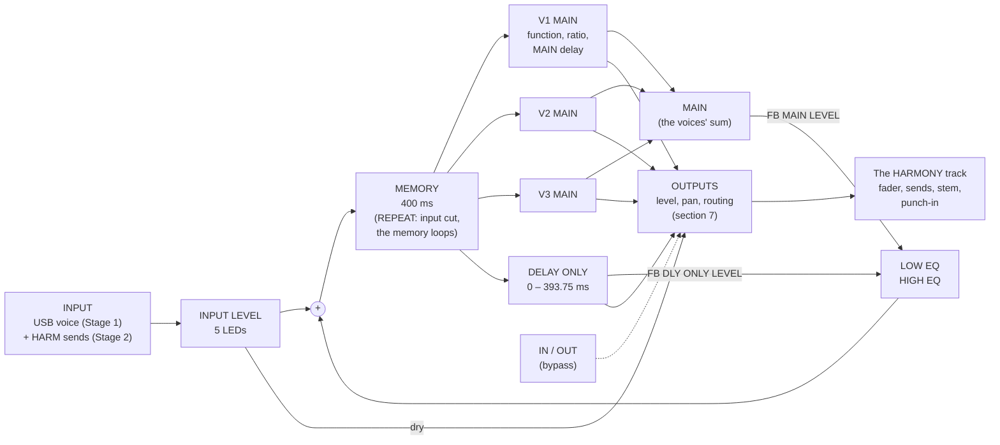

# The harmoniser: user manual (SMK-37 Elite, vocoder build)

> **Draft: describes the planned build. Nothing here is built yet.** This manual is written ahead of the firmware, from
> the harmoniser spec (§6, 2026-11-07) and the Eventide H949 manual, so the page can be checked before it is coded.
> **Stage 1** marks what the first build plays; **Stage 2** and **Stage 3** mark what comes after it. Points still open
> are listed in [section 12](#12-open-points-to-settle-before-stage-1). Everything here will be corrected against the
> unit as each stage is flashed and tested, as the vocoder's manual was.

The harmoniser turns your live voice (the same USB audio in as the [vocoder](VOCODER.md)) into up to **three harmony
voices that keep your voice's own sound**. The vocoder swaps your voice's timbre for the carrier's; the harmoniser
pitch-shifts your voice itself. The two are separate and can sound together: a vocoded chord on track 3, your sung
line harmonised on track 1 or 2.

It is modelled on the **Eventide H949 Harmonizer** and its keyboard, the HK940. The H949 was much more than a pitch
shifter: a 400 ms digital memory with an input stage, **two outputs** (MAIN, the pitch / effect output, and DELAY ONLY,
a plain delay), a **feedback** loop from both outputs with its own EQ, **REPEAT** (capture the memory and loop it) and
**REVERSE**. This build keeps that architecture, the H949's front-panel switch row on the pads, and its big red **PITCH
RATIO** readout on the screen. Where it adds to the H949 (three voices in one unit, scale-aware intervals, the
sequencer, stereo output splits) it says so.

Its sound comes from the method: a memory read by two heads moving at the pitch ratio, spliced every segment.
- **The formants move with the pitch.** A fifth up sounds a little smaller and brighter, an octave down larger and
  darker. That is the H949's character, not a fault.
- **The splice colours it slightly**, most on low notes and big intervals down. ALGORITHM 1 (crossfade) has no
  glitches but some colour; ALGORITHM 2 (Stage 2) is the H910's hard splice, glitches that come faster as the ratio
  moves from 1:1. The two sound the same at an octave either way.
- **Harmonies stay in tune** because each voice multiplies every frequency by its ratio. It is not a frequency shifter.

## 1. Getting started

1. Set up the USB audio in as for the vocoder: [VOCODER.md, Getting sound in](VOCODER.md#1-getting-sound-in), steps 1–3
   (**HOME > USB > AUDIO IN: ON**).
2. **HOME menu** (PATCH held) **> HARMONY > TRACK: T1** (or **T2**). That track becomes the **HARMONY** track: its
   synth, presets and Program Change are set aside (they come back with TRACK OFF), and its name on the tracks screen
   reads **HARMONY**.
3. Select the HARMONY track and tap **PATCH** until the header reads **HARMONY**: the big red PITCH RATIO readout
   fills the top of the screen ([section 3](#3-the-screen)).
4. Sing or speak and watch the **input LEDs** under the readout: aim for all three green, never the red LIMIT. **K1**
   on the PANEL group is INPUT LEVEL.
5. Press a pad on the **INTERVALS** group: the top row harmonises up, the bottom row down. The readout shows the
   voice's ratio (`1.260` for a major 3rd up). Or play keys: a key's distance from **C4** is its voice's interval.
6. **K8** is **WET / DRY**: all the way down is your voice unshifted, all the way up the harmony alone.

Track 3 still plays the voice too (AUDIO or VOCODER, as you set it). For the harmony alone, turn track 3's fader down
or mute it; to sing over a vocoded chord, leave it up.

## 2. How the sound flows (the H949's block diagram)



- **INPUT:** the source, then INPUT LEVEL and its meter ([section 6](#6-the-input)).
- **The feedback** returns the MAIN and DELAY ONLY outputs, through LOW / HIGH EQ, into the memory alongside the
  input, after INPUT LEVEL (so INPUT LEVEL does not change it), as on the H949 ([section 8](#8-feedback)).
- **The memory** holds the last 400 ms. **REPEAT** cuts the input and loops what is in it
  ([section 9](#9-repeat-the-note-repeat)).
- **Three MAIN outputs** (V1, V2, V3), each one H949: its function (pitch, delay, random, flange, reverse), its ratio,
  its MAIN delay. The H949 + HK940 drove up to three units for 4-part harmony; here they share one memory.
- **DELAY ONLY**, the H949's second output: the memory delayed by its own switches, unaffected by the MAIN functions.
- **OUTPUTS:** DRY, V1, V2, V3 and DELAY ONLY, each with level and pan, and the split modes
  ([section 7](#7-the-outputs-and-the-splits)).
- **The HARMONY track** is a track like any other at its output: fader, mute, pan, reverb and delay sends, its stem on
  the USB audio, the punch-ins. Its INSERT slot is not used (the H949's functions take its place).
- The voices are the harmoniser's own, outside SLOOP's 8-voice budget: the harmony never steals notes from the synths.

## 3. The screen

The page is built around the H949's **PITCH RATIO readout**, drawn as a red seven-segment LED display, with the
panel's indicator LEDs beneath it.

```
 ┌──────────────────────────────────────┐
 │  G2 PANEL          (or: K3 FB MAIN 64%)│  header: the group, or what is being turned
 │ V1  ┌─┐   ┌─┐ ┌─┐ ┌─┐                │
 │ KBD │ │ . │ │ │ │ │ │   8.888 style,    │  the PITCH RATIO readout: 4 digits,
 │ ALG1│ │   │ │ │ │ │ │   red LED         │  about 40 x 66 px each, unlit
 │     └─┘   └─┘ └─┘ └─┘                │  segments faintly visible
 │ NORM EXT SHRP FLAT│DLY RND FLG REV  REP│  the function LEDs (red | green), REPEAT
 │ ┌V1 +M3──┐┌V2 +P5──┐┌V3 -8va─┐       │  the voice strips: interval, level bar,
 │ │▮▮▮▮▯ ◂ ││▮▮▮▯▯ ▸ ││▯▯▯▯▯   │       │  pan, MAIN delay; dark while silent
 │ IN ●●●●○  FB M▮▮▯ D▮▯▯  DLY 218.75   │  input LEDs, feedback, DELAY ONLY time
 │ K1 INPUT K2 MANUAL ... │ pads: ...   │  the strip: knobs left, pads right
 └──────────────────────────────────────┘
```

- **The readout** (about the top third of the screen) shows the **pitch ratio of the readout voice**: the voice whose
  pad, key or knob was touched last, named beside it (**V1** in orange, **V2** cyan, **V3** violet). As on the H949:
  - always four digits: `1.260` (a major 3rd up), `0.749` (a 4th down), `2.000`, `0.250`;
  - in **RANDOM** and **FLANGE** the last digits move with the delay's sweep, so you see the rate, as the H949's did;
  - in **DELAY** the pitch is unity but the readout still shows the ratio set, its decimal point flashing: switching
    back to a pitch function takes that ratio at once (the H949's preset trick);
  - in **REPEAT** the readout stays, the REP LED lights.
  - Beside it: **KBD** or **MAN** (the control mode: keys and pads, or the MANUAL knob) and **ALG 1** / **ALG 2**.
- **The function LEDs**, as the H949's: one of four lit per voice, **red** for the pitch functions (NORM, EXTEND,
  SHARP, FLAT) or **green** for the delay functions (DELAY, RANDOM, FLANGE, REVERSE). **REP** lit while REPEAT holds.
- **The voice strips:** V1, V2, V3 each with its interval (`+M3`, `-P5`, `U`, `+8va`, `-15ma`; MICRO in cents while
  turned), a level bar, its pan, and its MAIN delay when one is set. Dark while the voice is silent.
- **The bottom line:** the **input LEDs** (five, as the H949's: section 6), the two **feedback** levels, and the
  **DELAY ONLY** time in ms.
- **The strip at the bottom** lists the group's knobs and pads, as on the vocoder page.
- While you turn a knob, its name and value show large in the header; the readout keeps the ratio.

## 4. The HARMONY page and its groups

**Opening it:** with a HARMONY track set, PATCH steps through the pages: **TRACKS → VOCODER → HARMONY → PUNCH IN →
TRACKS** (VOCODER only with AUDIO IN on; HARMONY only with HARMONY > TRACK set). As on the vocoder page: tap **PATCH**
to go on, **hold PATCH** for the HOME menu, **<** and **>** (or SELECT) step through the groups, and the page
**latches** with PATCH (the lock badge shows).

| Group | Its pads are | Stage |
|---|---|---|
| **G1 INTERVALS** | the HK940's interval keys: 8 up, 8 down | 1 |
| **G2 PANEL** | the H949's front-panel switch row: FUNCTION SELECT and the four function switches, ALGORITHM, REPEAT, IN / OUT; the MAIN OUTPUT (MSEC) switches | 1 (part), 2 |
| **G3 OUTPUTS** | the DELAY ONLY (MSEC) switches, the output mutes and the split modes | 2 (part in 1) |

The pads keep their usual jobs everywhere else. On this page they play the harmoniser. **Hold = momentary, tap =
latch**, as on the punch-in page, for every pad that turns something on.

### 4.1 G1 INTERVALS (Stage 1)

| Pad | 1 | 2 | 3 | 4 | 5 | 6 | 7 | 8 |
|---|---|---|---|---|---|---|---|---|
| **Top (up)** | unison | 2nd | 3rd | 4th | 5th | 6th | 7th | octave |
| **Bottom (down)** | 2nd | 3rd | 4th | 5th | 6th | 7th | octave | two octaves |

- **Press a pad:** it takes the next free voice (V1, V2, V3); a fourth replaces the oldest. Held: momentary; tapped:
  latched until tapped again.
- **The light:** a pad in use is lit in its voice's colour, **white while held**; a pad not in use is dim.
- **Unison** (top 1) is for doubling: with MICRO a few cents off, or the voice on RANDOM, it is the classic ADT.
- The interval sizes, SCALE and FREE: [section 5](#5-the-keys-and-the-intervals).

| K1 | K2 | K3 | K4 | K5 | K6 | K7 | K8 |
|---|---|---|---|---|---|---|---|
| MICRO V1 | MICRO V2 | MICRO V3 | LEVEL V1 | LEVEL V2 | LEVEL V3 | PAN (the readout voice) | WET / DRY |

- **MICRO:** about ±1 semitone, finer near the centre, with a detent at 0 (an addition: the H949 had MICRO as a
  separate mode, SHARP / FLAT, below).
- **LEVEL:** each voice from off to 0 dB (default −6 dB, so three voices and the dry do not overload).
- **WET / DRY:** 0 % the input alone, 50 % (the default) both equal, 100 % the harmoniser alone (the voices and DELAY
  ONLY).

### 4.2 G2 PANEL: the H949's switch row

| Pad | 1 | 2 | 3 | 4 | 5 | 6 | 7 | 8 |
|---|---|---|---|---|---|---|---|---|
| **Top** | FUNCTION SELECT | F1 | F2 | F3 | F4 | ALGORITHM 1 / 2 | REPEAT | IN / OUT |
| **Bottom** | 6.25 ms | 12.5 ms | 25 ms | 50 ms | 100 ms | 200 ms | VOICE | CONTROL |

**The function switches, as the H949's.** FUNCTION SELECT flips the meaning of F1–F4, and one of the four is active,
its pad lit in the LED's colour:

| | F1 | F2 | F3 | F4 |
|---|---|---|---|---|
| FUNCTION SELECT **IN** (red, pitch) | **NORM** | **EXTEND** | **SHARP** (MICRO up) | **FLAT** (MICRO down) |
| FUNCTION SELECT **OUT** (green, delay) | **DELAY** | **RANDOM** | **FLANGE** | **REVERSE** |

- **NORM:** pitch change, ×0.25 to ×2.0, the segment about 25 ms. Stage 1.
- **EXTEND:** the same with a longer segment, set by the MAIN switches (below): smoother on sustained sounds, slower
  to follow. Stage 2.
- **SHARP / FLAT** (the H949's MICRO PITCH CHANGE): the voice at unison, and the voice's MICRO knob (K1–K3 on G1, or
  MANUAL) runs from exactly 1:1 to about **1.07** (SHARP) or **0.93** (FLAT), finer the closer to 1:1 (settable to
  1.001). For doubling and chorus. Stage 1.
- **DELAY:** the voice becomes a plain delay at unity pitch, its time the sum of the six MAIN switches (0–393.75 ms).
  The readout keeps the ratio set (see section 3). Stage 2.
- **RANDOM:** the voice's delay wanders pseudo-randomly between 0 and 25 ms at a constant rate (MANUAL sets the
  rate), so its pitch drifts slightly too: automatic double tracking, less mechanical than a fixed delay. Stage 2.
- **FLANGE:** the voice's delay swept between 0 and 10 ms (MANUAL sets the rate), mixed with the dry: flanging
  without an outside mix. Stage 2.
- **REVERSE:** the memory read backwards in segments of **400 ms** (or 200 / 100 / 50 ms with the MAIN switches,
  below), pitched by the voice's interval (no MICRO, as the H949). Stage 2. [Section 10](#10-reverse).

**The MAIN OUTPUT (MSEC) switches (bottom 1–6)**, on the voice shown by VOICE, as the H949's, push on / push off:

| Function | What the switches do |
|---|---|
| DELAY | all six active: the delay is their sum, 6.25 to 393.75 ms in 6.25 ms steps |
| NORM, SHARP, FLAT, RANDOM, FLANGE | only **50, 100, 200** active: the voice displaced 50 to 350 ms later |
| EXTEND, REVERSE | **50, 100, 200 restrict the segment**: none in, 400 ms; 200 in, 200 ms; 200 + 100 in, 100 ms; 200 + 100 + 50 in, 50 ms (a switch whose larger neighbour is out does nothing, as the H949's) |

Switches with no job in the current function are drawn dim.

**The other pads:**
- **ALGORITHM 1 / 2** (top 6): 1, the crossfaded splice (Stage 1, the only one); 2, the H910's hard splice (Stage 2).
  The H949 needed algorithm 2 for clean RANDOM and FLANGE; here both work on either.
- **REPEAT** (top 7): hold = momentary, tap = latch. [Section 9](#9-repeat-the-note-repeat).
- **IN / OUT** (top 8): the H949's LINE IN / OUT. OUT bypasses the harmoniser: the input passes straight to the
  outputs, as it is. Lit green while IN.
- **VOICE** (bottom 7): which voice the function and MAIN switches act on: **ALL** (the default: the three together,
  as one H949), V1, V2, V3. Tap steps; the pad takes the voice's colour (white for ALL).
- **CONTROL** (bottom 8): **KBD** (the keys, pads and sequencer set the intervals, as the HK940) or **MAN** (the MANUAL
  knob sets the readout voice's ratio continuously, ×0.25 to ×2.0, as turning the H949's MANUAL).

| K1 | K2 | K3 | K4 | K5 | K6 | K7 | K8 |
|---|---|---|---|---|---|---|---|
| INPUT LEVEL | MANUAL | FB MAIN LEVEL | FB DLY ONLY LEVEL | LOW EQ | HIGH EQ | DLY ONLY LEVEL | WET / DRY |

**MANUAL** (K2), as the H949's knob: the ratio in MAN (and the MICRO range in SHARP / FLAT), the rate in RANDOM and
FLANGE. In KBD it does nothing in NORM.

Stage 1 plays NORM, SHARP, FLAT, ALGORITHM 1, IN / OUT, VOICE, CONTROL, INPUT LEVEL, MANUAL and WET / DRY; the rest is
drawn dim.

### 4.3 G3 OUTPUTS (Stage 2; the mutes and pans in Stage 1)

| Pad | 1 | 2 | 3 | 4 | 5 | 6 | 7 | 8 |
|---|---|---|---|---|---|---|---|---|
| **Top** | DRY on / off | V1 on / off | V2 on / off | V3 on / off | DLY ONLY on / off | MIX | MAIN \| DLY | DRY \| WET |
| **Bottom** | 6.25 ms | 12.5 ms | 25 ms | 50 ms | 100 ms | 200 ms | FB LIMIT | — |

- **Top 1–5:** each output source on or off (lit in its colour while it plays, its brightness the level, as the
  vocoder page's channel pads).
- **Top 6–8: the split** ([section 7](#7-the-outputs-and-the-splits)): one of three is lit.
- **Bottom 1–6: the DELAY ONLY (MSEC) switches**, as the H949's: the DELAY ONLY time is their sum, 0 to 393.75 ms. It
  has no effect on the MAIN functions and they none on it.
- **FB LIMIT** (bottom 7): **SAFE** (the default) or **H949** ([section 8](#8-feedback)).

| K1 | K2 | K3 | K4 | K5 | K6 | K7 | K8 |
|---|---|---|---|---|---|---|---|
| DRY LEVEL | DLY ONLY LEVEL | PAN DRY | PAN V1 | PAN V2 | PAN V3 | PAN DLY ONLY | WET / DRY |

## 5. The keys and the intervals

The keys set intervals as notes, as on the HK940 (whose keys were laid out from an octave down, 1:0.5, through unison,
1:1, to an octave up, 1:2):
- **A held key's distance from C4 is its interval.** C4 is unison, E4 a major 3rd up (FREE), G3 a 4th down, C3 an octave
  down. Every semitone from **−24 (C2) to +12 (C5)**; keys outside are ignored.
- **Up to three keys = three voices**, in the order played; a fourth replaces the oldest. Keys and pads mix.
- **CHORD mode** on the HARMONY track gives three intervals from one key.
- **The pads send their interval as a key too** (top 5, a 5th up, is G4), which is how the sequencer records them.
- **NO KEY: SILENT**, a voice sounds while its key or pad is held (or the pad latched); **HOLD**, the last intervals
  stay until new ones are played.
- **Bend** on the HARMONY track bends all three voices by the track's bend range; the **mod wheel** adds vibrato.

| Pad | FREE (semitones) | Ratio (the H949's table) | SCALE |
|---|---|---|---|
| top 1, unison | 0 | 1.000 | 0 |
| top 2, 2nd up | +2 | 1.123 | the scale's next step (+1 or +2) |
| top 3, 3rd up | +4 (major) | 1.260 | the scale's 3rd (+3 or +4) |
| top 4, 4th up | +5 | 1.335 | the scale's 4th |
| top 5, 5th up | +7 | 1.498 | the scale's 5th |
| top 6, 6th up | +9 (major) | 1.681 | the scale's 6th |
| top 7, 7th up | +10 (minor) | 1.781 | the scale's 7th |
| top 8, octave up | +12 | 2.000 | +12 |
| bottom 1, 2nd down | −2 | 0.891 | the scale's step below |
| bottom 2, 3rd down | −4 | 0.794 | the scale's 3rd below |
| bottom 3, 4th down | −5 | 0.749 | the scale's 4th below |
| bottom 4, 5th down | −7 | 0.667 | the scale's 5th below |
| bottom 5, 6th down | −9 | 0.595 | the scale's 6th below |
| bottom 6, 7th down | −10 | 0.561 | the scale's 7th below |
| bottom 7, octave down | −12 | 0.500 | −12 |
| bottom 8, two octaves down | −24 | 0.250 | −24 |

- **FREE:** the sizes above, always; the keys give every other interval.
- **SCALE** (HOME > HARMONY > INTERVALS): the intervals follow the HARMONY track's key and SCALE; keys off the scale
  snap to it. With the track's SCALE off, as FREE.
- **Counted from where (Stage 1):** with REFERENCE C4 there is no pitch tracker, so a scale interval is counted from the
  key's root, as if you sing the root. Stage 2's **TRACKED** reference counts from the note you sing.
- Your own ratio tables (just intonation, the owner's chromatic, harmonic and circle-of-fifths modes): Stage 2.

## 6. The input

- **The source** (HOME > HARMONY > SOURCE): **VOICE**, the USB audio in (Stage 1, whatever track 3's MODE); Stage 2
  adds **SENDS** (any track's **HARM send**, as the reverb and delay sends) and **BOTH**.
- **INPUT LEVEL** (G2 K1): −∞ to +12 dB, 0 dB at the centre detent.
- **The input LEDs**, as the H949's five: **yellow** a signal present (about −40 dB), **three green** a proper level
  (−18, −12, −6 dB), **red LIMIT** within 1 dB of clipping. Peak-reading: they light on peaky material even when the
  average is low. **Set INPUT LEVEL so the voice lights all three greens and never LIMIT.**
- **In REPEAT the LEDs work backwards**, as the H949's: they go out as the input gets louder, to show it is being
  ignored while still showing its level.
- **IN / OUT** (G2 top 8): OUT, the input straight to the outputs, the harmoniser bypassed.
- The feedback joins after INPUT LEVEL, so turning the input down does not change the feedback.

## 7. The outputs and the splits

The H949 had two outputs, MAIN and DELAY ONLY, each on its own connector, so the studio could send them to different
places: the pitch on one side and a plain delay on the other, the dry kept apart for a later mix. Here there are five
sources, **DRY, V1, V2, V3, DELAY ONLY**, and the HARMONY track's stereo output, its stem, is the connector.

**Each source:** on / off (G3 top 1–5), LEVEL (V1–V3 on G1, DRY and DLY ONLY on G3) and PAN (G3).

**The split modes** (G3 top 6–8, and HOME > HARMONY > OUTPUT):

| Mode | Left | Right | For |
|---|---|---|---|
| **MIX** (the default) | every source by its pan | every source by its pan | one stereo harmoniser |
| **MAIN \| DLY** | the voices (MAIN) | DELAY ONLY | the H949's two outputs: pitch one side, delay the other (wide doubling, slapback against harmony) |
| **DRY \| WET** | DRY | the voices and DELAY ONLY | the dry and the effect apart, on the stem's two sides, for a DAW to record and mix later |

- In the split modes each side is mono (the pans are not used) and WET / DRY is not applied: the levels set each side.
- **The stems:** the HARMONY track's stem carries the split as it is, so a DAW recording the stems gets MAIN and DELAY
  ONLY (or dry and wet) on separate channels.
- **The sends:** the HARMONY track's reverb and delay sends take its output after the split, as any track's.
- Stage 3, possible: DELAY ONLY on a track of its own (an open point).

## 8. Feedback

As the H949's FEEDBACK CONTROL GROUP: part of the two outputs returns to the memory's input.

- **FB MAIN LEVEL** (G2 K3): the MAIN output (the three voices' sum) back to the input.
- **FB DLY ONLY LEVEL** (G2 K4): the DELAY ONLY output back to the input.
- The two are mixed, then go through **LOW EQ** and **HIGH EQ** (G2 K5, K6), then join the input.
- **The levels:** with the EQ centred, each runs from 0 to 100 % loop gain: at 100 % a sound sustains for ever.
- **LOW EQ** (centre flat): fully clockwise boosts the lows up to about +18 dB around 100 Hz, fully anticlockwise cuts
  them by about −12 dB; flat above about 500 Hz.
- **HIGH EQ** (centre flat): clockwise boosts by up to about +4 dB above 3 kHz; anticlockwise cuts, about −4 dB at
  5 kHz and −11 dB at 10 kHz.
- **What it does:** with a voice on an interval, each pass through the loop shifts again: a rising or falling spiral of
  pitches (a 5th up climbs in fifths). With DELAY ONLY, a plain echo. With HIGH EQ cut, each repeat darker, like tape.
- **FB LIMIT** (G3 bottom 7):
  - **SAFE** (the default): a soft limiter in the loop. The feedback can sustain but never runs away.
  - **H949:** as the original: the loop gain can pass 1 (EQ boost and the levels high), and the sound can build into
    uncontrolled oscillation. The HARMONY track's output is still limited, so it cannot overload the mix. Use with
    care.

## 9. REPEAT (the note repeat)

As the H949's REPEAT: **press REPEAT and whatever is in the memory at that instant is captured and loops for as long
as REPEAT is held** (or latched).
- **The input is cut off** while REPEAT is on (the input LEDs work backwards to show it).
- **The voices keep playing the captured memory**: pads, keys and the sequencer still change their intervals, so a
  captured word or note can be played as a harmony, a chord, or a melody of repeats. With a voice on REVERSE, the
  capture plays backwards.
- **Its length:** the whole memory, **400 ms**, as the H949. Stage 2 adds **REPEAT LENGTH** (HOME > HARMONY): 400,
  200, 100 or 50 ms, or **SYNC** (1/4, 1/8, 1/16 of a beat at the song's tempo, up to 400 ms) for a rhythmic note
  repeat. The default, 400, is the H949's.
- **Capturing the right moment:** what is captured is what is in the memory, not what you last heard from a delayed
  output. A voice set to a MAIN delay or DELAY ONLY lags behind: to catch a particular word, listen to the dry voice or
  an undelayed voice when you press.
- **Release REPEAT** and the input comes back at once.
- **On the sequencer:** REPEAT is recorded as an event on the HARMONY track, so a pattern can capture and repeat on the
  beat (Stage 2).

## 10. REVERSE

As the H949's REVERSE function (G2, FUNCTION SELECT OUT, F4), per voice or for ALL:
- The memory is read **backwards in segments**: short pieces of your voice, each reversed, in their own order. Like
  cutting a tape into pieces, turning each round, and splicing them back in order: words come out "backwards" a
  syllable at a time, and long notes swell in.
- **The segment:** 400 ms (the whole memory), or 200, 100, 50 ms with the MAIN switches (section 4.2): shorter is more
  rhythmic, longer more like backwards tape.
- **Pitched:** the voice's interval still applies (a reversed 5th up); MICRO does not (as the H949).
- **With REPEAT:** the captured memory plays reversed for as long as REPEAT holds.
- **With feedback:** reversed pieces of reversed pieces: the reversed-reverb sound.

## 11. The menu, the sequencer, saving and troubleshooting

**HOME > HARMONY:**

| Item | Values (default first) | What it does |
|---|---|---|
| TRACK | OFF, T1, T2 | which track is the HARMONY track |
| SOURCE | VOICE (Stage 2: SENDS, BOTH) | the input |
| INTERVALS | SCALE, FREE | the intervals in the track's key and scale, or fixed sizes |
| NO KEY | SILENT, HOLD | the voices with nothing held |
| REFERENCE | C4 (Stage 2: TRACKED) | what unison is counted from |
| OUTPUT | MIX, MAIN \| DLY, DRY \| WET | the split (also G3) |
| REPEAT LENGTH | 400 (Stage 2: 200, 100, 50, SYNC 1/4, 1/8, 1/16) | REPEAT's loop |
| SPLICE | ALG 1 (Stage 2: ALG 2, CORRELATION) | the splice; CORRELATION (beyond the H949) picks the splice point by matching the waveform, the least colour |
| FB LIMIT | SAFE, H949 | the feedback's safety |

**The sequencer:** the harmony changes are the HARMONY track's notes (C4 unison). Record, step entry, editing and
playback as any track's; up to three notes at a step, always (as track 3 is always POLY for the vocoder). NO KEY acts on
the pattern too. Stage 2: REPEAT and the G2 function changes recorded as events. Stage 3: each voice's pitch as a MIDI
note on **HARM CH** (GLO > MIDI 3).

**Saving:** every setting on the page and in the menu, with each project slot and over a power-off, in the
harmoniser's own object (`OBJ_HARMSET`), as the vocoder's. A project saved before this build loads with TRACK OFF. The
web editor's **Harmony** tab comes later.

| Symptom | Check |
|---|---|
| No harmony | AUDIO IN ON; TRACK set; IN / OUT on IN; the input LEDs lit; a pad or key held (or NO KEY HOLD); WET / DRY not 0 %; the sources on (G3); the track's fader |
| The LEDs dark | INPUT LEVEL; the computer's output to the SMK-37; REPEAT on (the LEDs work backwards) |
| Red LIMIT flashing | INPUT LEVEL down |
| Only my dry voice, twice | track 3 also plays the voice: its fader down |
| The voice sounds frozen | REPEAT latched: tap it off |
| Words come out backwards | a voice on REVERSE (green F4 LED): FUNCTION SELECT IN, NORM |
| A growing howl or spiral | FB levels down, HIGH EQ and LOW EQ to the centre; FB LIMIT SAFE |
| Wrong interval in a key | INTERVALS SCALE and the track's key; in Stage 1 counted from the key's root |
| A warble or flutter | the splice: most on low voices and big intervals down; EXTEND on sustained sounds (Stage 2) |
| One side of the stereo only | OUTPUT on MAIN \| DLY or DRY \| WET: MIX for both sides |

## 12. Open points to settle before Stage 1

1. **The button grid:** the H949's front-panel switch row (FUNCTION SELECT, the four function switches, the two MSEC
   groups, ALGORITHM, REPEAT, IN / OUT) is G2 and G3 here; the intervals the HK940 gave are G1. Is that what was meant?
2. **The 16 interval pads** (section 4.1): two octaves down on bottom 8, or a 9th?
3. **SCALE without a tracker:** counted from the key's root in Stage 1, or the tracker in Stage 1?
4. **The memory:** REPEAT, REVERSE, EXTEND and the delays need the H949's 400 ms: ~35 KB of RAM at 44.1 kHz 16 bit
   (~18 KB at 22 kHz, the band limited to ~10 kHz against the H949's 15 kHz). Stage 1 alone needs ~100 ms (~9 KB).
   Measure, then decide whether Stage 1 takes the full memory.
5. **Defaults:** voice LEVEL −6 dB, WET / DRY 50 %, NO KEY SILENT, VOICE ALL, FB LIMIT SAFE, keys C2–C5.
6. **The outputs:** are MIX, MAIN | DLY and DRY | WET the splits wanted? DELAY ONLY on a track of its own (Stage 3)?
7. **Feedback:** MAIN as the voices' sum (as one H949), or a feedback level per voice?
