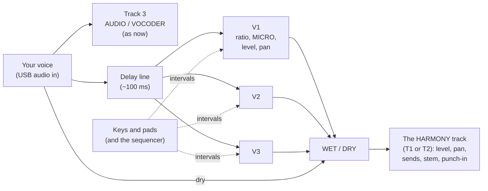

# The harmoniser: user manual (SMK-37 Elite, vocoder build)

> **Draft: describes the planned build. Nothing here is built yet.** This manual is written ahead of the firmware, from
> the harmoniser spec (§6, 2026-11-06), so the page can be checked before it is coded. **Stage 1** marks what the first
> build plays; **Stage 2** and **Stage 3** mark what comes after it. Points still open are listed in
> [section 9](#9-open-points-to-settle-before-stage-1). Everything here will be corrected against the unit as each
> stage is flashed and tested, as the vocoder's manual was.

The harmoniser turns your live voice (the same USB audio in as the [vocoder](VOCODER.md)) into up to **three harmony
voices that keep your voice's own sound**. The vocoder swaps your voice's timbre for the carrier's; the harmoniser
pitch-shifts your voice itself. The two are separate and can sound together: a vocoded chord on track 3, your sung
line harmonised on track 1 or 2.

It is modelled on the **Eventide H949 Harmonizer** (and its keyboard, the HK940): a short delay line read by two heads
moving at the pitch ratio, with a crossfaded splice about every 25 ms. That method is its sound:
- **The formants move with the pitch.** A fifth up sounds a little smaller and brighter, an octave down a little larger
  and darker. This is the H949's character, not a fault.
- **The splice colours it slightly**, most on low notes and big intervals down. Stage 2 adds the H910's hard splice
  (more glitch) and a splice by correlation (less colour).
- **Harmonies stay in tune** because each voice multiplies every frequency by its ratio. It is not a frequency shifter.

## 1. Getting started

1. Set up the USB audio in as for the vocoder: [VOCODER.md, Getting sound in](VOCODER.md#1-getting-sound-in), steps 1–3
   (**HOME > USB > AUDIO IN: ON**).
2. **HOME menu** (PATCH held) **> HARMONY > TRACK: T1** (or **T2**). That track becomes the **HARMONY** track: its
   synth, presets and Program Change are set aside (they come back with TRACK OFF), and its name on the tracks screen
   reads **HARMONY**.
3. Select the HARMONY track and open its page: tap **PATCH** until the header reads **HARMONY**
   ([section 3](#3-the-harmony-page)).
4. Sing or speak, and press a pad: the top row harmonises up, the bottom row down. Or play keys: a key's distance
   from **C4** is its voice's interval ([section 4](#4-the-keys)).
5. **K8** is **WET / DRY**: all the way down is your voice unshifted, all the way up the harmony voices alone.

Track 3 still plays the voice too (AUDIO or VOCODER, as you set it). For the harmony alone, turn track 3's fader down
or mute it; to sing over a vocoded chord, leave it up.

### How the sound flows

- **The source (Stage 1):** the USB voice in, whatever track 3's MODE. **Stage 2:** any track can send into the
  harmoniser with its own **HARM send**, as it sends to the reverb and delay.
- **The HARMONY track** is a track like any other at its output: its fader, mute, pan, reverb and delay sends, its stem
  on the USB audio, and the punch-ins. Its **INSERT** slot is not used (the harmoniser's own effects take its place in
  Stage 2).
- **The voices** are the harmoniser's own, outside SLOOP's 8-voice budget: playing the harmony never steals notes from
  the synths.

## 2. The menu (HOME > HARMONY)

| Item | Values (default first) | What it does |
|---|---|---|
| TRACK | OFF, T1, T2 | which track is the HARMONY track. One at a time. OFF: the harmoniser is off and the track plays its synth |
| INTERVALS | SCALE, FREE | **SCALE:** the intervals follow the HARMONY track's key and scale (a 3rd is major or minor as the scale has it); with SCALE off on the track, as FREE. **FREE:** fixed interval sizes, every semitone from the keys ([section 5](#5-intervals-scale-and-free)) |
| NO KEY | SILENT, HOLD | what the voices do with no pad or key held. **SILENT:** a voice sounds only while its pad or key is held (or its pad latched). **HOLD:** the last intervals keep sounding until new ones are played |
| REFERENCE | C4 | the key that means unison. Stage 2 adds **TRACKED**: the intervals counted from the note you sing |
| SPLICE | XFADE | the H949's crossfaded splice. Stage 2 adds HARD (H910) and CORRELATION |
| SEGMENT | NORM | the splice segment, about 25 ms (the H949's NORM). Stage 2 adds EXTEND (50, 100, 200, 400 ms) |

Items shown but not yet selectable are drawn dim, as on the vocoder's menus.

## 3. The HARMONY page

**Opening it:** with a HARMONY track set, PATCH steps through the pages: **TRACKS → VOCODER → HARMONY → PUNCH IN →
TRACKS** (VOCODER only with AUDIO IN on; HARMONY only with HARMONY > TRACK set). As on the vocoder page:
- **Tap PATCH** to go on; **hold PATCH** for the HOME menu.
- **<** and **>** (or SELECT) step through the groups. The header names the group: **G1 INTERVALS**, **G2 EFFECTS**,
  **G3 VOICES**.
- While you turn a knob, its name and value are shown large in the header.
- The page **latches** with PATCH as the vocoder page does: the lock badge shows while it is latched.

The pads keep their usual jobs everywhere else. On this page they play the harmoniser.

### 3.1 The screen

- **Three voice strips, V1 V2 V3**, each in its voice's colour (**V1 orange, V2 cyan, V3 violet**):
  - the interval, as `+M3` (a major 3rd up), `-P5` (a 5th down), `U` (unison), `+8va`, `-15ma`;
  - its ratio, as `x1.260`;
  - MICRO PITCH in cents, as `+7c`;
  - a level bar and a pan mark;
  - dark while the voice is silent.
- **The WET / DRY strip**, and in Stage 2 the effects' strip (RANDOM, FLANGE, REVERSE, REPEAT, DELAY lit while on).
- **The group marker** and the **lock badge**, as on the vocoder page.
- **The strip at the bottom** lists the knobs and the pads, as on the vocoder page: a swatch in the pad's colour, with
  a white mark on the side the pad is on.

### 3.2 G1 INTERVALS (Stage 1)

The pads are the H949's interval buttons. **Top row: up. Bottom row: down.**

| Pad | 1 | 2 | 3 | 4 | 5 | 6 | 7 | 8 |
|---|---|---|---|---|---|---|---|---|
| **Top (up)** | unison | 2nd | 3rd | 4th | 5th | 6th | 7th | octave |
| **Bottom (down)** | 2nd | 3rd | 4th | 5th | 6th | 7th | octave | two octaves |

**Playing them:**
- **Press a pad:** it takes the next free voice (V1, then V2, then V3). A fourth pad replaces the oldest voice.
- **Hold = momentary, tap = latch**, as on the punch-in page. A held pad sounds while held. A tapped pad stays on
  (latched); tap it again to let its voice go.
- **The light:** a pad in use is lit in its voice's colour, **white while held**. A pad not in use is dim.
- **Unison** (top 1) is for doubling: with MICRO PITCH turned a few cents it gives the classic thickened voice (ADT).
- Three pads at once give three-part harmony over your voice: the 4-part harmony of the H949 with an HK940.

**The knobs:**

| K1 | K2 | K3 | K4 | K5 | K6 | K7 | K8 |
|---|---|---|---|---|---|---|---|
| MICRO V1 | MICRO V2 | MICRO V3 | LEVEL V1 | LEVEL V2 | LEVEL V3 | PAN (the voice last played) | WET / DRY |

- **MICRO PITCH:** about ±1 semitone (±100 cents), finer near the centre, with a detent at 0. A few cents on a unison
  voice is doubling; ±10–20 cents on two unison voices is a chorus.
- **LEVEL:** each voice from off to 0 dB (the default −6 dB, so three voices and the dry do not overload).
- **PAN:** the voice whose pad or key was last played. Stage 2 gives each voice its own pan knob (G3).
- **WET / DRY:** 0 % your voice alone (the harmoniser bypassed), 50 % (the default) both equal, 100 % the harmony
  voices alone.

### 3.3 G2 EFFECTS (Stage 2)

Drawn dim in Stage 1. The H949's effect modes, for the whole harmoniser:

| Pad | 1 | 2 | 3 | 4 | 5 | 6 | 7 | 8 |
|---|---|---|---|---|---|---|---|---|
| **Top** | RANDOM | FLANGE | REVERSE | REPEAT | DELAY | SPLICE | SEGMENT | SCALE / FREE |
| **Bottom** | 6.25 ms | 12.5 ms | 25 ms | 50 ms | 100 ms | 200 ms | | |

- **Effect pads (top 1–5):** hold = momentary, tap = latch.
  - **RANDOM (ADT):** the pitch wanders slowly by a few cents, voice by voice, for double-tracking.
  - **FLANGE:** the delay swept short, for jet flanging on the harmony.
  - **REVERSE:** each segment played backwards.
  - **REPEAT:** the last segment held and looped (with EXTEND, up to 400 ms).
  - **DELAY:** each voice's delay (G3, and the switches below) switched in.
- **SPLICE** (top 6) steps XFADE → HARD → CORRELATION. **SEGMENT** (top 7) steps NORM → EXTEND 50 / 100 / 200 / 400 ms.
  **SCALE / FREE** (top 8) is the menu's INTERVALS, live.
- **The delay switches (bottom 1–6)** set the delay of the voice last played, combined as on the H949: each lit pad adds
  its time, 0 to 393.75 ms in 6.25 ms steps.

| K1 | K2 | K3 | K4 | K5 | K6 | K7 | K8 |
|---|---|---|---|---|---|---|---|
| RANDOM depth | RANDOM rate | FLANGE depth | FLANGE rate | REVERSE segment | REPEAT length | FEEDBACK | WET / DRY |

**FEEDBACK** returns the harmony into the delay line, through the H949's LOW and HIGH EQ (G3): a rising or falling
spiral of pitches when the interval is not unison. It stays below the point of runaway at every setting.

### 3.4 G3 VOICES (Stage 2)

| K1 | K2 | K3 | K4 | K5 | K6 | K7 | K8 |
|---|---|---|---|---|---|---|---|
| DELAY V1 | DELAY V2 | DELAY V3 | PAN V1 | PAN V2 | PAN V3 | LOW EQ | HIGH EQ |

- **Top pads 1–3:** each voice's interval mode (SCALE / FREE, a voice at a time).
- **Bottom pads 1–3:** each voice's mute (dark muted, lit in its colour while it plays, its brightness the level, as
  the vocoder page's channel pads).

## 4. The keys

The keys set intervals as notes, as on the HK940:
- **A held key's distance from C4 is its interval.** C4 is unison, E4 a major 3rd up (FREE), G3 a 4th down, C3 an octave
  down. Every semitone from **−24 (C2) to +12 (C5)**; keys outside that range are ignored.
- **Up to three keys = three voices**, in the order played. A fourth key replaces the oldest, as a fourth pad does.
- **Keys and pads mix:** a voice held by a pad and two by keys is three voices.
- **CHORD mode** on the HARMONY track gives three intervals from one key: the chord's notes as three voices.
- **The pads send their interval as a key too.** Top 5 (a 5th up) is G4, bottom 7 (an octave down) is C3, and so on
  (in SCALE, the scale's note: [section 5](#5-intervals-scale-and-free)). That is how the sequencer records them
  ([section 6](#6-the-sequencer)).
- With **NO KEY: SILENT**, a voice sounds while its key is held. With **HOLD**, the last chord of intervals stays until
  you play a new one.

The wheels act on the selected track as always. **Bend** on the HARMONY track bends all three voices (by the track's
bend range, as a synth); the **mod wheel** adds vibrato to them (±1 semitone at full).

## 5. Intervals: SCALE and FREE

| Pad | FREE (semitones) | Ratio (FREE) | SCALE |
|---|---|---|---|
| top 1, unison | 0 | x1.000 | 0 |
| top 2, 2nd up | +2 | x1.122 | the scale's next step (+1 or +2) |
| top 3, 3rd up | +4 (major) | x1.260 | the scale's 3rd (+3 or +4) |
| top 4, 4th up | +5 | x1.335 | the scale's 4th |
| top 5, 5th up | +7 | x1.498 | the scale's 5th |
| top 6, 6th up | +9 (major) | x1.682 | the scale's 6th |
| top 7, 7th up | +10 (minor) | x1.782 | the scale's 7th |
| top 8, octave up | +12 | x2.000 | +12 |
| bottom 1, 2nd down | −2 | x0.891 | the scale's step below |
| bottom 2, 3rd down | −4 | x0.794 | the scale's 3rd below |
| bottom 3, 4th down | −5 | x0.749 | the scale's 4th below |
| bottom 4, 5th down | −7 | x0.667 | the scale's 5th below |
| bottom 5, 6th down | −9 | x0.595 | the scale's 6th below |
| bottom 6, 7th down | −10 | x0.561 | the scale's 7th below |
| bottom 7, octave down | −12 | x0.500 | −12 |
| bottom 8, two octaves down | −24 | x0.250 | −24 |

- **FREE:** the sizes above, always. The keys give every other interval (a minor 3rd: D#4; a tritone: F#4).
- **SCALE:** the intervals follow the HARMONY track's **key and SCALE** (the track's scale setting, as for its notes).
  A pad gives the scale's degree: in C major, a 3rd up from C is E (+4), from D is F (+3). Keys off the scale snap to
  the nearest note in it. With the track's SCALE off, SCALE acts as FREE.
- **Counted from where (Stage 1):** with REFERENCE C4 there is no pitch tracker, so a scale interval is counted from the
  **key's root**, as if you sing the root. Sing other notes of the scale and a "3rd" stays the size it is above the root.
  Stage 2's **TRACKED** reference counts from the note you are singing, so a 3rd is always the scale's 3rd above it.
- The ratios are equal-tempered, as the H949's table. Ratio tables of your own (just intonation, the owner's chromatic,
  harmonic and circle-of-fifths modes) come in Stage 2, saved with the harmoniser.

## 6. The sequencer

The harmony changes are the HARMONY track's notes. Anything the sequencer does with a track's notes, it does with
these:
- **Record:** arm the HARMONY track, press record, and play pads or keys over your voice. Each pad press is recorded as
  its key ([section 4](#4-the-keys)), with its length (a latched pad: until it is let go).
- **Play back:** the pattern sets the intervals while you sing; the pads light as it plays them. You can sing the same
  line over different harmony patterns, or play a pad over the pattern (a live pad takes a free voice, as a fourth note
  replaces the oldest).
- **Step entry, editing, copying, length, swing** all work as on any track. A step's note is its interval (C4 unison).
- **Chords:** the HARMONY track records and plays up to three notes at a step, always (as track 3 is always POLY for the
  vocoder).
- **NO KEY** acts on the sequence too: SILENT, the voices sound for each step's length; HOLD, each step's intervals
  stay until the next step.
- **Stage 3, MIDI out:** each voice's pitch as a note on **HARM CH** (GLO > MIDI 3), so an external synth can double
  the harmony.

## 7. Saving

- The harmoniser's settings (the menu, the levels, MICRO, pan, WET / DRY, latched pads) are kept over a power-off, and
  **with each project slot**, in their own object (`OBJ_HARMSET`), as the vocoder's are. A project saved before this
  build loads with HARMONY > TRACK OFF.
- The HARMONY track's pattern is saved as any track's.
- A **full backup** from the web editor includes them. The editor's **Harmony** tab (later) shows the menu and the
  voices.

## 8. Troubleshooting

| Symptom | Check |
|---|---|
| No harmony at all | AUDIO IN ON; HARMONY > TRACK set; a pad or key held (or NO KEY HOLD); WET / DRY not at 0 %; the HARMONY track's fader, mute and the voices' LEVEL |
| Only my dry voice, twice | track 3 also plays the voice (AUDIO): its fader down, or mute it |
| The harmony is the wrong interval in a key | INTERVALS SCALE, and the HARMONY track's key and SCALE set; in Stage 1 the intervals are counted from the key's root ([section 5](#5-intervals-scale-and-free)) |
| A warble or slight flutter | the splice; most on low voices and big intervals down. MICRO at 0 for a still voice; Stage 2's CORRELATION splice for less |
| "Chipmunk" or "giant" voices | the formants move with the pitch, as on the H949. Smaller intervals, or a lower LEVEL on the large ones |
| Too loud with three voices | LEVEL down on each voice, or WET / DRY lower |
| Notes played on the HARMONY track do not sound as a synth | as intended: while it is HARMONY, its notes are intervals. HARMONY > TRACK OFF gives the synth back |

## 9. Open points to settle before Stage 1

1. **"The button grid":** the H949 itself has no interval buttons (a MANUAL knob and the HK940 keyboard). The pad
   layout here follows the H3000's interval keys. To confirm which panel is meant.
2. **The 16 pads' intervals:** as in [3.2](#32-g1-intervals-stage-1)? Two octaves down on bottom 8, or a 9th?
3. **SCALE without a tracker:** counted from the key's root in Stage 1 ([section 5](#5-intervals-scale-and-free)), or
   should Stage 1 already include the tracker?
4. **The cost, measured on the unit:** the ~100 ms delay line at 16 bit (~9 KB of RAM) and three voices (~4 % of a core),
   before the build.
