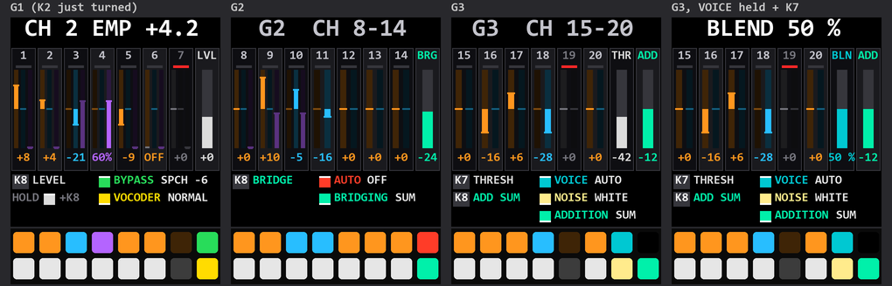

# SLOOP on the M-Vave SMK-37

The M-Vave SMK-37 has the FM-1's chip (JieLi AC791N), so SLOOP runs on it as a target board: `BOARD=smk37`.
Everything SMK-37-specific sits behind `BOARD_SMK37`; the FM-1 build is unchanged, byte for byte.

The SMK-37 board layer (input, screen, pad LEDs, flash map, update path, DAW mode) is M. Geisler's
([genkigenki/sloop-fm1](https://github.com/genkigenki/sloop-fm1), branch `smk37`; isod89/sloop-fm1#112), ported with
the [fm1-to-smk37](https://github.com/genkigenki/fm1-to-smk37) kit; this build carries it to SLOOP 2.8.1.

> Unofficial firmware for the SMK-37, not affiliated with or endorsed by M-Vave. No warranty: install at your own
> risk and read [Safety](#safety) first.

## What this build adds

**[Install from the browser](https://milomeowzers.github.io/sloop-smk37/)** (pick your model; back up first, see
[Install](#install)) · [Web editor](https://milomeowzers.github.io/sloop-smk37/elite/webapp/editor/) ·
[Releases](https://github.com/MiloMeowzers/sloop-smk37/releases)

All of SLOOP 2.8.1 (four tracks, the sequencer, the 27 punch-in effects, the web editor), on a keyboard with 37 keys,
16 pads, faders and wheels, plus:

| | What | Where |
|---|---|---|
| **The keyboard** | 37 velocity keys (the lowest five play drums on the drum track), 16 RGB pads (drum kit or steps), 4 faders, 8 knobs (FM-1 or SMK layout), pitch and mod wheels with a settable bend range, TRS MIDI out | [Knobs](#knobs-faders-wheels), [Buttons](#buttons), [Keys and pads](#keys-and-pads), [Velocity](#velocity) |
| **Samples and kits** | four 40 KiB user slots, a kit over two of them (about 7 s) | [User samples](#user-samples-and-drum-kits) |
| **The pad sound picker** | turn PRESETS: the sounds or kits on the pads, a pad loads and previews | [The pad sound picker](#the-pad-sound-picker) |
| **USB audio stems** | six mono channels, 24 bit, to the DAW: drums in four groups, the synths, the reverb / delay return; 48 or 44.1 kHz; a layout change re-plugs USB by itself | [USB audio stems](#usb-audio-stems) |
| **Punch-ins on the stems** | STEM FX: the rhythmic punch-ins (loops, stutter, reverse, stop, half, rewind, gate) on every stem, seamless loop joins, settable stitches (HOME > PUNCH: FADE, XFADE, CURVE) | [STEM FX](#usb-audio-stems) |
| **The stem punch-in page** | FX held (or locked with FX + FADER BANK): the pads as four colour rows, rows 1-3 the stem punch-ins, FREEZE | [the page](#the-stem-punch-in-page) |
| **Sequencer effects** | row 4 of the page: FLIP (backwards), LOOP BACK (2 bars .. 1/16, changeable while held), RAMP UP / DOWN (tempo ramps; the DAW stays the clock master); recorded and replayed as MIDI | [Sequencer effects](#sequencer-effects-row-4) |
| **DAW mode** | < + >: the whole keyboard as a MIDI controller, with an editable CC map | [DAW mode](#daw-mode) |
| **Punch-in MIDI out** | each punch-in sends its key's note on FX CH, so a DAW records and replays a performance | [HOME menu](#home-menu-the-smk-37-settings) (FX CH) |
| **The vocoder build** | track 3 as an audio track: your voice over USB through a 20-channel vocoder modelled on the Sennheiser VSM201, with its own page (the 20 channels on the knobs and pads) | [The vocoder build](#the-vocoder-build), [VOCODER.md](VOCODER.md) (the manual) |

The HOME menu (PATCH held) has the SMK-37's own settings: [HOME menu](#home-menu-the-smk-37-settings).

## Models

| Model | Build | Package identity |
|---|---|---|
| SMK-37 Pro | `BOARD=smk37 ./build.sh` | `SMK-37 Pro_900` (`build/sloop-smk37.fwsc`) |
| SMK-37 Elite | `BOARD=smk37 MODEL=elite ./build.sh` | `SMK-37 Elite_900` (`build/sloop-smk37-elite.fwsc`) |
| MKE-P37 | `BOARD=smk37 MODEL=mke ./build.sh` | `MKE-P37_900` (`build/sloop-smk37-mke.fwsc`) |
| Starrykey 37 Play | the SMK-37 Pro build | `SMK-37 Pro_900` |

They are one keyboard under several names. The `MODEL` builds differ only in the name the keyboard reports
(its identity, its update loader's, the update record's), so M-Vave's updater still recognises the unit for the way
back to the stock firmware. A release build: `--release X.Y` (identity `SMK-37 Pro_9XY`). See
[BUILDING.md](BUILDING.md) for the toolchain.

## Install

**First, a full flash backup** ([fm1-to-smk37](https://github.com/genkigenki/fm1-to-smk37),
docs/02-update-and-recovery.md, section 3): the calibration, the Bluetooth pairing and key_mac are this unit's
own, and no package has them. From the stock firmware, `tools/smk_backup_prep.py prep build/sloop-smk37.fwsc` runs
the check step only (nothing is written to the app) and sends the loader the UBOOT key; the keyboard comes back as the
USB disk `WL82 UBOOT1.00`, read twice with [jl-uboot-tool](https://github.com/kagaimiq/jl-uboot-tool). Then
`tools/smk_backup_prep.py verify dump-1.bin dump-2.bin`: 1 MiB each, the same, `trimdat` at 0xC1224.

Connect the keyboard over USB (a data cable) and use this repository's installer, as for the FM-1:

```sh
python3 tools/fm1_install.py build/sloop-smk37.fwsc        # Python 3 with mido and python-rtmidi
```

It finds the keyboard's MIDI port, checks the model and the package, asks the running firmware (the stock one or
SLOOP) to start the update loader and writes the package; then the keyboard restarts and the installed identity is
checked. The web installer (`web/index_pkg.html`, built by `web/make_site.py`) does the same in Chrome or Edge.
Updating later works the same way; projects, presets, samples and settings are kept. A package never goes to the
other device (FM-1 / SMK-37), and a keyboard running another firmware with its own updater is left alone.

Until this project's releases include SMK-37 packages, unofficial builds can be installed with the web installer: <https://genkigenki.github.io/smk37/>.

**Back to the stock firmware:** install the official package for your model with M-Vave's own updater (M-UPGRADE),
or give it to the installer: `python3 tools/fm1_install.py --force SMK-37_Pro_016.fwsc` (the installer reads the
stock package format). The SLOOP build keeps the stock update protocol, so the stock tools see the keyboard as usual.
The user sample slots USR1–USR4 (0xC2000–0xE9FFF) are where the stock firmware keeps its key, knob and fader
mapping; it trusts that area while its end marker `usrdata` (0xEAFF8) is there. SLOOP erases the marker's sector
(0xEA000, the only sector it may touch there) before it first stores a sample in USRFLASH, and at power-on when the
marker sits over sample data, so the stock firmware rebuilds its factory mapping; an untouched stock mapping (with
your MIDI Suite presets) stays as it is. The web editor's Settings tab has **Prepare the return to M-Vave** to erase
the marker on request.

**If it does not start:** after two failed starts SLOOP opens its USB recovery screen (identity `SMK-37 Pro_000`,
or the model's), where the installer can write a package again; after a third it drops into the chip's mask-ROM
update mode (UBOOT).

## Knobs, faders, wheels

| FM-1 printed | SLOOP function | SMK-37 printed | on the SMK-37 |
|---|---|---|---|
| MASTER (pot, top left) | output volume | K1 | master volume (virtual pot, 24 steps a click; its curve: HOME menu > AUDIO > LIMITER) |
| SELECT (big encoder) | tempo (TRACKS), page ◀▶, visualiser style, menu section | K2 | SELECT: tempo / pages |
| ALGORITHM | select track 1–4 | K3 | track |
| PRESETS | sound (synth) / kit (drums) | K4 | sound / kit, the pad picker shows them |
| KNOB 1 | dial 1 on screen (blue) | K5 | dial 1 |
| KNOB 2 | dial 2 on screen (green) | K6 | dial 2 |
| KNOB 3 | dial 3 on screen (yellow) | K7 | dial 3 |
| KNOB 4 | dial 4 on screen (orange) | K8 | dial 4 |
| — | — | KNOB LAYOUT = SMK | HOME menu > SCREEN > KNOB LAYOUT (K7): K1–K4 the dials 1–4, K5 master volume, K6 SELECT, K7 PRESETS, K8 ALGORITHM (track); FM-1 (default) as above |
| — | — | FADER 1–4 | tracks 1–4 (4 = drums), by FADER BANK: A level, B filter (low-pass ◀ open ▶ high-pass), C reverb, D delay; a fader takes over once moved |
| — (no wheels used by SLOOP) | — | PITCH wheel | pitch bend, selected synth track: HOME menu > PLAY > BEND UP (K6) / BEND DOWN (K7), OFF, 1, 2, 3, 4, 5, 7, 12 semitones each; default 7 / 7 |
| — | — | MOD wheel | vibrato 10 Hz, up to ±1 semitone (up = more) |
| — | — | PEDAL jack | — |

## Buttons

| FM-1 printed | SLOOP tap | SLOOP hold (layer) | SMK-37 printed | on the SMK-37 |
|---|---|---|---|---|
| PLAY | start / stop (LED flashes on every beat) | — | SEQ PLAY | PLAY |
| REC | record / arm | 2 s: clear track | SEQ REC | REC |
| HOME | TRACKS screen, again: visualiser | menu | PATCH | HOME |
| ENV | envelope pages (amp/filter shape) | — | CHORD | ENV |
| LFO | LFO pages (modulation) | — | NOTE REPEAT | LFO |
| FX | effect pages | punch-in FX on pads | FX | FX |
| SEL | key / chord pages | key layer (pads = piano: scale green, root brighter) | SCALE | SEL |
| EDIT | sound pages, drum kit | erase layer | PARA | EDIT |
| ARP | arp pages (MODE on K5: OFF switches the arpeggiator off) | note repeat (rolls) | ARP | ARP; LED lit while the selected track's arpeggiator runs |
| SEQ | step / pattern pages | step layer (steps 1–16) | SEQ | SEQ |
| GLO | global / master / system | mix layer (mute, solo, fill, tap) | GLOBE | GLO |
| SAVE | song screen / save | song layer (slots A–D: used green, free white) | BT | SAVE (SLOOP has no Bluetooth) |
| OCT− | octave down | drums: ghost hits | OCTAVE− | OCT− |
| OCT+ | octave up | drums: hard hits | OCTAVE+ | OCT+ |
| — | — | — | KNOB BANK | pins the pad sound picker open / closes it (lit while pinned or while K4 turns) |
| — | — | — | FADER BANK | the fader bank screen; pressed again, < > or SELECT: the next bank A→B→C→D (closes after 4 s; lit while up; closes the pad picker) |
| — | — | — | KNOB BANK + FADER BANK | the pads on the PLAY screen: DRUM KIT (default) ↔ STEPS (as the stock PAD BANK combo) |
| — | — | — | < | page back (as SELECT, never tempo); SEQ held or pads on STEPS: step page back; visualiser: style |
| — | — | — | > | page forward; SEQ held or pads on STEPS: step page forward; visualiser: style |
| — | — | — | < + > | SYNTH ↔ DAW mode ([DAW mode](#daw-mode)) |

## Keys and pads

| FM-1 | SLOOP | SMK-37 | on the SMK-37 |
|---|---|---|---|
| 27 keys F3–G5 | notes; in layers: tiles (steps, FX, mix…) | keys F3–G5 (middle 27) | same, with velocity |
| — | — | keys C3–E3 (lowest 5) | synth tracks: notes; drum track: C3 kick, D3 snare, E3 hat (black keys = left white key) |
| — | — | keys G#5–C6 (highest 5) | synth tracks: notes; drum track: G#5 cowbell, A5 open hat, B5 crash, C6 ride |
| LEDs under 27 keys | what is on / playing | 16 RGB pads | PLAY screen: DRUM KIT (default; a pad a drum sound whatever track is selected, velocity, recorded into the drum track while recording; the drum track selected: each pad dim in its sound's group colour, KICK red, SNARE white, HATS cyan, PERC violet, bright while it sounds; a synth track selected: dim in that track's colour, a drum hit bright in its group's; every synth track's notes flash in their track's colour on the pad of their white key) or STEPS (KNOB BANK + FADER BANK; the selected track's 16 steps of the page, top row 1–8: empty dim white, set in the track's colour, playhead white; tap sets / clears; drums: the sound last played). Layers: SEQ / FX / GLO / SAVE tiles, SCALE piano, EDIT / ARP held the white keys |

## User samples and drum kits

The web editor's samples and drum kits go to the four user slots **USR1–USR4**, as on the FM-1, at half the length:
40 KiB a slot (about 3.7 s at 22050 Hz; the FM-1's are 80 KiB). SAMPLE / GRAIN / TEXTURE play USR1–USR4 (SLICE USR1–USR3); the
drum track's KIT plays USR1–USR4 and **USR3+4**, one kit over the two slots (80 KiB, about 7 s), the editor's DRUM
KIT page's default: it shares the pads out over USR3 and USR4 by itself (each pad whole in one slot, so one sound is at
most about 3.7 s; FIT shortens the longest when a kit does not fit). The editor reads the slot size from the keyboard,
so its meters, FIT and the kit split are the SMK-37's.

- A **backup from an FM-1** restores; a sample slot bigger than 40 KiB is skipped (the editor names it, that slot stays
  as it was). Send it again shorter (FIT), or, for a drum kit, to USR3+4.
- Samples stored by an **earlier SMK-37 build** (two slots of 80 KiB) read as empty when longer than 40 KiB (a shorter
  USR2 shows up as USR3); send them again.

## Velocity

HOME menu (PATCH held) > PLAY > **KEY VELOCITY**, on K5 (before: MIDI, K8), sets how the 37 keys and the pads play. It applies to the
notes, their MIDI out and the drum levels; OCT− / OCT+ held still play ghost / hard drums. Kept with the settings.

| KEY VELOCITY | the notes play |
|---|---|
| DYNAMIC (default) | as played (the unit's factory velocity curves) |
| SOFT | louder for a light touch (32 → 56, 64 → 96) |
| HARD | loud needs a hard hit (64 → 32, 100 → 78) |
| FIXED 64 | always 64 (drums: soft) |
| FIXED 100 | always 100, as the FM-1's keys (drums: normal) |
| FIXED 127 | always 127 (drums: hard) |

## HOME menu: the SMK-37 settings

HOME menu (PATCH held; sections SCREEN, LIGHTS, AUDIO, USB, SEQ, PLAY, MIDI, DAW, SYSTEM: every row the SLOOP manual lists is in
its section, as on the FM-1, and the SMK-37's own are below); SELECT walks the sections, the knobs set the rows (K5–K8, or K1–K4 with KNOB LAYOUT = SMK;
the screen names them), OCT+ steps the row under the cursor; SEQ PLAY and SEQ REC still start / stop and arm:

| Section | Row | Knob | Setting |
|---|---|---|---|
| SCREEN | KNOB LAYOUT | K7 | FM-1 (default): K1 MASTER, K2 SELECT, K3 ALGORITHM, K4 PRESETS, K5–K8 the dials. SMK: K1–K4 the dials, K5 MASTER, K6 SELECT, K7 PRESETS, K8 ALGORITHM. The knobs are endless: the new layout works at once. Switched to SMK, the menu's rows move to K1–K4 (K3 switches back) |
| SCREEN | KNOB ACCEL | K8 | SLOOP's: ON (default), a fast turn moves further; OFF, one value a detent |
| USB | USB LAYOUT | K5 | STEREO (default): the USB audio input as on the FM-1. DRUMS+RET, SYNTHS+RET, ALL DRY: [stems](#usb-audio-stems) for a DAW. A moment after the knob stops the keyboard re-plugs itself on USB (~1 s; RE-PLUG shows meanwhile) |
| USB | STEM RATE | K6 | with a stem layout: 48 KHZ (default; resampled on the keyboard) or 44.1 KHZ (the lightest: the engines' own samples, the computer converts); **48 / 16 BIT** or **44.1 / 16**: 16-bit stems for a single-TT USB hub (about 78 dB below a full stem; with AUDIO IN, 24-bit stems do not fit such a hub's budget). Re-plugs as USB LAYOUT |
| USB | STEM FILTER | K7 | at 48 KHZ: FULL (default; 12 taps, the cleanest top end) or LIGHT (8 taps, a third less of the stems' resampling, for busy patterns: −1.3 dB at 14 kHz, −2.8 dB at 16 kHz). At once |
| PUNCH | STEM FX | K5 | with a stem layout: SLICER (default; each track's SLICER STUT, the punch-ins on the master only), PUNCH or PUNCH HQ (the rhythmic punch-ins on every stem; [below](#usb-audio-stems)). At once |
| PUNCH | FADE | K6 | the punch-ins' fade in and out, 0 (default, the shortest) .. 15: the same setting as SELECT on the FX page (shown large at its top right). OCT+ back to 0 |
| PUNCH | XFADE | K7 | with STEM FX: the shortest stitch on the stems (a punch in or out), 1.5 / 2.9 (default) / 5.8 MS; FADE makes it longer. At once |
| PUNCH | CURVE | K8 | with STEM FX: EQUAL (default; the level holds through a stitch between unrelated audio) or LINEAR (the old ramp, ~3 dB down half way). A fresh loop's punch-in (the same audio both sides) stays linear. At once |
| SEQ | FLIP RETURN | K7 | the stem page's FLIP and LOOP BACK, let go: SLIP (default; the tracks come back where they would have been) or CARRY (they go on from where the effect left them). At once |
| PLAY | KEY VELOCITY | K5 | see [Velocity](#velocity) |
| PLAY | BEND UP | K6 | the pitch wheel up, on the internal sounds (the selected synth track): OFF, 1, 2, 3, 4, 5, 7 or 12 semitones, default 7. MIDI IN's pitch bend has its own (GLO > MIDI 2 > BEND) |
| PLAY | BEND DOWN | K7 | the same, down (default 7; e.g. +2 up, −12 down). The earlier BEND RANGE is read as both |
| PLAY | LIMITER | K8 | SOFT (default): 9 dB more headroom at the power-on MASTER position, the limiter only near full scale, so a held chord keeps its level; MASTER's top as loud as before (turn it up for loudness). CLASSIC: SLOOP's limiter and MASTER curve |
| MIDI | TRS MIDI OUT | K5 | ON (default) / OFF. The 3.5 mm jack sends what goes out over USB MIDI: the keys and pads (and the sequencer with GLO > SYSTEM > MIDI = SEQ, or DAW mode), on each track's MIDI channel, with or without a computer. NOT SENDING: the UART did not answer; set it again to retry |
| MIDI | MODE | K6 | SYNTH (default) / DAW ([DAW mode](#daw-mode); also `<` + `>`) |
| MIDI | CHANNEL | K7 | 1–16 (default 1): DAW mode's keys and every map entry on MAIN |
| MIDI | LOCAL | K8 | DAW mode: OFF (default; SLOOP silent) / ON (the keys play the selected track, NOTE pads the drum kit); also PATCH tapped |
| DAW | CC MAP | K5 | DEFAULT / USER (the map edited on the keyboard or in the web editor) |
| DAW | KNOBS | K6 | ABSOLUTE (0–127) / RELATIVE (64 ± the detents) |
| DAW | EDIT MAP | K7 | OCT+: the map editor (also PATCH held + OCTAVE+) |
| DAW | RESET MAP | K8 | how many entries differ from DEFAULT; OCT+ twice: USER = DEFAULT |

**Punch-in FX over MIDI:** with GLO > MIDI 3 > **FX CH** set (OFF by default), a punch-in played on the keys or pads
(FX held) also goes out on that channel as the note SLOOP reads back there (F3–G5, 53–79: the FM-1's 27 keys), and its
release as the note off. A DAW records them on a MIDI track and plays them back into SLOOP over USB MIDI (FX CH, as since
SLOOP 2.7); with the DAW's MIDI thru on, the echo takes the effect over and the key's note off still ends it. Punch-ins
that come in over MIDI are not sent again. SMK-37 only.

The jack is a MIDI **OUT** (UART1 on PC7, 31250 baud; there is no MIDI IN on the SMK-37). Connect it with a
TRS-to-DIN MIDI adapter. The SMK-37 is listed with a **type A** TRS jack (a community spec sheet; M-Vave's manual
only says "a 3.5 mm to MIDI adapter", and it has not been measured): if a synth does not respond, try a type B
adapter.

## USB audio stems

HOME menu > USB > **USB LAYOUT**: the USB audio input becomes 6 mono channels, 24 bit, 48 kHz (or 44.1, STEM RATE),
each named for the DAW:

| Channel | DRUMS+RET | SYNTHS+RET | ALL DRY |
|---|---|---|---|
| 1 | KICK | SYN 1 | SYN 1 |
| 2 | SNARE | SYN 2 | SYN 2 |
| 3 | HATS | SYN 3 | SYN 3 |
| 4 | PERC | DRUMS (the kit as one stem) | KICK |
| 5 | RET L | RET L | SNARE |
| 6 | RET R | RET R | HATS+PERC |

- A synth track's stem is the track after its own chain (DIST, INSERT, SLICER, FILTER), LEVEL, mute / solo and DUCK,
  before its pan and sends. RET L / R: the shared reverb, delay and chorus, with what every track sends to them.
- The drum groups: each sound in its group (KICK: KICK, KICK 2 / SNARE: SNARE, CLAP, RIM, SNARE 2 / HATS: HAT, OPEN
  HAT, PEDAL, CRASH, RIDE / PERC: the toms, SHAKER, CONGA, COWBELL; the pads show them in their colours), each group
  through the drum track's SLICER GATE, INSERT and FILTER, before the track's pan and sends. INSERT's drive and fold act
  on each group (on the kit in the stereo mix). While SLICER **STUT** runs on the drum track the kit goes out as one
  stem on KICK's channel (STUT records the whole track). Per-kit groups and choke are to come.
- Pan, trim and mix them in the DAW. The master stage (TEXTURE, DUST, the DJ filter, the limiter) and the metronome are
  on no stem.
- **STEM FX** (HOME menu > PUNCH, at once): **SLICER** (default): each track's SLICER as always, the punch-ins on the
  master only (headphones, not the stems). **PUNCH** / **PUNCH HQ**: the rhythmic punch-ins (LOOP 4 / 8 / 16 / 32 /
  8T, STUTTER, REVERSE, STOP, HALF, REWIND, GATE) on every stem, each on its own signal before its pan and sends, the
  same grid for all (the stems, the stereo mix and the headphones hear the same; the reverb hears the punched sound).
  The tonal ones (the filters, kills, CRUSH, ALIAS, PHONE, ECHO, FLANGER, FREEZE ...) stay on the master (ECHO short).
  The memory is the master ring's and the SLICERs' STUT recordings': SLICER STUT is off meanwhile (GATE stays). Each
  stem keeps a past of 0.51 s (SYNTHS+RET, 4 rings), 0.29 s (DRUMS+RET, 7), 0.34 s (ALL DRY, 6) with PUNCH, stored at 22 kHz (the
  top end above ~10 kHz goes while a punch-in plays, as the SLICER's STUT); PUNCH HQ keeps the full band and half the
  time. A punch-in longer than that past (a slow tempo: REVERSE plays a beat, HALF and STOP 1/8 note and more) plays
  what there is: REVERSE shorter, STOP and REWIND fade where the past ends.

### The stem punch-in page

At a glance (STEM FX = PUNCH or PUNCH HQ, the FX layer held or locked):

| Control | Does |
|---|---|
| FX held | the page: the pads and the screen show the stem effects |
| FX + FADER BANK | locks the page open (FADER BANK lit); FADER BANK again lets it go |
| Pads, row 1 (orange) | LOOP 4, 8, 16, 32, held |
| Pads, row 2 (cyan) | STUTTER, REVERSE, STOP, HALF, held |
| Pads, row 3 | LOOP 8T (orange), GATE (green), REWIND (cyan), FREEZE (violet), held |
| Pads, row 4 (yellow) | FLIP, LOOP BACK, RAMP UP, RAMP DOWN, held ([below](#sequencer-effects-row-4)) |
| SELECT | the punch-ins' FADE, 0 .. 15, shown large at the top |
| PRESETS (K4; K7 SMK layout) | LOOP BACK's length, live while it is held |
| ALGORITHM (K3; K8 SMK layout) | RAMP's grid |
| HOME > PUNCH | STEM FX, FADE, XFADE (1.5 / 2.9 / 5.8 ms), CURVE (EQUAL / LINEAR) |
| HOME > SEQ > FLIP RETURN | SLIP or CARRY after FLIP and LOOP BACK |

In detail:

- **The page** (FX held, STEM FX = PUNCH / HQ): the screen and the pads show only what plays on the
  stems, three rows by kind: LOOP 4 / 8 / 16 / 32 (orange), STUTTER, REVERSE, STOP, HALF (cyan), LOOP 8T (orange),
  GATE (green), REWIND (cyan), FREEZE (violet); the one playing white. The header says stems and PUNCH or PUNCH HQ. A
  pad holds its effect while held, and sends the effect's key note on FX CH as the key does. The keys keep all 27
  effects (the tonal ones on the master); MIDI on FX CH is unchanged.
- **FREEZE** with STEM FX: the reverb holds (the RET stems) and the dry stems fade under it as the master's dry mix
  does.
- **Stitches** on the stems: each loop's wrap blends over 2.9 ms (equal power) into the audio just before the loop
  (REVERSE: just after its turn), so a loop repeats without a gap or a click; a punch in or out takes at least
  PUNCH > XFADE, with PUNCH > CURVE.
- **FX + FADER BANK** locks the FX layer open (FADER BANK lit): no holding FX. FADER BANK again, or any other button but
  PLAY, REC and OCT, lets it go. (SLOOP's own lock, FX held + PATCH tapped, works too.)

### Sequencer effects (row 4)

Row 4 of the page (yellow) changes what the sequencer plays rather than the audio, so the stems, the stereo mix and
MIDI out all follow; they work with any STEM FX and any USB LAYOUT. Each while held:

- **FLIP**: every track plays backwards from the step it is on.
- **LOOP BACK**: every track loops the steps that just played, ending at the playhead, forwards. PRESETS on the page
  sets the length, halving: 2 bars, 1 bar (default), 1/2 bar, 1/4, 1/8, 1/16 (the short end: break slices, 1/8 a
  shuffle, 1/16 a single hit). Turned while LOOP BACK is held, the loop takes the new length at once, keeping its
  end and the beat: halving rolls into the last hit, doubling reaches back. Longer than a track's pattern, that track
  just plays its pattern; shorter than its step, it holds the step it is on.
- **RAMP UP / DOWN**: the tempo steps on a grid (ALGORITHM: 1/4, 1/8, 1/16, straight or dotted), each step
  1/(steps a bar) of the tempo down to the floor (1 BPM; 20 with CLOCK OUT); UP is its mirror, rising as DOWN falls
  and easing into double (the most): at 120 BPM after 1 s about 170 up, 75 down. Let go, it snaps back. The header
  shows the tempo meanwhile.
- **FLIP RETURN** (HOME > SEQ, shown in the header): SLIP, the tracks come back where they would have been; CARRY,
  they go on from where the effect left them (until the transport stops).
- With the DAW's clock in (SYNC), the DAW stays the master: a RAMP leaves its clock only while held and, let go,
  jumps back to the DAW's place; FLIP and LOOP BACK never leave it.
- Notes recorded while an effect plays land on the step heard. On FX CH they go out as notes 80 (FLIP), 81 (LOOP
  BACK), 82 / 83 (RAMP UP / DOWN), the velocity carrying the setting (FLIP 1 SLIP, 2 CARRY; LOOP BACK 1..6 the
  length; RAMP 1..6 the grid), so a DAW's recording replays exactly.

### Levels, rates and the USB device

- A fixed level: the stems follow neither MASTER nor USB AUDIO (set the levels in the DAW). The stereo output's full
  scale sits at −18 dBFS in the stems: 18 dB of headroom for the sum of six of them, and no limiter on them.
- One rate at a time (6 channels of 24 bit fill a full-speed USB packet): **STEM RATE** 48 KHZ (default) or 44.1 KHZ.
- **Through a USB hub:** a hub with a single TT (most) budgets about 1000 bytes a millisecond for full-speed audio. 24-bit stems reserve 882 (828 at 44.1); with AUDIO IN (196 more) that does not fit and the audio in drops out when the stems open. **STEM RATE 48 / 16 BIT** (or 44.1 / 16) reserves 588 / 552 and fits. A port on the computer itself needs none of this.
  The FM-1's USB RATE does not apply. At 48 kHz the stems are resampled on both cores, shared by the work each has
  (**STEM FILTER** FULL or LIGHT, at once); at 44.1 kHz they go out as the engines make them, with nothing to resample
  (the lightest on the keyboard; the computer converts if its project runs at 48). They are one 0.7 ms block later
  than the stereo output.
- A new USB LAYOUT or STEM RATE applies a moment after the knob stops: the keyboard leaves USB and comes back (~1 s,
  RE-PLUG on the menu meanwhile) as that layout's device; the sound and the sequencer run on. No power cycle.
- Each layout and rate is its own USB device with its own serial number (…-DR, -SY, -AD; at 44.1 …-D4, -Y4, -A4), so a
  computer keeps its name (and your renames) in any port; the first time one is used the computer sets it up once.

## DAW mode

**< + >** (the second pressed while the first is held) switches **SYNTH ↔ DAW**; so does HOME menu > MIDI > MODE.
A full screen says which. In DAW mode the keyboard is a MIDI controller (USB, and the TRS jack with TRS MIDI OUT on):
SLOOP's sequencer stops and the controls leave SLOOP alone. MIDI IN still plays SLOOP (a sound module for the DAW).

- **Keys:** notes on CHANNEL (HOME menu > MIDI, default 1), the lowest key C3 (48) at octave 0, velocity as KEY
  VELOCITY. OCTAVE− / OCTAVE+: the octave (±3; both: 0).
- **K1–K8** (as printed, whatever KNOB LAYOUT), **FADER 1–4**, the **16 pads**, **13 buttons** and the **wheels** send
  what the map says. KNOB BANK / FADER BANK: bank A / B of the knobs / faders (lit on B); both: the pads' bank.
  Knobs ABSOLUTE (0–127, kept per knob) or RELATIVE (64 ± the detents): HOME menu > DAW > KNOBS. `<` `>` send when
  let go. A knob, fader or wheel sends at most every 8 ms (the last value always); a CC TOGGLE flips once a press.
- **PATCH** tapped: **LOCAL** ON / OFF (PATCH lit: ON). ON: the keys also play the selected track, NOTE pads the drum
  kit (GM drum notes). OFF (default): SLOOP stays silent. PATCH held: the menu.
- **Screen:** DAW, CHANNEL, LOCAL; the last control touched (its name and bank, its message, the value, a bar); the
  fader and pad banks, the octave; the eight knobs as bars with their CCs.
- **Pads:** NOTE bank A blue, bank B green (dim, bright while held); CC yellow (dim, bright while held; a CC TOGGLE
  bright while on); OFF faint.

Default map (CC MAP DEFAULT). M-Vave's own DAW presets use Mackie Control on extra USB ports and its CC numbers are
not published, so the map uses free CCs (no bank select, data entry, volume, pan, pedals or channel mode). A pad or
button CC is 127 while held, 0 when let go.

| Control | Bank A | Bank B | Channel |
|---|---|---|---|
| K1–K8 | CC 70–77 | CC 102–109 | MAIN |
| FADER 1–4 | CC 20–23 | CC 24–27 | MAIN |
| PAD 9–16 (bottom row) | notes 36–43 | notes 52–59 | 10 |
| PAD 1–8 (top row) | notes 44–51 | notes 60–67 | 10 |
| `<` `>` | CC 110, 111 | | MAIN |
| SEQ PLAY, SEQ REC | CC 115, 117 | | MAIN |
| SEQ, FX, PARA | CC 112, 113, 114 | | MAIN |
| ARP, NOTE REPEAT | CC 118, 119 | | MAIN |
| SCALE, CHORD, GLOBE, BT | CC 85, 86, 87, 88 | | MAIN |
| Pitch wheel | pitch bend | | MAIN |
| Mod wheel | CC 1 | | MAIN |
| Keys | notes | | MAIN |

MAIN = HOME menu > MIDI > CHANNEL. **Your own map (USER):**

- **On the keyboard:** PATCH held + OCTAVE+ (or HOME menu > DAW > EDIT MAP). Touch a control (turn a knob, move a
  fader or a wheel, hit a pad, press a button), then KNOB 1 its TYPE (OFF, CC, CC TOGGLE, NOTE, MMC, PITCH BEND, as
  the control has them), KNOB 2 its NUMBER (CC, note or MMC command), KNOB 3 its CHANNEL (MAIN or 1–16); the screen
  names the knobs (K5–K7, or K1–K3 with KNOB LAYOUT = SMK). OCTAVE+: the next control; OCTAVE−: done. The banks
  switch as above. Editing puts CC MAP on USER.
- **In the web editor:** the DAW MAP tab (an SMK-37 with this firmware): the settings and the whole map; send, read,
  back to DEFAULT, save / open a file.
- HOME menu > DAW > **CC MAP**: DEFAULT / USER; **RESET MAP**: OCTAVE+ twice, USER = DEFAULT.

Kept in flash (0xB3000 / 0xB4000) with MODE, CHANNEL, LOCAL, CC MAP and KNOBS; without it: SYNTH, 1, OFF, DEFAULT,
ABSOLUTE.

## Hardware calibration

OCTAVE− + OCTAVE+ held at power-on (or HOME menu > SYSTEM > HARDWARE CALIBRATION): press each button and turn each
knob as the screen names it (K2 SELECT, K3 ALGORITHM, K4 PRESETS, K5–K8; with KNOB LAYOUT = SMK: K2–K4, K5 MASTER,
K6 SELECT, K7 PRESETS, K8 ALGORITHM: the same knobs, per printed knob), then the wheels, OCTAVE+ taking each step:

1. PITCH WHEEL, LET IT REST (its noise sets the dead band)
2. PITCH WHEEL, FULL DOWN (hold it there)
3. PITCH WHEEL, FULL UP
4. MOD WHEEL, AT THE BOTTOM
5. MOD WHEEL, FULL UP

The screen shows the wheel's reading. The full travel then gives the full range (BEND UP / DOWN, mod 0–127); at
power-on a pitch wheel resting near its taught rest is re-centred. 30 s without OCTAVE+ (or too little travel)
keeps the wheels as they were. Kept in flash with the settings (0xB1000 / 0xB2000); without it, or after updating,
the wheels calibrate themselves as before.

## The pad sound picker

Turning PRESETS (K4; K7 with KNOB LAYOUT = SMK) shows the sounds of the selected track's kind on the 16 pads and on the screen (8 × 2), in the
PRESETS order, 16 a page, then the user presets; on the drum track the drum kits. A pad loads its sound and plays a
short preview; < > step the pages. It closes by itself a moment after the last turn, unless KNOB BANK pinned it.
FADER BANK closes it (one screen at a time).

## The vocoder build

`sloop-smk37-elite-vocoder.fwsc` (built with `SMK_UAC_IN_PROBE=1 SMK_VOC_LEAN=1`) makes track 3 an audio track. The
voice comes in over USB audio and is played dry (AUDIO) or through a 20-channel channel vocoder (VOCODER) whose carrier
is played from the keys. Everything else in SLOOP stays. How to use it: **[VOCODER.md](VOCODER.md)**, the manual, with
the page's screens, the pads and the menus.



### Sources and modelling

The model is the **Sennheiser VSM201** (1977), the studio channel vocoder. The design follows its documents. They are
not included here (vendor material); the values taken from them are listed in the code's comments:
- **The operating instructions:** the technical section, the technical data, Illustration 8 (the filter responses)
  and Illustration 9 (the signals).
- **The schematics:**
  - B11 / B12: the channel emphasis and the NORMAL weights;
  - B13 / B14: the speech addition;
  - B15: the silence bridging;
  - the panel's controls and their ranges.

Where the documents give no figure, the code says so; nothing is guessed. What is modelled:

| VSM201 | Here | Code |
|---|---|---|
| 20 analysis + 20 synthesis channels, 100 Hz – 8 kHz | 20 band-pass channels at the VSM201's centres, read from Illustration 8 (145 … 6780 Hz, about ±5 %): half an octave apart at the bottom, closing to about a quarter octave from channel 6 up; steep-sided, neighbours crossing near the top | `smk_vocoder.h`, `smk_vocoder_tab.h` |
| Analysis: AGC amplifier → band-pass → full-wave rectifier → low-pass (20–50 Hz) | the same chain per channel; AUTOCONTROL (the input AGC switch) | `voc_analyse` |
| Synthesis: replacement × envelope → band-pass → mixer | the same; the channels' gains set per block (emphasis and mutes folded into the first filter section: no cost a sample) | `voc_process`, `voc_chan_block` |
| Voiced / unvoiced comparator: channel 0 (a low-pass under 1 kHz) against channel 19 (over 5 kHz) | the same comparator (twice to turn voiced, 1.4 × to stay); VOICE AUTO / VOICED / UNVOICED | `voc_analyse` |
| Unvoiced replacement: white noise level-matched to the voiced replacement (rectifier + modulator), switchable pink filter | the noise follows the carrier's rectified level; WHITE, PINK (Kellet's filter), and SOFT (new: a saw's −6 dB an octave) | `voc_process` |
| Internal carrier AGC ("prevents overmodulation"), no control | always on, ~5 ms down / ~150 ms up; SILENCE > AGC sets its ceiling | `voc_process` |
| NORMAL preset: fixed resistors 2.94 k (ch 1) … 10.0 k (ch 20) into a 9.53 k feedback | NORMAL's weights from those resistors: channel 20 10.6 dB under channel 1 | `VOC_B0`, `VOC_B0S` |
| VARIABLE CHANNEL EMPHASIS: 20 log pots into a 39.2 k bus, centre = NORMAL | per channel OFF … +12 dB, the pot's square law, the middle exactly NORMAL (bit for bit) | `voc_emph_q12` |
| SPEECH ADDITION / MULTIFILTER: 20 individual + SUM, a −7.5 dB preset tilt | ADDITION OFF / SUM / INDIVIDUAL with the per-channel and SUM levels | `voc_analyse` |
| BYPASS: speech or replacement straight to the output | BYPASS OFF / REPLACEMENT / SPEECH, with its level | `voc_process` |
| SILENCE BRIDGING: speech / pause detector (THRESHOLD), a log amplifier, 10 pair controls (P1–P10) + SUM into the analysis low-passes; bridging makes the voiced / unvoiced switch soft | BRIDGE, THRESHOLD, BRIDGING SUM / INDIVIDUAL with the 10 pairs; the noise added, not switched, while bridging | `voc_analyse`, `voc_process` |
| The channel activity LEDs (−20 dB) | the mute pads' brightness: each channel's level after its emphasis, eight steps, peak hold | `ui_vpage.c vp_meter` |

**Beyond the VSM201** (the owner's additions):
- **BRIDGE TONE:** the bridge's TILT, COLOUR (the voice's shape held in a pause) and BLEND (SUM / FILL).
- **RESPONSE FLAT:** the bands summed evenly.
- **NOISE SOFT** and **NOISE BLEND:** the noise's share on unvoiced sounds.
- **AUTOCONTROL's response:** it cuts at once, rises over about 1.5 s and only in clear speech, by at most +9 dB.
- **The carrier:** a built-in saw, the VSM201's standard test-and-play source. It is a fixed, named patch (VOCODER):
  track 3 takes no engine, preset or Program Change while AUDIO IN is on.

The vocoder runs at **22.05 kHz** (the VSM201's range ends at 8 kHz; 44.1 kHz would double its cost).

### CPU: what was done, and measured

The SMK-37 has two cores at the FM-1's clock. The vocoder had to fit beside three synth tracks, the drums, the effects,
the punch-ins and six USB stems without dropping audio. The measure is the **sheds** a second: half-buffers that missed
their time and were filled with the last good audio. They are counted by the firmware and read on the console
(`timing`) with the sequence playing at 161 BPM. The work went build by build, each one flashed and measured on the
unit, nothing changing the sound:

| Change | What it does |
|---|---|
| The analysis on core 0, the synthesis on core 1 with track 3 | the vocoder's ~0.9 ms a half split over both cores |
| FX buses skipped when idle | chorus, delay and reverb run only with something in them or a tail to finish |
| The stems' punch-in timeline skipped when idle | the crossfade not computed with no punch-in playing (0.28 → 0.13 ms a half) |
| The synthesis loop chosen a block | the plain loop while voicing; the bridge only in a pause; the ramps only while a control moves |
| Channel emphasis and mutes per block | folded into the first filter section's gains: nothing added a sample, the defaults bit for bit |
| The output tail's code in RAM (`.ram_hot`, 10.7 KB) | the mix tail's whole call tree out of the shared flash cache, copied at boot. The build checks that every call in `.ram_hot` stays inside it (no cold calls) |
| The hot code placed together in flash | the linker places the audio path's functions in one run, so a change elsewhere does not move them across cache lines |
| FM6 and PHASE's loops reworked, a RAM sine | the two heaviest engines' inner loops shorter (tested against the old loops over 400,000 blocks) |
| Track 3's FILTER skipped while vocoding | its fader and FX K4 drive the carrier's CUTOFF instead (~85 µs a half saved) |
| Per-section timing on the console | `timing`: each stage, each track's engine, the analysis, the mix |

**Result:** from **6.0 sheds a second** (build 1f88f41) to **about one** (f89a85e: 0.99; later builds 1.1–1.25 with
more features) with the full sequence playing. The vocoder page itself costs nothing measurable.

### RAM and flash

- **Flash:** the vocoder build drops every built-in sample set (PERC / GM kit, piano, bass, vibes, flute, horns,
  strings, scratch: 283 KB) and the TRIO, DIGITAL, VOICE, NOISE and LOFI engines (~10 KB). In all, about 295 KB for the
  vocoder and what comes next.
  - It keeps the four tracks, the sequencer, ANALOG, PHASE, WHEEL, FM6, PHYS, SAMPLE and GRAIN on your samples, SLICE
    and the synth drums.
  - A removed engine keeps its number and loads as ANALOG, so older projects open.
- **RAM:**
  - the delay line is stored at 22 kHz (the same 1.49 s, 64 KB back);
  - the reverb's lines moved to the pool, freeing room for the RAM code;
  - CI refuses a build with less than 8 KB of pool headroom.
- **Settings:** the vocoder's settings and page live in a flash object of their own (472 bytes, `OBJ_VOCSET`). They
  are saved with each project slot, and older saves load with the defaults. The standard builds and the project
  format are untouched.

### Testing

- **Host tests** (`tests/smk_vocoder_test.c`, run in CI):
  - the bands' responses and the voiced / unvoiced detector on noise and vowels;
  - the noise level-matched to the carrier (no carrier, no noise), and silence bridging;
  - NORMAL's tilt; EMPHASIS at the middle bit for bit equal to NORMAL, and at the top +12.04 dB;
  - every channel muted silent; BYPASS REPLACEMENT; AUTOCONTROL;
  - NOISE SOFT (less above 4 kHz than WHITE) and NOISE BLEND (0 % equal to VOICED).
- **Other host tests:** `tests/fm6_loops_test.c` (the new engine loops against the old, 400,000 random blocks).
- **CI on every build:**
  - the FM-1 build is checked **byte-identical** to upstream;
  - every model's image is checked (size, sections, no calls out of `.ram_hot`, RAM and pool headroom);
  - all host and web tests run against the upstream baseline;
  - the editor's tests cover the backup objects and its tabs.
- **On the unit:** each build flashed, played and measured (sheds, `timing`) before the next.

### Next steps: the harmoniser

**Not built.** The harmoniser is the next stage of the vocoder build. Its spec is being written and nothing will be
built before it is complete and signed off. What follows is the spec as it stands.

**What it is.** Your live voice (the same USB audio in as the vocoder) pitch-shifted into harmony voices that **keep
the voice's own timbre**. The vocoder replaces the voice's timbre with the carrier's; the harmoniser keeps it. The two
are separate sources and can sound together.

**The model: the Eventide H949 / H910 Harmonizer.**
- **The method:** a delay line with two read heads moving at the pitch ratio, spliced every segment (about 25 ms, the
  H949's NORM).
- **Ratios:** from the H949's table, equal-tempered, from ×0.25 to ×2.0 (two octaves down, one up). MICRO PITCH adds
  about ±1 semitone for doubling and chorus.
- **Harmonies hold** because the ratio multiplies every frequency; it is not a frequency shifter.
- **The formants shift with the pitch**, as on the H949 (plain delay-line shifting). That is its sound. Formant
  correction would go beyond the H949: an option for later, not in this spec.

**Decided (the owner, 2026-11-01):**

| | Decision |
|---|---|
| Where it plays | **HARMONY is a role T1 or T2 can take**, as AUDIO / VOCODER is on T3; one at a time. While a track is HARMONY it is not a synth. It works as a bus: any track sends into it with its own **HARM send** (as the reverb and delay sends). Its output is a track with level, pan, sends, its stem and punch-in |
| Notes and intervals | the Eventide modes as their manuals define them. SLOOP's **SCALE** is respected when active (the intervals snap to the key). The owner's modes (chromatic, harmonic, circle-of-fifths modal) are ratio tables, in a format open to custom tables |
| Voices | **3 harmony voices + the dry = 4-part harmony**, outside SLOOP's 8-voice budget (as the vocoder's carrier is) |
| Per voice | as the H949: ratio, MICRO PITCH, delay, level, pan |
| Its effects | the track's INSERT slot becomes the H949's effect modes: RANDOM / ADT, FLANGE, REVERSE, REPEAT |
| Splice | a choice: H910 hard (the glitch, the character), H949 crossfaded, or by correlation (pitch-synchronous, the least colour) |
| Feedback | its own control, with the H949's LOW / HIGH EQ in the loop |
| Mix | one WET / DRY control on the harmoniser track |
| Playing it | its own page, as the vocoder page on T3, with the same conventions. **The keys and pads play the harmoniser**, as the Eventides' buttons did. The track's own notes (keys, sequencer) set the intervals (HK940 style), with the tracked note as the other mode. **The sequencer records and plays the harmony changes** |
| MIDI out (optional) | HARM CH (GLO > MIDI 3): each harmony voice's pitch (the tracked note + its interval) as a note, so an external synth can double it. Later: the voice itself as MIDI notes |
| Saving | an object of its own (`OBJ_HARMSET`, the SMK store's last spare pair), in the autosave as the vocoder's settings are |
| Exclude tracks from punch-in | a per-track PUNCH: IN / OUT. The excluded tracks are summed into a side bus and added after the punch-in; their reverb and delay tails stay in the shared returns |

**The page (a draft, to be worked through against the H949's panel step by step, as the vocoder page was):**
- **Keys:** each held key is one harmony voice's interval (up to 3), against a reference note or the tracked voice.
- **Top pads:** the effect modes (RANDOM / ADT, FLANGE, REVERSE, REPEAT) and DELAY. Hold for momentary, tap to latch,
  as punch-in.
- **Bottom pads:** the H949's delay switches (6.25 / 12.5 / 25 / 50 / 100 / 200 ms, combined: 0–393.75 ms), the segment
  (NORM / EXTEND), the splice, the interval mode.
- **Knobs:** per voice MICRO PITCH, level, pan and delay; WET / DRY, FEEDBACK, LOW / HIGH EQ.

**Cost (estimates, to be measured on the unit):**

| Block | CPU (one core) | RAM |
|---|---|---|
| Pitch tracker (YIN-type at a reduced rate, a frame every ~10 ms, spread over the samples) | ~7 % | ~4 KB |
| Each harmony voice (two interpolated heads, crossfade, splice by correlation) | ~1.2 % | ~5 KB (50 ms) |
| Three voices | ~4 % | ~15 KB |
| An H949-style long memory (400 ms: EXTEND, REVERSE, REPEAT), if wanted | — | ~38–77 KB |

The room is already made. The vocoder build's flash savings (~295 KB) leave space. Storing the delay at 22 kHz gives
64 KB of RAM back, leaving about 40 KB after the harmoniser. The vocoder's CPU work (sheds down from 6 a second to
about 1) leaves the time.

**Open, before the spec is complete:**
1. **No key held:** what the voices play then (the last intervals, or fixed ratios as the H949's MANUAL).
2. **The page, walked through with mock-ups**, as the vocoder page was.
3. **The CPU budget on core 1:** a console micro-benchmark (cycles per multiply-accumulate) and the per-section
   timing on the unit, then where it runs (core 0 or 1).
4. **The splice timing:** from the H910's digital-board pages.

**Then the build, in stages,** each one flashed, measured and tested on the unit before the next, the way the vocoder
was built:
1. **The core:** the pitch tracker and one voice, with host tests for the ratios and the splice.
2. **The three voices and the page.**
3. **The H949's effects and the MIDI out.**

The spec lives with the vocoder's (`harmoniser-spec.md`, outside this repository, with the reference sheet).

## Power-on and special combos (same as SLOOP on FM-1)

| Combo | Does |
|---|---|
| OCTAVE− held at power-on | USB rescue |
| OCTAVE− + OCTAVE+ held at power-on | hardware calibration (re-teach buttons, knobs and the wheels) |
| OCTAVE− + OCTAVE+ held 5 s, stopped | update mode (UBOOT) |
| KNOB BANK + FADER BANK (SMK-37) | the pads: DRUM KIT ↔ STEPS (DAW mode: the pads' bank A / B) |
| < + > (SMK-37) | SYNTH ↔ DAW mode |
| PATCH held + OCTAVE+ (SMK-37, DAW mode) | the DAW map editor |

## Safety

- **Back up the whole 1 MiB flash first**, over the chip's mask-ROM UBOOT mode (e.g. with `jl-uboot-tool`). The stock
  firmware has no way into UBOOT, so you need a USB_KEY dongle (as for the FM-1); with SLOOP installed, hold
  OCTAVE− and OCTAVE+ for 5 seconds while stopped. Keep the dump private: it holds data unique to your unit.
- **Never write 0xC0000–0xC1FFF** (Bluetooth pairing and the factory key / pad calibration, "trimdata") **or key_mac
  (0xFF000–0xFFFFF)**, and leave the stock resources (0xF4000–0xFDFFF) alone: they are unique to each unit and cannot
  be recreated. The firmware and its update loader write only an explicit allow-list of flash ranges (checked at
  compile time and again in the flash driver), but a manual UBOOT write can; restore only the ranges you need.
- `FELUCCA_UART` must stay 0 on the SMK-37 (PH8, the FM-1's MIDI IN, is a key-matrix row there): the build refuses
  otherwise. The SMK-37's TRS MIDI OUT is its own driver (`firmware/hal/smk_uart_tx.h`, `firmware/src/smk_midi_out.h`).
- Power the keyboard from a reliable USB port during an update and do not unplug it while the update screen is up.
