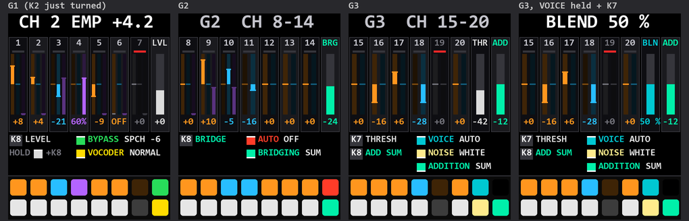

# Mewcoder: how the vocoder was built

The design notes behind **Mewcoder**, the SMK-37 Elite vocoder build: what it models and from which documents, how it
was fitted into the CPU and memory, how it was tested, and what changed since. To use it, read the manual,
[VOCODER.md](VOCODER.md); for the build itself, [Mewcoder's page](.github/README.md).

`sloop-smk37-elite-vocoder.fwsc` (built with `SMK_UAC_IN_PROBE=1 SMK_VOC_LEAN=1`) makes track 3 an audio track. The
voice comes in over USB audio and is played dry (AUDIO) or through a 20-channel channel vocoder (VOCODER) whose carrier
is played from the keys. Everything else in SLOOP stays. How to use it: **[VOCODER.md](VOCODER.md)**, the manual, with
the page's screens, the pads and the menus.

## Sources and modelling

The model is the **Sennheiser VSM201** (1977), the studio channel vocoder. The design follows its documents. They are
not included here (vendor material); the values taken from them are listed in the code's comments:
- **The operating instructions:** the technical section, the technical data, Illustration 8 (the filter responses)
  and Illustration 9 (the signals).
- **The schematics:**
  - B11 / B12: the channel emphasis and the NORMAL weights;
  - B13 / B14: the speech addition;
  - B15: the silence bridging;
  - the panel's controls and their ranges.

Where the documents give no figure, the code says so; nothing is guessed. What is modelled:

| VSM201 | Here | Code |
|---|---|---|
| 20 analysis + 20 synthesis channels, 100 Hz – 8 kHz | 20 band-pass channels at the VSM201's centres, read from Illustration 8 (145 … 6780 Hz, about ±5 %): half an octave apart at the bottom, closing to about a quarter octave from channel 6 up; steep-sided, neighbours crossing near the top | `smk_vocoder.h`, `smk_vocoder_tab.h` |
| Analysis: AGC amplifier → band-pass → full-wave rectifier → low-pass (20–50 Hz) | the same chain per channel; AUTOCONTROL (the input AGC switch) | `voc_analyse` |
| Synthesis: replacement × envelope → band-pass → mixer | the same; the channels' gains set per block (emphasis and mutes folded into the first filter section: no cost a sample) | `voc_process`, `voc_chan_block` |
| Voiced / unvoiced comparator: channel 0 (a low-pass under 1 kHz) against channel 19 (over 5 kHz) | the same comparator (twice to turn voiced, 1.4 × to stay); VOICE AUTO / VOICED / UNVOICED | `voc_analyse` |
| Unvoiced replacement: white noise level-matched to the voiced replacement (rectifier + modulator), switchable pink filter | the noise follows the carrier's rectified level; WHITE, PINK (Kellet's filter), and SOFT (new: a saw's −6 dB an octave) | `voc_process` |
| Internal carrier AGC ("prevents overmodulation"), no control | always on, ~5 ms down / ~150 ms up; SILENCE > AGC sets its ceiling | `voc_process` |
| NORMAL preset: fixed resistors 2.94 k (ch 1) … 10.0 k (ch 20) into a 9.53 k feedback | NORMAL's weights from those resistors: channel 20 10.6 dB under channel 1 | `VOC_B0`, `VOC_B0S` |
| VARIABLE CHANNEL EMPHASIS: 20 log pots into a 39.2 k bus, centre = NORMAL | per channel OFF … +12 dB, the pot's square law, the middle exactly NORMAL (bit for bit) | `voc_emph_q12` |
| SPEECH ADDITION / MULTIFILTER: 20 individual + SUM, a −7.5 dB preset tilt | ADDITION OFF / SUM / INDIVIDUAL with the per-channel and SUM levels | `voc_analyse` |
| BYPASS: speech or replacement straight to the output | BYPASS OFF / REPLACEMENT / SPEECH, with its level | `voc_process` |
| SILENCE BRIDGING: speech / pause detector (THRESHOLD), a log amplifier, 10 pair controls (P1–P10) + SUM into the analysis low-passes; bridging makes the voiced / unvoiced switch soft | BRIDGE, THRESHOLD, BRIDGING SUM / INDIVIDUAL with the 10 pairs; the noise added, not switched, while bridging | `voc_analyse`, `voc_process` |
| The channel activity LEDs (−20 dB) | the mute pads' brightness: each channel's level after its emphasis, eight steps, peak hold | `ui_vpage.c vp_meter` |

**Beyond the VSM201** (the owner's additions):
- **BRIDGE TONE:** the bridge's TILT, COLOUR (the voice's shape held in a pause) and BLEND (SUM / FILL).
- **RESPONSE FLAT:** the bands summed evenly.
- **NOISE SOFT** and **NOISE BLEND:** the noise's share on unvoiced sounds.
- **AUTOCONTROL's response:** it cuts at once, rises over about 1.5 s and only in clear speech, by at most +9 dB.
- **The carrier:** a built-in saw, the VSM201's standard test-and-play source. It is a fixed, named patch (VOCODER):
  track 3 takes no engine, preset or Program Change while AUDIO IN is on.

The vocoder runs at **22.05 kHz** (the VSM201's range ends at 8 kHz; 44.1 kHz would double its cost).

## CPU: what was done, and measured

The SMK-37 has two cores at the FM-1's clock. The vocoder had to fit beside three synth tracks, the drums, the effects,
the punch-ins and six USB stems without dropping audio. The measure is the **sheds** a second: half-buffers that missed
their time and were filled with the last good audio. They are counted by the firmware and read on the console
(`timing`) with the sequence playing at 161 BPM. The work went build by build, each one flashed and measured on the
unit, nothing changing the sound:

| Change | What it does |
|---|---|
| The analysis on core 0, the synthesis on core 1 with track 3 | the vocoder's ~0.9 ms a half split over both cores |
| FX buses skipped when idle | chorus, delay and reverb run only with something in them or a tail to finish |
| The stems' punch-in timeline skipped when idle | the crossfade not computed with no punch-in playing (0.28 → 0.13 ms a half) |
| The synthesis loop chosen a block | the plain loop while voicing; the bridge only in a pause; the ramps only while a control moves |
| Channel emphasis and mutes per block | folded into the first filter section's gains: nothing added a sample, the defaults bit for bit |
| The output tail's code in RAM (`.ram_hot`, 10.7 KB) | the mix tail's whole call tree out of the shared flash cache, copied at boot. The build checks that every call in `.ram_hot` stays inside it (no cold calls) |
| The hot code placed together in flash | the linker places the audio path's functions in one run, so a change elsewhere does not move them across cache lines |
| FM6 and PHASE's loops reworked, a RAM sine | the two heaviest engines' inner loops shorter (tested against the old loops over 400,000 blocks) |
| Track 3's FILTER skipped while vocoding | its fader and FX K4 drive the carrier's CUTOFF instead (~85 µs a half saved) |
| Per-section timing on the console | `timing`: each stage, each track's engine, the analysis, the mix |

**Result:** from **6.0 sheds a second** (build 1f88f41) to **about one** (f89a85e: 0.99; later builds 1.1–1.25 with
more features) with the full sequence playing. The vocoder page itself costs nothing measurable.

## RAM and flash

- **Flash:** the vocoder build drops every built-in sample set (PERC / GM kit, piano, bass, vibes, flute, horns,
  strings, scratch: 283 KB) and the TRIO, DIGITAL, VOICE, NOISE and LOFI engines (~10 KB). In all, about 295 KB for the
  vocoder and what comes next.
  - It keeps the four tracks, the sequencer, ANALOG, PHASE, WHEEL, FM6, PHYS, SAMPLE and GRAIN on your samples, SLICE
    and the synth drums.
  - A removed engine keeps its number and loads as ANALOG, so older projects open.
- **RAM:**
  - the delay line is stored at 22 kHz (the same 1.49 s, 64 KB back);
  - the reverb's lines moved to the pool, freeing room for the RAM code;
  - CI refuses a build with less than 8 KB of pool headroom.
- **Settings:** the vocoder's settings and page live in a flash object of their own (472 bytes, `OBJ_VOCSET`). They
  are saved with each project slot, and older saves load with the defaults. The standard builds and the project
  format are untouched.

## Testing

- **Host tests** (`tests/smk_vocoder_test.c`, run in CI):
  - the bands' responses and the voiced / unvoiced detector on noise and vowels;
  - the noise level-matched to the carrier (no carrier, no noise), and silence bridging;
  - NORMAL's tilt; EMPHASIS at the middle bit for bit equal to NORMAL, and at the top +12.04 dB;
  - every channel muted silent; BYPASS REPLACEMENT; AUTOCONTROL;
  - NOISE SOFT (less above 4 kHz than WHITE) and NOISE BLEND (0 % equal to VOICED).
- **Other host tests:** `tests/fm6_loops_test.c` (the new engine loops against the old, 400,000 random blocks).
- **CI on every build:**
  - the FM-1 build is checked **byte-identical** to upstream;
  - every model's image is checked (size, sections, no calls out of `.ram_hot`, RAM and pool headroom);
  - all host and web tests run against the upstream baseline;
  - the editor's tests cover the backup objects and its tabs.
- **On the unit:** each build flashed, played and measured (sheds, `timing`) before the next.

## Fixes and additions, 2026-11-04 to 11-06

Each was measured on the unit before it was built (the console on the CDC port, the stems recorded on the computer and
compared by syllabic modulation, brightness and harmonic sharpness):
- **The audio in, polled at 5 kHz** while the stems run: about 0.9 % of its packets were lost before (crackles that
  grew); none since.
- **STEM RATE 16 BIT** (48 / 16, 44.1 / 16): fits a single-TT hub's budget with the audio in. Tested clean through
  the hub at 44.1 / 16.
- **The carrier's own envelope:** full while a key or step is held, at its velocity, whatever track 3's envelope.
- **Track 3 always POLY** in the sequencer and step entry (`TRK_VOICE`, 3353be8): a recorded chord was kept as a mono
  line when the stored VOICE was not POLY, so one note of each chord played back. The cause of the thin sequenced sound
  and of the change heard when the sequence took over from the keys.
- **SILENCE > MOD WHEEL** (ae4a5e1): VIBRATO, BRIDGE TILT or NOISE BLEND while track 3 is selected.
- **AUTOCONTROL:** its rise restored (+18 dB, speech only), its instant cut kept; BYPASS's forced −12 dB removed.
- CPU with all of these: ~1.1 sheds a second with the sequence and the voice, as before.

## Next: the harmoniser

In development, for Mewcoder: the live voice pitch-shifted into up to three harmony voices that keep its own sound,
modelled on the **Eventide H949** Harmonizer (its 400 ms memory, the MAIN and DELAY ONLY outputs, the feedback with
LOW / HIGH EQ, REVERSE and REPEAT, the PITCH RATIO readout, the front panel's switch rows on the pads), in the
sketchbook as a track role (HARMONY on T1 or T2). It is being specified and measured on the unit before it is
built; it will be documented here and in its own manual when it lands.
