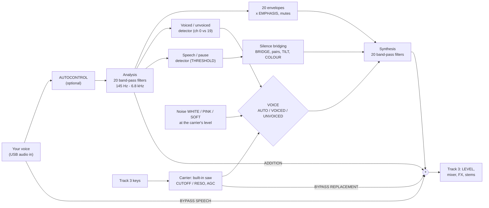
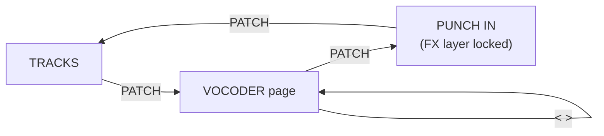

# The vocoder: user manual (SMK-37 Elite, vocoder build)

The vocoder build (`sloop-smk37-elite-vocoder.fwsc`) turns track 3 into an audio track. Your voice comes in over USB
audio from the computer. Track 3 either plays it as it is (AUDIO) or vocodes it (VOCODER): a 20-channel vocoder modelled
on the Sennheiser VSM201, played from the keys. Everything else in SLOOP stays: four tracks, the sequencer, the
punch-ins, the stems. How it is built and tested: [SMK37.md, The vocoder build](SMK37.md#the-vocoder-build).

## 1. Getting sound in

1. Connect the SMK-37 to the computer with a USB data cable. It shows up as an audio device with an input and an
   output.
2. In your computer's sound settings (or your DAW), send your microphone to the SMK-37's audio **output**: mono or
   stereo, 48 kHz.
3. On the keyboard: **HOME menu** (PATCH held) **> USB > AUDIO IN: ON**. Track 3 is now the audio track: its own
   engine, presets and Program Change are set aside (they come back with AUDIO IN OFF). TEST plays a test tone in
   place of the computer's audio.
4. **HOME menu > VOCODER > MODE**: **AUDIO** plays your voice dry on track 3; **VOCODER** vocodes it.
5. Select track 3 and play the keys. In VOCODER mode the keys play the **carrier**, a built-in saw (the VSM201's
   classic replacement source). Your voice shapes it.

Track 3's carrier is a fixed, named patch, **VOCODER**: you cannot load another engine, preset or picker sound onto
track 3 while AUDIO IN is on. Its filter is the carrier's own (below). The web editor shows track 3 as **VOCODER** and
locks its engine and presets.

### How the sound flows

## 2. The menus (HOME menu, PATCH held)

| Section | Item | Values (default first, where there is one) | What it does |
|---|---|---|---|
| USB | AUDIO IN | OFF, ON, TEST | the computer's audio onto track 3 |
| VOCODER | MODE | AUDIO, VOCODER | the voice dry, or vocoded |
| | LEVEL | 0 dB (−12 .. +18 dB, 3 dB steps) | the vocoder's make-up gain |
| | DRY | OFF, −18, −12, −6, 0 dB | the BYPASS level (see the page) |
| | HF | −12 dB (OFF .. 0 dB) | the speech addition's SUM level |
| CARRIER | CUTOFF, RESO | 127, 0 | the carrier saws' low-pass (also on FADER BANK B's track 3 fader and FX K4) |
| | VOICE | AUTO, VOICED, UNVOICED | the VSM201's voice mode: unvoiced sounds (s, f, t) replaced by noise in AUTO |
| | NOISE | WHITE, PINK, SOFT | the unvoiced replacement's colour (SOFT: a saw's −6 dB an octave, the gentlest) |
| SILENCE | BRIDGE | OFF (−48 .. 0 dB) | silence bridging: the carrier plays on through pauses in your voice |
| | THRESHOLD | −42 dB (−54 .. −24) | where the speech / pause detector draws the line |
| | AGC | OFF, PEAKS, LIGHT, FULL | the carrier's own level control (keeps big chords from overloading) |
| BRIDGE TONE | TILT | +1.0 dB/oct (−3 .. +3) | the bridged sound's tilt |
| | COLOUR | 100 % | how much of your voice's last shape stays on the bridge in a pause |
| | BLEND | SUM, FILL | the bridge added to the vocoder, or filling in under it |
| | RESPONSE | FLAT, NORMAL, EMPHASIS | the synthesis weights: flat; the VSM201's NORMAL tilt; NORMAL with the page's per-channel EMPHASIS |

Everything here is also on the vocoder page or the web editor's **Vocoder** tab.

## 3. The vocoder page

**Opening it:** on the tracks screen tap **PATCH**. PATCH steps through the pages: **TRACKS → VOCODER → PUNCH IN → TRACKS**.
The page stays open until you tap PATCH again or open something else.

*The page drawn from the firmware's own layout (ui_vpage.c's coordinates and colours), with the pads' lights below
each screen. Left to right: G1 just after K2 was turned (the header shows the value); G2; G3; G3 with the VOICE pad
held and K7 turned (K7's column becomes NOISE BLEND). In the channels' columns: orange EMPHASIS, blue ADDITION, purple
BRIDGING; channels 7 and 19 muted (red light, dark pad).*

**Groups:** the 20 channels are in three groups. **<** and **>** (or SELECT) step through them; the header names the
group (**G1 CH 1-7**, **G2 CH 8-14**, **G3 CH 15-20**). While you turn something, the header shows its name and value.

### 3.1 The screen

Each knob has a column, 30 pixels wide:
- **A channel's column** shows the channel number, a **red mute light**, a narrow fader and its value. The fader fills
  from the middle for EMPHASIS and ADDITION (the middle is the basic setting) and from the bottom for BRIDGING. Its
  colour is the function the channel's knob is on. Columns are framed and shaded in alternate clusters, so you can
  find a channel at a glance.
- **The master columns** (G1 K8, G2 K8, G3 K7 and K8) show a larger bar and value. While you turn one, its outline goes
  **green** on the default value, and the place you started from is ticked in **amber** and flashes amber when you
  come back to it.
- **The strip at the bottom** lists the knobs on the left (K and the name) and the pads on the right: a swatch in the
  option's colour, with a white mark on the side the pad is on (top or bottom row), the pad's name and its setting,
  in its colour.

### 3.2 The knobs

| Group | K1 .. K7 (G3: K1 .. K6) | K7 (G3) | K8 |
|---|---|---|---|
| G1 | channels 1–7 | | **LEVEL**; with the BYPASS pad held: the **BYPASS level** |
| G2 | channels 8–14 | | **BRIDGE** (the silence bridging level) |
| G3 | channels 15–20 | **THRESHOLD**; with the VOICE pad held: **NOISE BLEND** | **ADD SUM** (the speech addition's SUM) |

A channel knob sets the channel's value for the function it is on:
- **EMPHASIS** (the default): the channel's level in the vocoder, from OFF through the basic setting (the middle) to
  +12 dB. It acts with RESPONSE on EMPHASIS.
- **ADDITION**: how much of your voice in that band is added back (speech addition; with ADDITION on INDIVIDUAL).
- **BRIDGING**: channels 1–10 only. Channel *n*'s knob sets bridging pair *n* (channels 2*n*−1 and 2*n*, as the
  VSM201's P1..P10); the label reads **BRIDGE 1/2**, **BRIDGE 3/4** and so on. It acts with BRIDGING on INDIVIDUAL.

**The middle holds:** EMPHASIS and ADDITION stop at the middle (the basic setting) for three detents, and the channel's
outline turns light green for a second, so you can find the basic setting by feel.

### 3.3 The pads

The pads are laid out under the knobs: the top pad of a column is that knob's function or selector, the bottom pad its
mute or second selector.

**A channel's pads:**
- **Top: its function.** Tap: EMPHASIS → ADDITION → BRIDGING (channels 1–10) → EMPHASIS. Its colour is the function's.
  **Hold** (0.6 s): the channel back to its basic setting (EMPHASIS and ADDITION to the middle, its bridging pair to 0).
  The mute stays as it is.
- **Bottom: its mute.** Tap: muted / on. While the channel plays, the pad's **brightness is its level**: eight steps,
  after the channel's emphasis, with a short peak hold. A muted channel's pad is dark and its light on the screen red.

**The selector pads** (on the last columns). Each has a colour per option. OFF has a colour too (the pad's own), so
you always know which pad is which:

| Group | Pad | Tap | Hold |
|---|---|---|---|
| G1, column 8, top | **BYPASS**: OFF (magenta), REPLACEMENT (ice blue), SPEECH (green) | the next option, on release. Choosing REPLACEMENT or SPEECH with the level at OFF sets it to −12 dB, so you hear it | hold + **K8**: the BYPASS level (the K8 column shows it, with the green / amber marks) |
| G1, column 8, bottom | **VOCODER**: OFF (orange), FLAT (cyan), NORMAL (yellow), EMPHASIS (red-pink) | the next option, on release. OFF plays the voice dry | **all channels back to basic and unmuted** |
| G2, column 8, top | **AUTOCONTROL**: OFF (red), ON (green) | on / off | |
| G2, column 8, bottom | **BRIDGING**: OFF (purple), SUM (aqua), INDIVIDUAL (yellow) | the next option | |
| G3, column 7, top | **VOICE**: AUTO (teal), VOICED (yellow), UNVOICED (periwinkle) | the next option, on release | hold + **K7**: **NOISE BLEND** |
| G3, column 7, bottom | **NOISE**: WHITE (cream), PINK (pink), SOFT (orange) | the next option | |
| G3, column 8, bottom | **ADDITION**: OFF (blue), SUM (aqua), INDIVIDUAL (yellow) | the next option | |

What they do:
- **BYPASS:** REPLACEMENT adds the carrier itself (more carrier); SPEECH adds your voice dry (more voice), at the
  BYPASS level.
- **VOCODER:** FLAT sums the bands evenly; NORMAL uses the VSM201's fixed tilt (the top channels softer); EMPHASIS is
  NORMAL plus each channel's EMPHASIS knob. OFF takes the vocoder out (your voice dry).
- **AUTOCONTROL:** keeps your voice's level steady going into the analysis. Above its target it turns down at once; it
  turns up only slowly (about 1.5 s), only while you are clearly speaking, and by at most 9 dB. A pause leaves it
  where it is.
- **BRIDGING:** SUM uses the one BRIDGE level (G2 K8); INDIVIDUAL also uses each pair's BRIDGING knob.
- **VOICE:** AUTO detects voiced (vowels) and unvoiced (s, f, sh) sounds and replaces the unvoiced ones with noise;
  VOICED only uses the carrier; UNVOICED uses only noise.
- **NOISE BLEND** (AUTO only): how much noise replaces the carrier on unvoiced sounds, 0–100 % (100 %, the default, is
  full replacement as on the VSM201; lower keeps more of the saw in the consonants).
- **NOISE:** WHITE is the classic, brightest hiss; PINK is softer; SOFT falls off like a saw (−6 dB an octave), the
  gentlest. The noise follows the carrier's level, so it is never louder than what you play.
- **ADDITION:** adds your voice back in each band for intelligibility. SUM uses ADD SUM (G3 K8); INDIVIDUAL uses each
  channel's ADDITION knob as well.

### 3.4 Starting points

- **Classic robot:** VOCODER NORMAL, VOICE AUTO, NOISE WHITE, BYPASS OFF, everything else basic. Play chords on track 3.
- **More words:** ADDITION SUM, ADD SUM around −12 dB; or BYPASS SPEECH at −18 dB.
- **Softer consonants:** NOISE SOFT, or NOISE BLEND around 50 %.
- **Pads that keep going:** BRIDGING SUM, BRIDGE around −15 dB; COLOUR 100 %.
- **Shape the sound:** VOCODER EMPHASIS, then turn channels up or down; mute channels for a filtered, telephone-like
  voice. Hold the VOCODER pad to start again.

## 4. The carrier's filter

While track 3 is vocoding, its track FILTER is off and the controls you would use for it set the **carrier's cutoff**
instead:
- **FADER BANK B** (the filter faders): track 3's fader is **CUTOFF**; the screen labels it so. The faders have a dead
  zone at the centre.
- **FX layer, K4:** CUTOFF.
- **HOME menu > CARRIER > CUTOFF / RESO.**

## 5. Saving

- The vocoder's settings and the page (every channel's values and mutes, the selectors, NOISE BLEND) are kept over a
  power-off, and **with each project slot**: saving a project saves them with it, and loading it brings them back. A
  project saved before this build loads with the vocoder as it is.
- **AUDIO IN** is the unit's setting, never a project's.
- A **full backup** from the web editor includes them (backup object 14), with the SMK-37's settings (12) and the DAW
  map (13).

## 6. The web editor

Connect the editor matching the firmware (`sloop-editor-…-smk37-<build>.html`, from the same build). On the vocoder
build it shows:
- **Track 3 as VOCODER**: the engine, the presets and INIT locked, with a note.
- **The Vocoder tab:** the menus' settings, the page's selectors and NOISE BLEND, and a table of the 20 channels
  (function, EMPHASIS, ADDITION, BRIDGING, mute). A name in colour has changed from its default. **Send to the
  keyboard** applies and saves at once (stop the song first); **Read** loads what the keyboard has now; **Defaults**
  sets every value back (send it to keep it).
- **The SMK-37 tab:** the HOME menu's SMK-37 settings.

The editor reads these tabs once per connection and again after a restore. Press **Read** after you change something
on the keyboard.

## 7. Troubleshooting

| Symptom | Check |
|---|---|
| No voice at all | AUDIO IN ON; the computer's output set to the SMK-37; MODE; the track 3 fader and mute |
| Voice dry, no robot | MODE VOCODER; the VOCODER pad not OFF; play keys on track 3 |
| Rough or peaky | VOICE on VOICED makes every sound the saw: try AUTO; lower LEVEL; AGC LIGHT for big chords |
| Harsh consonants | NOISE PINK or SOFT; NOISE BLEND lower |
| Pumping or pops | AUTOCONTROL OFF, or leave it on: it no longer boosts in pauses |
| Sound goes on in pauses | BRIDGING OFF, or BRIDGE lower |
