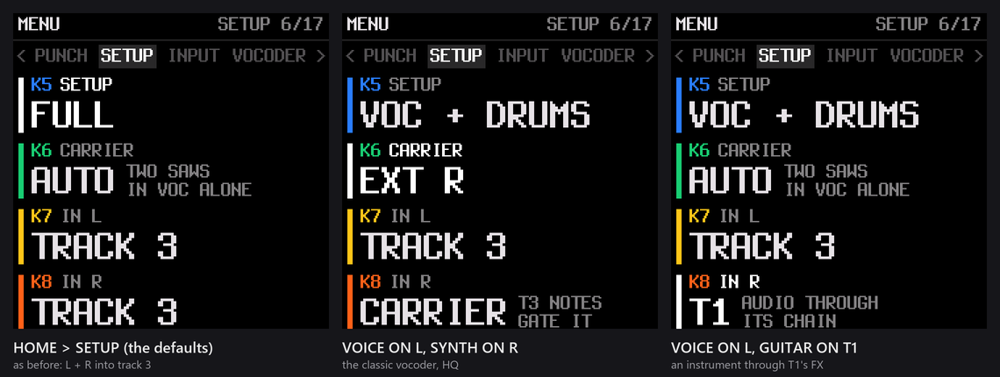
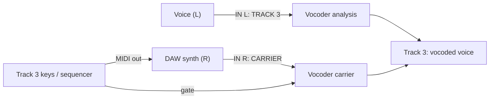
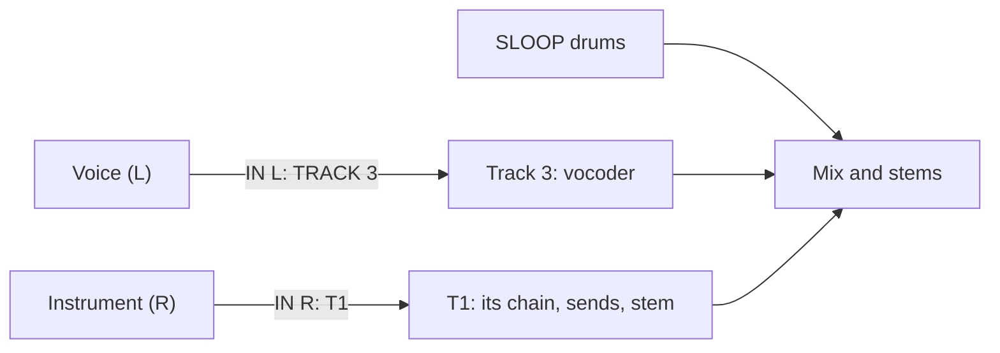
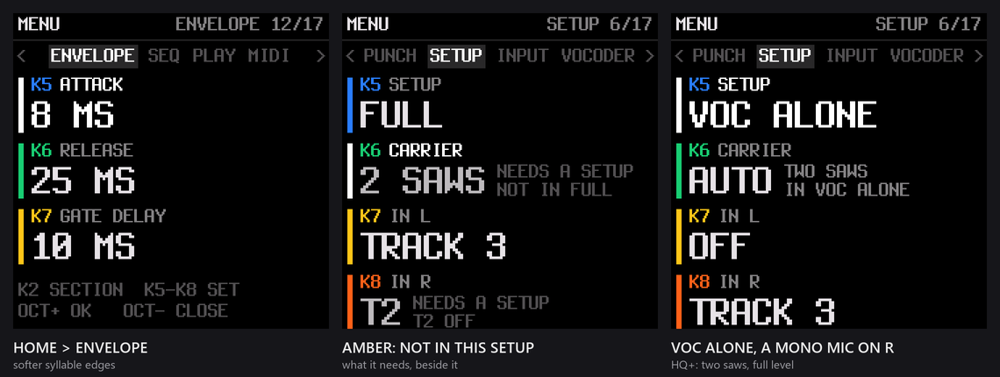
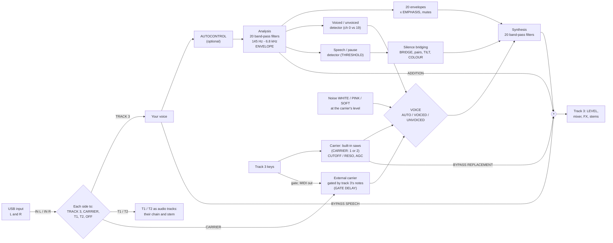
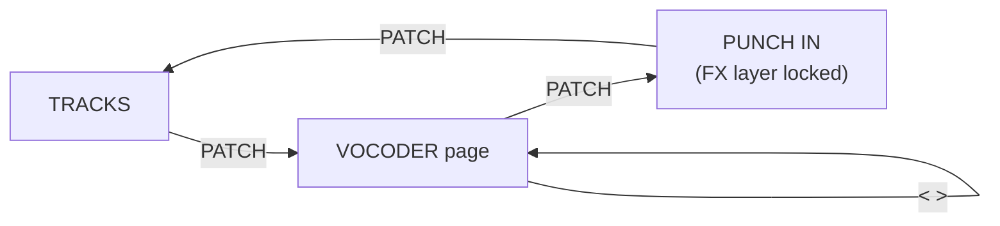
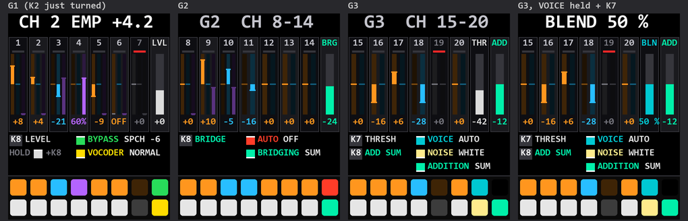

# The vocoder: user manual (Mewcoder, SMK-37 Elite)

**Mewcoder**, the vocoder build (`sloop-smk37-elite-vocoder.fwsc`), turns track 3 into an audio track. Your voice comes in over USB
audio from the computer. Track 3 either plays it as it is (AUDIO) or vocodes it (VOCODER): a 20-channel vocoder modelled
on the Sennheiser VSM201, played from the keys. **The input's two sides can be routed apart** (section 2): your voice on
one, and on the other an external synth as the carrier, or an instrument through T1's or T2's effects. Everything else
in SLOOP stays: the four tracks, the sequencer, the punch-ins, the multichannel USB audio (below). Install and editor: [Mewcoder's page](.github/README.md). How it was built and tested: [VOCODER-DESIGN.md](VOCODER-DESIGN.md).

## At a glance

| | |
|---|---|
| **Base** | SLOOP 2.8.4, with all the Multichannel USB audio build adds: punch-in effects on every channel, the punch-in page on the pads, sequencer effects (FLIP, LOOP BACK, RAMP), DAW mode |
| **Keyboard** | SMK-37 Elite only |
| **Tracks** | T1 and T2 (synths); **T3** the audio track (USB > AUDIO IN: ON: the input dry or vocoded) or a synth (AUDIO IN: OFF); the drums |
| **Configurations** | HOME > SETUP: **FULL** (every track), **VOC + DRUMS** (T1, T2 off), **VOC + SYNTH** (the drums off), **VOC ALONE** (T1, T2 and the drums off). Section 2.1 |
| **USB audio in** (from the computer) | 2 channels, 48 kHz, each side routed on its own (HOME > SETUP > IN L, IN R): **TRACK 3** (the voice), **CARRIER** (an external synth), **T1** or **T2** (an instrument through that track), **OFF**. Section 2.2 |
| **USB audio out** (to the computer) | HOME > USB > USB LAYOUT: **STEREO** (the mix), or 6 channels, 24 bit, 48 or 44.1 kHz: **SYNTHS+RET** (T1, T2, T3, the drums, the effects return L and R), **DRUMS+RET** (kick, snare, hats, percussion, the return L and R), **ALL DRY** (T1, T2, T3, kick, snare, hats and percussion) |
| **The vocoder** | 20 channels at the Sennheiser VSM201's centres, 145 Hz to 6.78 kHz, each a 4th-order band-pass. The voice analysed at 22.05 kHz; the output at 22.05 kHz in FULL, **44.1 kHz (HQ)** in the other SETUPs |
| **The carrier** | HOME > SETUP > CARRIER: the built-in saw, one or two a note (**AUTO**, **1 SAW**, **2 SAWS**), played from the keys, the sequencer or MIDI on track 3's channel; or **EXT L** / **EXT R**: an external synth on that input, gated by track 3's notes. Section 2.4 |
| **Shaping** | ENVELOPE (ATTACK 3-30 ms, RELEASE 8-100 ms, GATE DELAY); voiced / unvoiced detection with a noise source (WHITE, PINK, SOFT); the speech addition (HF); silence bridging and BRIDGE TONE; AUTOCONTROL (the input's level); the carrier's AGC; RESPONSE (FLAT, the VSM201's NORMAL, EMPHASIS); per channel on the vocoder page: EMPHASIS, ADDITION, BRIDGING, mute |
| **Left out to make room** | the built-in samples (your own samples work); the TEXTURE, DIGITAL, LOFI, VOICE, TRIO and NOISE engines; the delay runs at 22.05 kHz. For those: the Multichannel USB audio build |

## 1. Getting sound in

1. Connect the SMK-37 to the computer with a USB data cable. It shows up as an audio device with an input and an
   output.
2. In your computer's sound settings (or your DAW), send your microphone to the SMK-37's audio **output**: mono or
   stereo, 48 kHz. Keep your voice's peaks around −10 dBFS: hotter makes the vocoder harsh.
3. On the keyboard: **HOME menu** (PATCH held) **> USB > AUDIO IN: ON**. Track 3 is now the audio track: its own
   engine, presets and Program Change are set aside (they come back with AUDIO IN OFF). TEST plays a test tone in
   place of the computer's audio.
4. **HOME menu > VOCODER > MODE**: **AUDIO** plays your voice dry on track 3; **VOCODER** vocodes it.
5. Select track 3 and play the keys. In VOCODER mode the keys play the **carrier**, a built-in saw (the VSM201's
   classic replacement source). Your voice shapes it.
6. A mono microphone on one side only: **HOME > SETUP > IN L** or **IN R: OFF** for the empty side (full level). For
   more, read section 2.

Track 3's carrier is a fixed, named patch, **VOCODER**: you cannot load another engine, preset or picker sound onto
track 3 while AUDIO IN is on. Its filter is the carrier's own (below). The web editor shows track 3 as **VOCODER** and
locks its engine and presets.

**How the carrier plays.**
- **Its own envelope.** Each carrier note sounds at full level for as long as its key or sequencer step is held (about
  1.5 ms to open, 12 ms to close), at the note's velocity. Track 3's own envelope and level settings do not shape it,
  so a played note and a sequenced one sound the same.
- **Always POLY.** While AUDIO IN is on, track 3 plays, records and steps in its chords as POLY, whatever its stored
  VOICE setting. A chord recorded into the sequencer, played or made by CHORD mode, plays back with all its notes.
  Patterns recorded before build 3353be8 may hold one note of each chord: record them again.
- **Chords are the vocoder.** One note gives the vocoder one saw's harmonics to shape; a chord of three or four gives
  it about three times the level and the classic sound. The whisper sounds (s, t, f) come from the noise source and
  stay the same whatever is played.

## 2. SETUP and the two inputs

The USB input is stereo, but each side can be a **source of its own**. Most microphones and instruments are mono, so
one cable from the computer can carry two different things: your voice on one side and a synth, a guitar or a drum
machine on the other. **HOME > SETUP** decides where each side goes and which of SLOOP's tracks run beside the
vocoder. Everything starts as before: both sides into track 3, every track running.

| Row | Values (default first) | What it does |
|---|---|---|
| **SETUP** | FULL, VOC + DRUMS, VOC + SYNTH, VOC ALONE | which tracks run beside the vocoder, and its quality |
| **CARRIER** | AUTO, 1 SAW, 2 SAWS, EXT L, EXT R | what the vocoder plays through: the built-in saws, or one of the inputs |
| **IN L** | TRACK 3, CARRIER, T1, T2, OFF | where the input's left side goes |
| **IN R** | TRACK 3, CARRIER, T1, T2, OFF | where the right side goes |

### 2.1 SETUP: which tracks run

| SETUP | T1, T2 | Drums | The vocoder |
|---|---|---|---|
| **FULL** (default) | play | play | **22.05 kHz**, as before |
| **VOC + DRUMS** | off | play | **HQ: 44.1 kHz** |
| **VOC + SYNTH** | play | off | **HQ: 44.1 kHz** |
| **VOC ALONE** | off | off | **HQ: 44.1 kHz**, two saws on the built-in carrier (CARRIER AUTO) |

- **HQ** runs the vocoder's 20 output filters at the full 44.1 kHz: crisper consonants and more air on the noise and the
  speech addition. The time comes from the tracks the SETUP turns off. Measured on the unit with a busy sequence:
  every SETUP plays without overload, VOC + DRUMS and VOC ALONE with room to spare.
- **A track turned off** takes no new notes at once, lets its notes release, and stops about 0.4 s later. Its
  patterns, sounds and settings are all kept, and it plays again as soon as you go back to a SETUP that has it. The
  sequencer keeps running; the metronome still clicks with the drums off.
- **The point of the setups:** when the input already carries drums or synths from your DAW or a groovebox, you do not
  need SLOOP's own, and the vocoder gets their time.

### 2.2 IN L and IN R: where each side goes

| Destination | What the side does there |
|---|---|
| **TRACK 3** | the audio track: your voice, dry (VOCODER > MODE AUDIO) or into the vocoder (MODE VOCODER). Both sides on TRACK 3: L and R averaged, exactly as before |
| **CARRIER** | replaces the built-in saw: the vocoder plays **this** sound, shaped by your voice. Your keys gate it (2.4) |
| **T1, T2** | the track plays the side **as audio**, through its own chain: DIST, INSERT, SLICER, FILTER, LEVEL, PAN, the sends, STEM FX and its own USB stem. Only for a track the SETUP has turned off (T1 and T2 in VOC + DRUMS and VOC ALONE); otherwise the value shows in amber with **NEEDS A SETUP** |
| **OFF** | not used |

**A mono microphone:** set the side without it to **OFF** (or to another use). With both on TRACK 3, an empty side
halves your voice's level; on its own it comes in at full level.

### 2.3 What the split makes possible

Each recipe lists only what differs from the defaults. Send the sources to the SMK-37's left and right outputs in your
DAW (two mono sends, hard left and hard right, or a stereo pair).

**Voice only, at full level** (a mono mic on L): **IN R: OFF**.

**The classic studio vocoder: your voice + your synth** (voice on L, a synth from the DAW on R). **CARRIER: EXT R**
(this sets IN R to CARRIER). Play track 3's keys: the notes go out as MIDI to the synth (2.4) and open the vocoder.
Best in **VOC + DRUMS** or **VOC ALONE** (HQ).

**An instrument through SLOOP's effects, beside the vocoder** (voice on L, a guitar or a synth line on R).
**SETUP: VOC + DRUMS**, **IN R: T1**. T1 plays the instrument through its own filter, drive, INSERT, delay and reverb
sends and STEM FX, onto its own stem. The vocoder keeps HQ.

**A vocoded drum machine or synth** (a drum machine on L, your synth on R): **IN L: TRACK 3**, **CARRIER: EXT R**. The
drum machine's rhythm shapes the synth: rhythmic, gated chords. Use VOICE VOICED for a cleaner pulse.

**External drums, SLOOP's synths** (voice on L, your drum machine playing in the DAW): **SETUP: VOC + SYNTH**,
**IN R: OFF**. SLOOP's drums step aside for yours, T1 and T2 keep playing, and the vocoder runs in HQ. (T1 and T2
cannot take an input in VOC + SYNTH: they are playing.)

**Two instruments through SLOOP** (no vocoder): **SETUP: VOC ALONE**, **IN L: T1**, **IN R: T2**, **VOCODER > MODE
AUDIO** (track 3 silent with nothing routed to it). Two external sources, each with its own chain and stem.

### 2.4 CARRIER: the saws or an external synth

| CARRIER | The carrier |
|---|---|
| **AUTO** (default) | one saw a note; two (slightly detuned, fuller) in VOC ALONE |
| **1 SAW** | always one |
| **2 SAWS** | two a note, in every SETUP but FULL (there it shows amber, **NEEDS A SETUP**, and plays one: two do not fit beside every track). In VOC + SYNTH the guide says **CPU TIGHT**: it fits, at about FULL's load |
| **EXT L**, **EXT R** | that side of the input is the carrier: choosing it sets that side to CARRIER (and takes the other side off CARRIER). Choosing a saw again sets the CARRIER side to OFF, so the synth never leaks into your voice |

The row always tells the truth: setting IN L or IN R to CARRIER by hand shows EXT L or EXT R here.

**Playing an external carrier:**
1. In the DAW, set the synth to receive MIDI from the SMK-37 on **track 3's MIDI channel**: **GLO → MIDI → CH3**
   (3 unless you changed it). The keys always send; for the sequencer's notes too, set **GLO → MIDI 2 → OUT: SEQ**.
   USB MIDI and the TRS MIDI OUT both carry them.
2. Send the synth's audio back to the SMK-37 on the carrier side, and your voice on the other.
3. Play track 3: the synth plays your notes, and the vocoder **opens while any track 3 note is held** (about 1.5 ms to
   open, about 12 ms to close, as the built-in saw). Chords work: every note goes out, the gate is open while any is held.
4. The synth's sound comes back through the DAW a few milliseconds late, so the end of each note could be cut. Raise
   **ENVELOPE > GATE DELAY** (0–50 ms) until the release is whole.

### 2.5 ENVELOPE: how fast the vocoder follows your voice

| Row | Values (default first) | What it does |
|---|---|---|
| **ATTACK** | 3, 5, 8, 12, 20, 30 ms | how fast each of the 20 bands opens when a sound starts |
| **RELEASE** | 8, 15, 25, 40, 60, 100 ms | how fast it closes |
| **GATE DELAY** | 0 .. 50 ms (5 ms steps) | an external carrier's gate held open after the last note (2.4) |

The defaults are the VSM201's fast, articulate response. If syllable edges sound sharp or harsh, slow them down:

| Feel | ATTACK | RELEASE |
|---|---|---|
| Crisp (default) | 3 ms | 8 ms |
| Soft | 8 ms | 25 ms |
| Smooth, pad-like | 12–20 ms | 40–60 ms |

Only the bands' envelopes change: the voiced / unvoiced and speech / pause detectors keep their speed, so consonants and
pauses are still caught in time. Harshness can also come from the input: keep your voice's peaks around −10 dBFS and
make up the level with VOCODER > LEVEL.

### How the sound flows

## 3. The menus (HOME menu, PATCH held)

| Section | Item | Values (default first, where there is one) | What it does |
|---|---|---|---|
| USB | AUDIO IN | OFF, ON, TEST | the computer's audio onto track 3 |
| SETUP | SETUP | FULL, VOC + DRUMS, VOC + SYNTH, VOC ALONE | which tracks run, and HQ (section 2.1) |
| | CARRIER | AUTO, 1 SAW, 2 SAWS, EXT L, EXT R | the carrier: the saws or an input (2.4) |
| | IN L, IN R | TRACK 3, CARRIER, T1, T2, OFF | where each side of the input goes (2.2) |
| VOCODER | MODE | AUDIO, VOCODER | the voice dry, or vocoded |
| | LEVEL | 0 dB (−12 .. +18 dB, 3 dB steps) | the vocoder's make-up gain |
| | DRY | OFF, −18, −12, −6, 0 dB | the BYPASS level (see the page) |
| | HF | −12 dB (OFF .. 0 dB) | the speech addition's SUM level |
| CARRIER | CUTOFF, RESO | 127, 0 | the carrier saws' low-pass (also on FADER BANK B's track 3 fader and FX K4) |
| | VOICE | AUTO, VOICED, UNVOICED | the VSM201's voice mode: unvoiced sounds (s, f, t) replaced by noise in AUTO |
| | NOISE | WHITE, PINK, SOFT | the unvoiced replacement's colour (SOFT: a saw's −6 dB an octave, the gentlest) |
| SILENCE | BRIDGE | OFF (−48 .. 0 dB) | silence bridging: the carrier plays on through pauses in your voice |
| | THRESHOLD | −42 dB (−54 .. −24) | where the speech / pause detector draws the line |
| | AGC | OFF, PEAKS, LIGHT, FULL | the carrier's own level control (keeps big chords from overloading) |
| | MOD WHEEL | VIBRATO, BRIDGE TILT, NOISE BLEND | what the mod wheel does while track 3 is selected: VIBRATO (±1 semitone at full); BRIDGE TILT (wheel up: TILT to +3 dB/oct, heard in pauses); NOISE BLEND (wheel up: the carrier back into the whisper sounds, less hiss). Not VIBRATO: no vibrato on track 3 |
| BRIDGE TONE | TILT | +1.0 dB/oct (−3 .. +3) | the bridged sound's tilt |
| | COLOUR | 100 % | how much of your voice's last shape stays on the bridge in a pause |
| | BLEND | SUM, FILL | the bridge added to the vocoder, or filling in under it |
| | RESPONSE | FLAT, NORMAL, EMPHASIS | the synthesis weights: flat; the VSM201's NORMAL tilt; NORMAL with the page's per-channel EMPHASIS |
| ENVELOPE | ATTACK | 3 ms (3 .. 30) | how fast the bands open (2.5) |
| | RELEASE | 8 ms (8 .. 100) | how fast they close |
| | GATE DELAY | 0 ms (0 .. 50) | an external carrier's gate held after the last note |

Everything here is also on the vocoder page or the web editor's **Vocoder** tab.

## 4. The vocoder page

**Opening it:** on the tracks screen tap **PATCH**. PATCH steps through the pages: **TRACKS → VOCODER → PUNCH IN → TRACKS**.
The page stays open until you tap PATCH again or open something else.

*The page drawn from the firmware's own layout (ui_vpage.c's coordinates and colours), with the pads' lights below
each screen. Left to right: G1 just after K2 was turned (the header shows the value); G2; G3; G3 with the VOICE pad
held and K7 turned (K7's column becomes NOISE BLEND). In the channels' columns: orange EMPHASIS, blue ADDITION, purple
BRIDGING; channels 7 and 19 muted (red light, dark pad).*

**Groups:** the 20 channels are in three groups. **<** and **>** (or SELECT) step through them; the header names the
group (**G1 CH 1-7**, **G2 CH 8-14**, **G3 CH 15-20**). While you turn something, the header shows its name and value.

### 4.1 The screen

Each knob has a column, 30 pixels wide:
- **A channel's column** shows the channel number, a **red mute light**, a narrow fader and its value. The fader fills
  from the middle for EMPHASIS and ADDITION (the middle is the basic setting) and from the bottom for BRIDGING. Its
  colour is the function the channel's knob is on. Columns are framed and shaded in alternate clusters, so you can
  find a channel at a glance.
- **The master columns** (G1 K8, G2 K8, G3 K7 and K8) show a larger bar and value. While you turn one, its outline goes
  **green** on the default value, and the place you started from is ticked in **amber** and flashes amber when you
  come back to it.
- **The strip at the bottom** lists the knobs on the left (K and the name) and the pads on the right: a swatch in the
  option's colour, with a white mark on the side the pad is on (top or bottom row), the pad's name and its setting,
  in its colour.

### 4.2 The knobs

| Group | K1 .. K7 (G3: K1 .. K6) | K7 (G3) | K8 |
|---|---|---|---|
| G1 | channels 1–7 | | **LEVEL**; with the BYPASS pad held: the **BYPASS level** |
| G2 | channels 8–14 | | **BRIDGE** (the silence bridging level) |
| G3 | channels 15–20 | **THRESHOLD**; with the VOICE pad held: **NOISE BLEND** | **ADD SUM** (the speech addition's SUM) |

A channel knob sets the channel's value for the function it is on:
- **EMPHASIS** (the default): the channel's level in the vocoder, from OFF through the basic setting (the middle) to
  +12 dB. It acts with RESPONSE on EMPHASIS.
- **ADDITION**: how much of your voice in that band is added back (speech addition; with ADDITION on INDIVIDUAL).
- **BRIDGING**: channels 1–10 only. Channel *n*'s knob sets bridging pair *n* (channels 2*n*−1 and 2*n*, as the
  VSM201's P1..P10); the label reads **BRIDGE 1/2**, **BRIDGE 3/4** and so on. It acts with BRIDGING on INDIVIDUAL.

**The middle holds:** EMPHASIS and ADDITION stop at the middle (the basic setting) for three detents, and the channel's
outline turns light green for a second, so you can find the basic setting by feel.

### 4.3 The pads

The pads are laid out under the knobs: the top pad of a column is that knob's function or selector, the bottom pad its
mute or second selector.

**A channel's pads:**
- **Top: its function.** Tap: EMPHASIS → ADDITION → BRIDGING (channels 1–10) → EMPHASIS. Its colour is the function's.
  **Hold** (0.6 s): the channel back to its basic setting (EMPHASIS and ADDITION to the middle, its bridging pair to 0).
  The mute stays as it is.
- **Bottom: its mute.** Tap: muted / on. While the channel plays, the pad's **brightness is its level**: eight steps,
  after the channel's emphasis, with a short peak hold. A muted channel's pad is dark and its light on the screen red.

**The selector pads** (on the last columns). Each has a colour per option. OFF has a colour too (the pad's own), so
you always know which pad is which:

| Group | Pad | Tap | Hold |
|---|---|---|---|
| G1, column 8, top | **BYPASS**: OFF (magenta), REPLACEMENT (ice blue), SPEECH (green) | the next option, on release. Choosing REPLACEMENT or SPEECH with the level at OFF sets it to −12 dB, so you hear it | hold + **K8**: the BYPASS level (the K8 column shows it, with the green / amber marks) |
| G1, column 8, bottom | **VOCODER**: OFF (orange), FLAT (cyan), NORMAL (yellow), EMPHASIS (red-pink) | the next option, on release. OFF plays the voice dry | **all channels back to basic and unmuted** |
| G2, column 8, top | **AUTOCONTROL**: OFF (red), ON (green) | on / off | |
| G2, column 8, bottom | **BRIDGING**: OFF (purple), SUM (aqua), INDIVIDUAL (yellow) | the next option | |
| G3, column 7, top | **VOICE**: AUTO (teal), VOICED (yellow), UNVOICED (periwinkle) | the next option, on release | hold + **K7**: **NOISE BLEND** |
| G3, column 7, bottom | **NOISE**: WHITE (cream), PINK (pink), SOFT (orange) | the next option | |
| G3, column 8, bottom | **ADDITION**: OFF (blue), SUM (aqua), INDIVIDUAL (yellow) | the next option | |

What they do:
- **BYPASS:** REPLACEMENT adds the carrier itself (more carrier); SPEECH adds your voice dry (more voice), at the
  BYPASS level.
- **VOCODER:** FLAT sums the bands evenly; NORMAL uses the VSM201's fixed tilt (the top channels softer); EMPHASIS is
  NORMAL plus each channel's EMPHASIS knob. OFF takes the vocoder out (your voice dry).
- **AUTOCONTROL:** keeps your voice's level steady going into the analysis. Above its target it turns down at once; it
  turns up only slowly (about 1.5 s), only while you are clearly speaking, and by at most 9 dB. A pause leaves it
  where it is.
- **BRIDGING:** SUM uses the one BRIDGE level (G2 K8); INDIVIDUAL also uses each pair's BRIDGING knob.
- **VOICE:** AUTO detects voiced (vowels) and unvoiced (s, f, sh) sounds and replaces the unvoiced ones with noise;
  VOICED only uses the carrier; UNVOICED uses only noise.
- **NOISE BLEND** (AUTO only): how much noise replaces the carrier on unvoiced sounds, 0–100 % (100 %, the default, is
  full replacement as on the VSM201; lower keeps more of the saw in the consonants).
- **NOISE:** WHITE is the classic, brightest hiss; PINK is softer; SOFT falls off like a saw (−6 dB an octave), the
  gentlest. The noise follows the carrier's level, so it is never louder than what you play.
- **ADDITION:** adds your voice back in each band for intelligibility. SUM uses ADD SUM (G3 K8); INDIVIDUAL uses each
  channel's ADDITION knob as well.

### 4.4 Starting points

- **Classic robot:** VOCODER NORMAL, VOICE AUTO, NOISE WHITE, BYPASS OFF, everything else basic. Play chords on track 3.
- **More words:** ADDITION SUM, ADD SUM around −12 dB; or BYPASS SPEECH at −18 dB.
- **Softer consonants:** NOISE SOFT, or NOISE BLEND around 50 %.
- **Pads that keep going:** BRIDGING SUM, BRIDGE around −15 dB; COLOUR 100 %.
- **Shape the sound:** VOCODER EMPHASIS, then turn channels up or down; mute channels for a filtered, telephone-like
  voice. Hold the VOCODER pad to start again.

## 5. The carrier's filter

While track 3 is vocoding, its track FILTER is off and the controls you would use for it set the **carrier's cutoff**
instead:
- **FADER BANK B** (the filter faders): track 3's fader is **CUTOFF**; the screen labels it so. The faders have a dead
  zone at the centre.
- **FX layer, K4:** CUTOFF.
- **HOME menu > CARRIER > CUTOFF / RESO.**

## 6. Saving

- The vocoder's settings and the page (every channel's values and mutes, the selectors, NOISE BLEND) are kept over a
  power-off, and **with each project slot**: saving a project saves them with it, and loading it brings them back. A
  project saved before this build loads with the vocoder as it is.
- **AUDIO IN** is the unit's setting, never a project's. So are **SETUP, CARRIER, IN L, IN R** and **ENVELOPE**: they
  describe your studio, not a song.
- A **full backup** from the web editor includes them (backup object 14), with the SMK-37's settings (12) and the DAW
  map (13).

## 7. The web editor

Use Mewcoder's own editor: [online](https://milomeowzers.github.io/sloop-smk37/mewcoder/webapp/editor/), or the one file
`sloop-editor-…-smk37-<build>.html` from the same release. The Multichannel USB audio editor does not know the vocoder. It shows:
- **Track 3 as VOCODER**: the engine, the presets and INIT locked, with a note.
- **The Vocoder tab:** the menus' settings, the page's selectors and NOISE BLEND, and a table of the 20 channels
  (function, EMPHASIS, ADDITION, BRIDGING, mute). A name in colour has changed from its default. **Send to the
  keyboard** applies and saves at once (stop the song first); **Read** loads what the keyboard has now; **Defaults**
  sets every value back (send it to keep it).
- **The Vocoder tab** also has SETUP, IN L, IN R, ATTACK and RELEASE.
- **The SMK-37 tab:** the HOME menu's SMK-37 settings, with GATE DELAY and CARRIER's saws (AUTO, 1 SAW, 2 SAWS).

The editor reads these tabs once per connection and again after a restore. Press **Read** after you change something
on the keyboard.

## 8. Troubleshooting

| Symptom | Check |
|---|---|
| No voice at all | AUDIO IN ON; the computer's output set to the SMK-37; MODE; the track 3 fader and mute; SETUP > IN L / IN R: your voice's side on TRACK 3 |
| Voice half as loud as expected | a mono source on one side, both sides on TRACK 3: set the empty side to OFF |
| Drums or T1 / T2 silent | SETUP: VOC + DRUMS turns T1 and T2 off, VOC + SYNTH the drums, VOC ALONE all three. FULL plays everything |
| An instrument plays on T1 / T2 | IN L or IN R is on T1 or T2 (only in a SETUP that has the track off) |
| Harsh, sharp syllable edges | the input too hot (peaks near 0 dBFS): lower it; ENVELOPE > ATTACK 8 ms, RELEASE 25 ms or slower |
| External carrier silent | CARRIER EXT L / EXT R; the synth's audio on that side; play track 3: the gate opens only while a track 3 note is held |
| External carrier's notes cut short | ENVELOPE > GATE DELAY up (the synth comes back through the DAW late) |
| The synth plays nothing | it must receive track 3's MIDI channel (GLO → MIDI → CH3); for the sequencer's notes, GLO → MIDI 2 → OUT: SEQ |
| Voice dry, no robot | MODE VOCODER; the VOCODER pad not OFF; play keys on track 3 |
| Rough or peaky | VOICE on VOICED makes every sound the saw: try AUTO; lower LEVEL; AGC LIGHT for big chords |
| Harsh consonants | NOISE PINK or SOFT; NOISE BLEND lower |
| Pumping or pops | AUTOCONTROL OFF, or leave it on: it no longer boosts in pauses |
| Sound goes on in pauses | BRIDGING OFF, or BRIDGE lower |
| Tremolo or wobble on track 3 | the mod wheel is up and track 3 is selected (the wheels act on the selected track, the sequencer's notes too): wheel down, or SILENCE > MOD WHEEL to another choice. The sound changes as K5 on the punch page selects tracks for the same reason |
| The mod wheel reads near full half-way up | HOME > SYSTEM > HARDWARE CALIBRATION, both wheels through their full travel |
| Sequenced chords thin, one note held | patterns recorded before 3353be8: record them again |
| Audio in crackles through a USB hub | USB > STEM RATE: 48 / 16 BIT or 44.1 / 16 (a single-TT hub cannot fit 24-bit stems and the audio in), or a port of its own |
